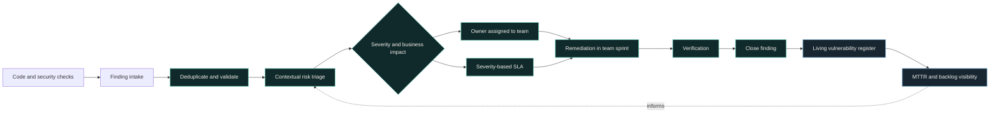

import StatGrid from '@/components/case/StatGrid.astro';
import Callout from '@/components/case/Callout.astro';

<Callout kind="scope" lang="en" title="Status">
This case is a design. It defined the target architecture and the roadmap; standing up the full flow in production was scoped as the next phase. Nothing below describes a deployed system.
</Callout>

## Context

Application security was reactive. Findings appeared and might be fixed, but there was no reliable way to see what remained open, who owned it, how long it had been open or when remediation was due. Without ownership, work drifted. Without a trustworthy MTTR, the program could not measure whether it was improving.

- **No owner** — a finding did not belong to a team or a person.
- **No due date** — nothing said when a fix was expected.
- **No trustworthy MTTR** — time to remediate could not be measured from a consistent record.
- **Priority by nominal CVSS** — the score ignored exposure and business context.

The missing piece was not another scanner. It was an operating structure that connected findings to people, decisions, deadlines and verification.

## What I did

### A five-stage lifecycle

I designed a complete lifecycle with explicit transitions:

1. **Detect** — collect findings from the existing security checks.
2. **Triage** — validate context and remove duplicates or noise.
3. **Prioritize** — weigh exposure, data sensitivity, exploitability and chainability rather than relying on nominal CVSS alone.
4. **Assign and remediate** — name an owner in the responsible team and attach a severity-based SLA.
5. **Verify and close** — confirm the fix and preserve the status history in the vulnerability register.

### SLAs teams can actually meet

The remediation targets had to be realistic enough to operate and firm enough to matter. An ambitious SLA that teams routinely miss becomes background noise; an owner and a due date make the priority actionable inside each team's sprint.

| Severity | Remediation SLA |
| --- | --: |
| Critical | 15 days |
| High | 30 days |
| Medium | 60 days |
| Low | 90 days |

### Design before tooling

I deliberately did not add another scanner. The design makes the existing work operable first — owner, due date, verified closure — so that the measurements come from the register rather than from a snapshot spreadsheet.

## How it works

Each finding leaves triage with an owner and a due date, and only closes after verification. Every closure lands in the register, which is where MTTR and backlog age come from, and that visibility feeds back into how the next findings are prioritized.

## Results

This was a design engagement, so the results are the deliverables, not production outcomes.

<StatGrid title="Design deliverables" stats={[
  { value: '5', label: 'Lifecycle stages', detail: 'Detect to verified close' },
  { value: '4', label: 'Priority factors', detail: 'Exposure, data, exploitability, chaining' },
  { value: '5', label: 'Design artifacts', detail: 'Architecture, priority model, ownership, SLA approach, roadmap' },
  { value: '1', label: 'Owner per finding', detail: 'Named in the responsible team' },
]} />

- **Target architecture** for a five-stage flow from finding intake to verified closure.
- **Prioritization model** with 4 contextual factors on top of nominal CVSS.
- **Ownership rules** that name one owner per finding in the responsible team.
- **Remediation SLAs of 15, 30, 60 and 90 days** for Critical, High, Medium and Low, built to be met inside a team's sprint.
- **Roadmap** for the next implementation cycle, making the build specific and measurable.

## Business value

<Callout kind="value" lang="en">
The design defines what leadership needs to answer "is application security improving?": every finding with an owner, a due date and a verified closure, recorded in one register. Once implemented, MTTR and backlog age can be calculated from that register instead of reconstructed from snapshots, and remediation that is stuck becomes visible by team. It also gives the next phase a concrete, scoped target instead of a general intent, and is the foundation for the [SAST governance audit](/portfolio/projects/sast-governance-audit/) and the [enterprise vulnerability management](/portfolio/projects/enterprise-vuln-mgmt/) work.
</Callout>

## Lessons

- **Ownership before tooling.** The gap was not detection but who owned a finding and by when; the design adds no scanner.
- **An SLA that is always missed is noise.** Targets had to fit inside a team's sprint to change behavior at all.
- **Measure from the register, not a spreadsheet.** MTTR is only trustworthy when every finding's status history lives in one place.
- **Call a design a design.** Being explicit that this was a target architecture keeps the roadmap credible for the implementation phase.
