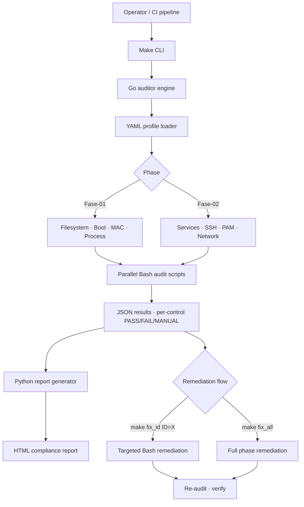

import StatGrid from '@/components/case/StatGrid.astro';
import Callout from '@/components/case/Callout.astro';

## Context

Hardening looks great in a one-time audit and decays the moment people start working. The state we inherited was familiar: manual CIS Benchmark reviews twice a year, by an outside contractor with a checklist.

- **Drift accumulated silently** between audits — packages added, configs tweaked, sysctls flipped, mount options altered.
- **No diff between audits** — you saw the current state, never how it had eroded.
- **No way to tell** *"we never configured this"* from *"this used to be hardened and someone broke it"*.
- **Vulnerability counts climbing** because the underlying OS posture eroded faster than patches landed.

Hardening had to stop being a project and become a regular signal.

## What I did

### A hybrid engine, one language per layer

I built **CIS-Auditor** as a Go + Bash + Python framework targeting Ubuntu 22.04 LTS, with each language at the layer it is strongest at and strict separation between audit and remediation.

- **Go orchestration engine** (`internal/auditor`) — control execution, parallel runs, JSON aggregation and YAML profile loading. Static typing keeps the engine boring; concurrency keeps audits across many hosts fast.
- **Bash audit and remediation scripts** — CIS controls *are* shell-level checks (mount flags, sysctl values, file permissions, GRUB config, AppArmor profiles). Re-implementing `findmnt` and `sysctl` in Go would add code for no reason.
- **Python report generator** (`scripts/generate_report.py`) — HTML with an executive summary, a per-control view, severity and remediation availability.
- **YAML control profiles** (`configs/profiles/`) — Phase 01 (initial setup: filesystem, boot loader, MAC, process hardening) and Phase 02 (services: SSH, PAM, network). Profiles are versioned data, so STIG or internal hardening packs could be added without touching engine code.
- **Make-driven UX** — `make audit`, `make audit_id ID=1.1.3`, `make fix_all`, `make report`. Operators do not need to know Go or Python to run it.

### Why not pure Go

Pure Go would have been cleaner on paper. Three reasons it stayed hybrid:

- **Bash matches what CIS controls actually are.** A control like *"Ensure nodev option set on /tmp partition"* is `findmnt -k -n -o OPTIONS /tmp | grep -q nodev`. Re-implementing that in Go costs more code, more bugs and no clarity.
- **Go is for orchestration, not system probing.** One goroutine per control runs checks in parallel instead of serially, and a single binary ships the same way to hundreds of hosts.
- **Python for reports because it fits.** Templating, charts and mature HTML libraries. Go's `html/template` serves web servers well; for a compliance report with severity and pass/fail views, Python was faster to build and easier to evolve.

The cost of three languages is real (build complexity, contributor onboarding), but each layer can be swapped independently. A new control is one Bash script under `scripts/Fase-XX/auditoria/`; a new report format is a Python target; a new profile is YAML with no engine change.

### Trade-offs that mattered

- **Audit and remediation strictly separated.** The audit path cannot modify system state. `make audit` is safe to run on production at 3 a.m.; `make fix_*` requires explicit invocation. The boundary lives in the architecture, not in convention — separate script directories, separate Make targets, separate code paths.
- **Idempotent by design.** Every audit and remediation script is safe to run repeatedly: a re-applied fix does not accumulate side effects, and a re-run audit gives the same result on an unchanged system.
- **Non-destructive audit mode is non-negotiable.** Operators run `make audit` against production every week. If the audit could ever cause an incident, nobody would run it.
- **Pluggable rule packs.** The same engine runs CIS profiles and can run STIG profiles or internal hardening standards. Profile is data; engine is code.
- **JSON intermediate format.** Results land as structured JSON before the HTML render, so CI pipelines parse the same artifact the report renders from — no separate machine-readable track that drifts from the visible output.

## How it works

The engine loads a profile, runs its Bash checks in parallel and writes one JSON result per control. The HTML report and CI both read that JSON; remediation is a separate branch that only runs on an explicit `make fix_*` and always ends in a re-audit.

## Results

<StatGrid title="What the tool covers" stats={[
  { value: '70%', label: 'CIS Ubuntu 22.04 controls', detail: 'Detection and remediation automated' },
  { value: '5', label: 'YAML profiles', detail: 'Phase 01 and four Phase 02 packs' },
  { value: '8 + 8', label: 'Phase 01 scripts', detail: 'One audit and one fix per control' },
  { value: '0', label: 'Changes made by audit', detail: 'Remediation is a separate command' },
]} />

<StatGrid title="One audit run · test VM, 2025-10-15" stats={[
  { value: '8', label: 'Controls checked', detail: 'Profile ubuntu_22.04_fase01' },
  { value: '4', label: 'Passed' },
  { value: '4', label: 'Failed', detail: 'Each with its fix script' },
  { value: '0', label: 'Errors' },
]} caption="From the make audit output shown in the evidence below." />

- **70% of CIS Ubuntu 22.04 controls automated** — both detection and remediation paths, with manual-only controls explicitly marked in reports.
- **Drift became visible** — a previously compliant control that regresses shows up in the next audit run, not at the next external review six months later.
- **Hardening became a continuous discipline** — a number engineers and leadership follow week over week instead of a binder pulled out at audit time.
- **CI/CD-native** — the same binary runs locally for engineer triage and in pipelines as a posture gate.
- **Audit-ready trail** — every run saved as timestamped JSON (`audit-results-ubuntu-20251015-111122.json`), every remediation logged.
- **Contributed to the Linux reduction** — together with SecScan, CIS-Auditor contributed to the Ubuntu fleet going from 569K to 318K vulnerabilities, a result owned by the [Linux vulnerability reduction](/portfolio/projects/linux-vuln-reduction/) program.

## Business value

<Callout kind="value" lang="en">
Compliance stopped depending on a twice-a-year manual review. Drift now shows up between runs, so the team fixes a regression while it is one setting on one host instead of discovering it at the next external audit. Because the audit mode cannot change anything, it is safe to run on production, and every run leaves a timestamped JSON record that compliance can hand to an auditor as-is.
</Callout>

## Lessons

- **Separate audit from remediation in the architecture, not by discipline.** Separate directories, Make targets and code paths are what make `make audit` safe to run on production.
- **Match the language to the layer.** CIS checks are one-line shell commands like `findmnt ... | grep -q nodev`; Go orchestrates them and Python renders the report.
- **Compliance is a side effect, not a goal.** The report ships each control's status, the reason it failed and the exact fix script; the compliance number follows from fixing controls.
- **JSON before HTML, always.** CI and the HTML report read the same JSON, so the pretty output can never drift from the data.
- **Idempotency is the only honest interface.** Every audit and fix script is safe to re-run, which is what lets it live in a pipeline.
