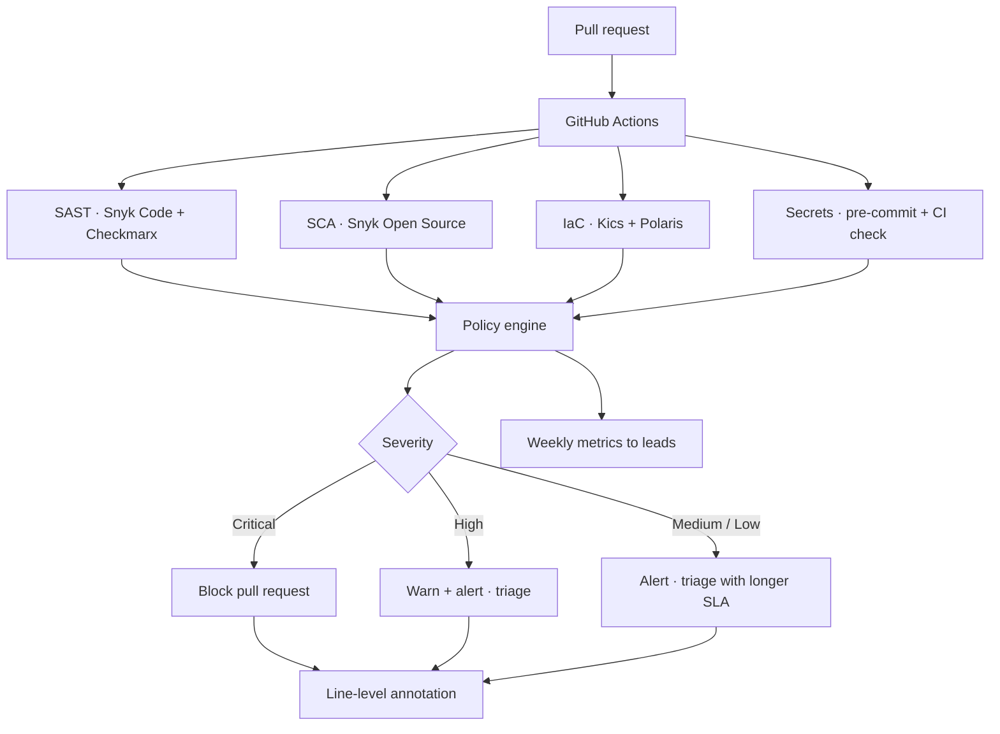

import StatGrid from '@/components/case/StatGrid.astro';
import Callout from '@/components/case/Callout.astro';

## Context

The pipeline already ran security checks, but the results were hard to act on. Engineering treated security as a quarterly bottleneck instead of something they owned, and the checks gave them little reason to think otherwise.

- **More noise than signal** — generic CVSS scores with no reachability or exploitability context, plus false positives.
- **Findings nobody opened** — results lived on a separate dashboard, away from the code change.
- **Block rules with no sense of risk** — a transitive low-severity CVE was treated the same as an actively exploited RCE.
- **No clear next action** — a finding did not say who should fix it or how.

## What I did

I focused the gates on findings with a validated path to impact and put the results in the pull request, where the code owner could act.

### Five gates on every pull request

All five run in GitHub Actions and feed line-level annotations into the pull request itself.

- **SAST** — Snyk Code for primary coverage of the Go and Python stack; Checkmarx for deeper application-logic analysis on web-facing services.
- **SCA** — Snyk Open Source on direct and transitive dependencies, with reachability filtering: is the vulnerable function actually called from our code?
- **IaC** — Kics for Terraform, Helm and Kubernetes manifests, plus Polaris for Kubernetes cluster posture.
- **Secrets** — pre-commit hooks for fast feedback on the developer's machine, plus a CI check that catches anything the hook missed.
- **Policy as code** — versioned rules for what blocks, what warns and what only comments, reviewed through pull requests like any other code.

### Tool choices and trade-offs

- **Snyk for SAST and SCA together** — Snyk Code covered the source, and Snyk Open Source's reachability analysis on Go dependencies was the differentiator: it separates a vulnerable module our code calls from one it only imports. SonarQube is strong on code quality, but at the time its security mode lagged on Go dependency analysis.
- **Checkmarx on top, for a subset** — on the small set of web-facing services, Checkmarx's slower but deeper data-flow analysis caught categories Snyk Code did not. The cost is CI minutes, not engineering hours, so it stayed.
- **Kics and Polaris together** — Kics covers Terraform, Helm and generic IaC misconfiguration; Polaris specializes in Kubernetes posture (resource limits, security contexts, network policies). Each surfaces categories the other misses, running both costs little CI time, and their false-positive overlap is small.
- **Pre-commit and CI for secrets** — the hook gives immediate feedback before a push; the CI check proves the hook actually ran. Without it, one disabled hook silently exposes the whole repository.

### Designing for adoption

- **Block only on critical** — a Critical finding stopped the merge. High raised a warning and an alert for triage, and Medium and Low went to triage with a longer SLA. Reachability ordered that triage queue, so a vulnerable function our code calls was handled before one it only imports. Engineering accepted the rule because it made sense.
- **Annotations on the pull request, not a separate dashboard** — each finding appears on the exact line, with the recommended fix inline.
- **Automatic upgrade pull requests** — fixable, security-relevant dependency upgrades open as separate, tested pull requests that engineering reviews and merges like any other bump.
- **Weekly metrics for engineering leads** — what is red, what is green and what is getting worse, per service, so leads triage their own posture before the next sprint.

## How it works

Every scanner feeds one policy engine. Only a Critical finding blocks the merge. High raises a warning and an alert, Medium and Low go to triage with a longer SLA, and every finding lands on the exact line — strict where it matters, without stalling engineering on the rest.

## Results

<StatGrid title="Gate coverage" stats={[
  { value: '5', label: 'Gate types', detail: 'SAST, SCA, IaC, secrets, policy' },
  { value: '3', label: 'Policy outcomes', detail: 'Block, warn, triage' },
  { value: '2', label: 'Clouds', detail: 'AWS and GCP, one severity model' },
]} />

- **5 gate types on every pull request** across 100+ repositories, integrated end to end into GitHub Actions.
- **AWS and GCP infrastructure as code** under the same policy engine and severity model, so a misconfigured S3 bucket or GKE workload was caught before the deploy that would have exposed it.
- **Security stopped being a quarterly bottleneck** — the dependency-upgrade backlog moved continuously instead of piling up before audit cycles.
- **Engineering trusted the gates** — pull requests stopped being pushed with `--no-verify`, leads cited the weekly numbers in planning, and new services adopted the same template by default.
- **The gates stayed on** — engineering did not argue them away over the life of the project.

## Business value

<Callout kind="value" lang="en">
Security checks moved from a quarterly audit scramble into the daily flow of code review. A blocked merge now meant a critical risk, so engineering fixed findings instead of bypassing the gate. Leads could see and plan their own service's posture every week, and cloud misconfiguration was caught before it reached production in either AWS or GCP.
</Callout>

## Lessons

- **Block on signal, not surface area.** A gate that fires on every transitive CVE teaches engineering to ignore gates; blocking only on critical findings, and sending the rest to triage with an SLA, is what kept these gates on.
- **Put the finding where the fix happens.** The dashboard is for trends; the line annotation on the pull request is for fixes.
- **Overlapping scanners can be a feature.** Kics and Polaris both look at Kubernetes, and each surfaces categories the other misses.
- **Policy as code is non-negotiable.** Block rules versioned with the pipeline get reviewed like code; rules buried in a UI decay as soon as their owner changes role.
