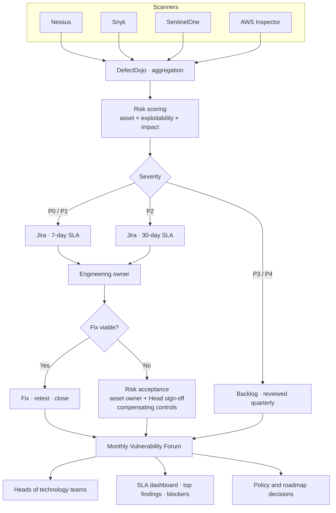

import StatGrid from '@/components/case/StatGrid.astro';
import Timeline from '@/components/case/Timeline.astro';
import Callout from '@/components/case/Callout.astro';

## Context

Vulnerabilities arrived from four scanners — Nessus, Snyk, SentinelOne and AWS Inspector — into separate inboxes, with no common prioritization, no SLA and no shared accountability. Security raised findings, engineering didn't know which ones mattered, and remediation drifted for months. Vulnerability management happened in Jira tickets and ad hoc Slack threads, invisible to the leaders who had to choose between fixing, accepting the risk or deprioritizing.

- **Four inboxes** — each scanner reported on its own, and nobody had a single source of truth.
- **No prioritization** — critical issues were mixed with noise, ranked by raw scanner severity at best.
- **No SLA or owner** — findings had no deadline and no named team.
- **No forum** — Heads of technology never reviewed findings together, so risk decisions were made informally or not at all.

## What I did

### Centralized intake

The four scanners feed DefectDojo, which aggregates and normalizes their findings. Each finding is risk-scored and then routed into one Jira workflow: Backlog → Refinement → In progress → Retest → Done. Pentest findings on critical assets enter the same workflow.

### Risk-based prioritization

Severity is not a copy of CVSS. Before anything reaches engineering, the score combines three signals:

- **Asset criticality** — internet-facing? holds customer data? part of the payment path? A single asset attribute can move a finding two tiers either way.
- **Exploitability** — public PoC? exploit framework module? known active campaigns? Sourced from CISA KEV, vendor advisories and threat-intel feeds.
- **Business impact** — what breaks if this is exploited: revenue, data class, regulatory exposure, recovery cost.

Two illustrative findings:

- **Internet-facing API · SQL injection with a public PoC** — criticality *max* × exploitability *max* × impact *max* = **P0, 7-day SLA**. The owner is identified automatically from the service tag in Jira, and a Jira automation rule escalates a missed SLA.
- **Internal admin tool · CVE in a transitive dependency with no execution path** — criticality *low* × exploitability *low* (not reachable) × impact *low* = **P3, backlog**. Reviewed quarterly, blocking nothing.

The same scoring model put them two tiers apart: a 7-day SLA and the quarterly backlog. Context, not the raw score, set the order of work.

### The monthly Vulnerability Forum

This is the half of the program that doesn't fit on a Jira board. I owned it end to end: I wrote the playbook, set the agenda and presented the dashboard to the CTO, the Heads and coordinators of the technology teams, and the people responsible for the areas that owned the vulnerabilities. The forum is where prioritization, SLA tracking and risk-acceptance decisions happen with the people who can authorize them.

<Timeline title="One forum cycle" steps={[
  { when: '48h before', title: 'Pre-read sent', detail: 'Top findings, SLA hit rate, risk-acceptance queue, blockers' },
  { when: '5 min', title: 'SLA dashboard', detail: 'What is red, what is green, what slipped' },
  { when: '20 min', title: 'Top 5 findings deep dive', detail: 'Context, owner, blocker, decision needed', key: true },
  { when: '15 min', title: 'Risk-acceptance reviews', detail: 'Formal sign-off and compensating controls' },
  { when: '10 min', title: 'Blockers and cross-team escalations' },
  { when: '10 min', title: 'Policy and roadmap', detail: 'Trends, new scanner coverage, scoring changes' },
  { when: 'After', title: 'Every decision becomes a Jira action', detail: 'Owner and due date synced to the SLA tier' },
]} />

- **Cadence** — monthly, a standing slot on the calendars of the Heads of every technology team.
- **Pre-read 48 hours before**, so the meeting was for decisions, not status.
- **Risk-acceptance track** — when a fix wasn't viable (end-of-life legacy system, unsupported vendor, refactor cost higher than the risk), the finding moved to a structured acceptance track. The asset owner and the Head of the relevant team co-signed, compensating controls were documented (WAF rule, network segmentation, extra monitoring), and the acceptance had a review date (90, 180 or 365 days) when it came back to the forum.

## How it works

Four scanners converge in DefectDojo, every finding is scored on context and lands in Jira with an SLA tier, and everything — fixed, accepted or backlogged — comes back to the monthly forum where the Heads decide.

## Results

<StatGrid title="Jira board snapshot" stats={[
  { value: '212', label: 'Tickets under management', detail: 'Vulnerabilities and security requirements' },
  { value: '192', label: 'Backlog', detail: 'Scored and queued by tier' },
  { value: '9', label: 'Refinement', detail: 'Owner and fix being defined' },
  { value: '5', label: 'In progress', detail: 'Being remediated' },
  { value: '6', label: 'Retest', detail: 'Fix awaiting validation' },
]} caption="Status counts from the Jira space summary at capture time. Closed tickets are archived, so Done shows 0." />

| Work type | Share of tickets |
| --- | ---: |
| Application vulnerability | 43% |
| Infrastructure vulnerability | 30% |
| Security requirement | 27% |

| Tier | SLA | Where it goes |
| --- | --- | --- |
| P0 / P1 | 7 days | Jira, named engineering owner |
| P2 | 30 days | Jira, named engineering owner |
| P3 / P4 | Quarterly review | Backlog |

- **212 tickets under active management**, each with status, an SLA tier and a formal acceptance track for what can't be fixed.
- **4 scanners in one workflow** — no more email threads, spreadsheets or duplicate tracking.
- **Monthly Vulnerability Forums** institutionalized cross-team review with the CTO, the Heads and the coordinators of every technology team, all looking at the same dashboard.
- **Targeted pentests** on critical assets validated remediations and surfaced gaps the scanners missed, and their findings went into the same Jira workflow.
- **Risk acceptance with a review date** of 90, 180 or 365 days, co-signed by the asset owner and the team's Head.

## Business value

<Callout kind="value" lang="en">
The company got one place to see its vulnerability exposure and one meeting where the people accountable for it made decisions. Engineering worked on what was most likely to hurt the business first, instead of trying to fix everything at once. And when someone asked "why isn't this fixed?", the answer was no longer "we didn't know" but "we know, here is the sign-off, here are the controls, here is the review date" — a defensible position for audits, customers and leadership.
</Callout>

## Lessons

- **A vulnerability program is a rhythm, not software.** Tools normalize data; the forum makes decisions; the playbook makes the forum useful. Without the rhythm, the tools become a graveyard.
- **CVSS is not severity.** Asset criticality and exploitability move a finding by tiers, as the P0 API and the P3 admin tool show.
- **Risk acceptance is a feature, not a failure.** A governed path with sign-off, controls and a review date replaced the informal, invisible version.
- **Build the forum for the people who decide.** Engineers fix; Heads decide what gets fixed when, so the agenda and the pre-read were written for them.
- **Pentests belong in the same workflow.** Routing pentest and scanner findings through the same Jira flow is how the company stops rediscovering the same gaps.
