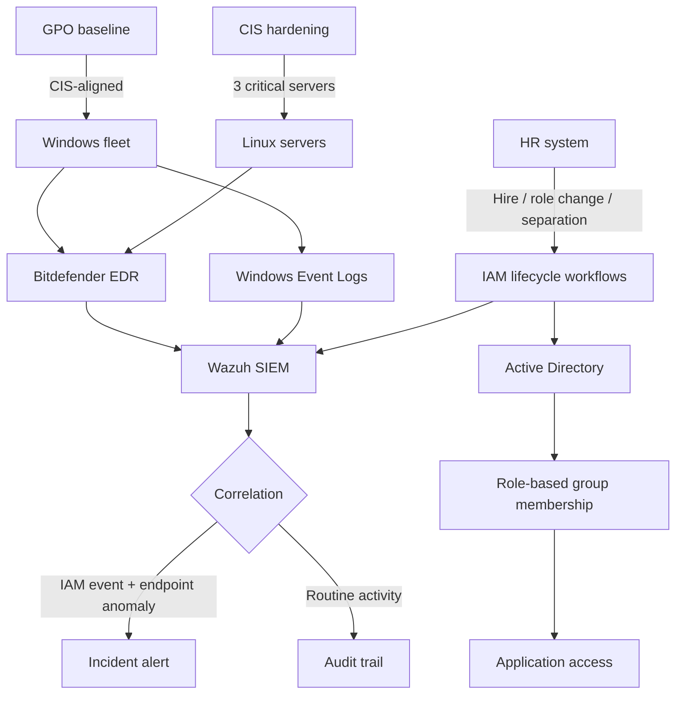

import StatGrid from '@/components/case/StatGrid.astro';
import Callout from '@/components/case/Callout.astro';

## Context

Global Estratégias Financeiras is a regulated Brazilian fintech that handles sensitive financial data. In that kind of environment, **permission drift is not a hygiene issue, it is a compliance risk**. The previous process relied on manual quarterly access reviews and ad hoc offboarding tickets, and every audit turned into a manual sweep because nothing could be answered from existing data.

- **Slow offboarding** — the window between "person leaves" and "access revoked" was measured in days, sometimes weeks. For a fintech, that window is the audit finding.
- **Access piling up across role changes** — users moved between teams and kept their old permissions, because nobody owned pruning them.
- **No history** — quarterly reviews showed the current state, never how it had changed since the last review.
- **Endpoint telemetry isolated from IAM** — a privileged user signing in from an unusual host was not visible next to that user's access-change history.

## What I did

I owned the IAM lifecycle and rebuilt it around three principles: state always known, transitions always logged, drift always detectable.

### Lifecycle automation

- **Hire → role change → offboard → audit.** Identity events from HR drove Active Directory group membership through PowerShell workflows, using the Microsoft Graph API for Microsoft 365, instead of tickets. On every role change, group membership was recomputed against a canonical role-permission matrix instead of accumulating by hand.
- **Automated offboarding.** When HR recorded a separation, the workflow disabled the AD account, removed its group memberships, archived the mailbox and logged every step to the audit trail, all within 10 to 15 minutes. Revocation no longer waited for someone to open a ticket.

### Hardening

- **3 critical Linux servers** — the financial-data layer — on a CIS-aligned baseline. Hardening was idempotent and scheduled, not one-shot, and drift between sweeps was the metric.
- **GPO baseline** applied across the Windows fleet.

### Endpoint and identity correlation

Bitdefender EDR and Windows Event Logs fed Wazuh alongside the IAM events. A privileged login from an unusual endpoint, a local administrator group change on a critical server and a service account moving laterally were correlated into one incident timeline, instead of three unrelated alerts on three dashboards.

### Designed for audit

A regulated fintech has to answer "who accessed what, from where, and when?" — for its LGPD obligations and for ISO 27001 access-control audits. The design choices map to that question:

- **The audit trail is the system** — every IAM transition, privileged login and group change is logged with timestamp, actor and context. The audit is a query against the same telemetry the SIEM uses, not a separate report.
- **Least privilege by default** — groups defined by role and recomputed on every role change. A user gains access only when the canonical role grants it.
- **A hardened baseline, not snowflake servers** — asked "what is hardened?", the answer is a number and a drift report.

## How it works

HR events drive Active Directory through the lifecycle workflows. The same events, the EDR and the Windows logs all land in Wazuh, which raises an incident when an identity change and an endpoint anomaly line up and files everything else as audit trail.

## Results

<StatGrid title="Identity program in steady state" stats={[
  { value: '500+', label: 'Users under lifecycle management', detail: 'Every transition logged' },
  { value: '10–15 min', label: 'Offboarding after HR signal', detail: 'Was days, sometimes weeks' },
  { value: '3', label: 'Critical Linux servers hardened', detail: 'CIS-aligned, drift monitored' },
  { value: '3', label: 'Signal sources in Wazuh', detail: 'IAM events, EDR, Windows logs' },
]} />

| | Before | After |
| --- | --- | --- |
| Offboarding | Ticket-driven, days to weeks | Automated from the HR signal, in 10–15 minutes |
| Role change | Access accumulated | Membership recomputed from the role matrix |
| Audit question | Manual sweep | Query on existing telemetry |
| Privileged anomaly | Separate alerts per tool | One correlated incident timeline in Wazuh |

- **500+ users** under continuous lifecycle management, with every transition logged.
- **Offboarding went from days to 10–15 minutes** after the HR signal, mailbox archiving included, without a manual ticket in the path.
- **Audit questions answered from existing telemetry** instead of a manual sweep.
- **3 critical Linux servers** on a CIS-aligned baseline with continuous drift detection.
- **Privileged anomalies correlated** into one incident in Wazuh instead of isolated alerts on Bitdefender's dashboard.

## Business value

<Callout kind="value" lang="en">
The fintech closed the access window that auditors look for first: people who left lost access 10 to 15 minutes after HR recorded it, not days later. Compliance posture became a continuous record instead of a quarterly snapshot, so audit questions were answered from data the company already had, and the systems holding financial data ran on a hardened, monitored baseline.
</Callout>

## Lessons

- **In a regulated environment, audit is the system.** The audit answer and the SIEM query became the same query, which is what ended the manual sweeps.
- **Offboarding is the metric that catches everything else.** Moving revocation from a ticket to the HR signal was the change that made least privilege believable.
- **Permission drift is the slow-motion incident.** Recomputing membership on every role change stopped access from piling up silently.
- **Endpoint telemetry without IAM context is half a story.** A privileged login from an unusual host only meant something next to the access change that preceded it.
