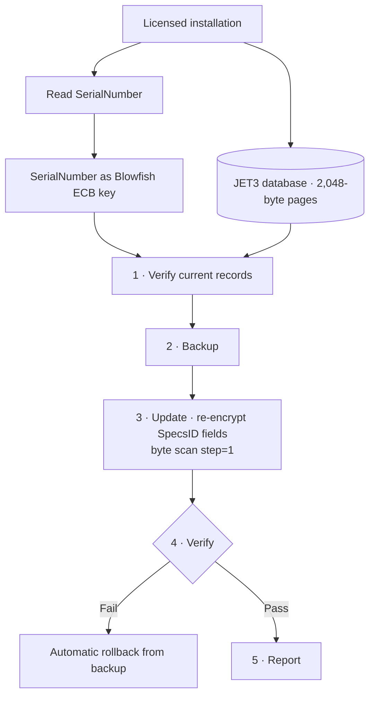

import BeforeAfter from '@/components/case/BeforeAfter.astro';
import StatGrid from '@/components/case/StatGrid.astro';
import Timeline from '@/components/case/Timeline.astro';
import Callout from '@/components/case/Callout.astro';

<Callout kind="scope" lang="en">
All work was performed under explicit authorization from licensed customers, to enable legitimate database updates on already-licensed installations. No protection mechanism was distributed, replicated for unauthorized use or used offensively. All deliverables remain within the scope of the original software license.
</Callout>

## Context

A legacy automotive alignment system (Windows 32-bit, from around 2001) stored its vehicle specification databases in a proprietary JET3 / Access 97 format with proprietary encryption. The licensing scheme bound each database to the customer's hardware, which made legitimate database updates impossible without a full reinstallation. Customers with valid licenses needed updated vehicle data, and the original vendor's update path was broken.

- **SerialNumber served two functions at once** — authentication and the cryptographic key for the SpecsID fields.
- **JET3 / Access 97 has limited write support outside Windows** — standard libraries (Jackcess) could not update encrypted indexed fields.
- **No documentation, no source, no hints** — the scheme had to be recovered by black-box binary analysis.

## What I did

I used Ghidra for static analysis and an AI assistant to compare algorithm hypotheses with patterns in the binary. I checked each candidate against observed behavior; the work took two days.

### Day 1 — Reconnaissance and algorithm identification

- Loaded the PE32 main binary of the complete ~635MB application into Ghidra and extracted strings to map the security DLL surface.
- Found the call to `GetVolumeInformationA`, which confirmed a hardware-bound machine ID.
- Disassembled the encryption routine in the `.text` section; AI assistance sped up opcode pattern matching.
- Recognized the **Blowfish ECB signature**: an 18-entry P-array and four 256-entry S-boxes in a classic Feistel structure.
- Validated the hypothesis with a known plaintext/ciphertext pair, which decrypted to the expected `SpecsID = 1978`.

### Day 2 — Implementation and production rollout

- Built the re-encryption tool in **C** (binary-level JET3 page manipulation) and **Python** (orchestration).
- Mapped the JET3 page structure by hand: 2,048-byte pages, with row offsets packed from the end toward the start.
- Found and fixed a critical bug: a byte scan with `step=4` caught only 30% of the records, because JET3 fields are not 4-byte aligned. `step=1` recovered 100%.
- Packaged a Windows 7 32-bit-compatible installer with PyInstaller (Python 3.8 and a pure-Python Blowfish, with no ctypes dependency).
- Implemented a 5-phase safety workflow — **Verify → Backup → Update → Verify → Report** — with automatic rollback.

### How I used AI assistance

The assistant helped with three bounded tasks:

1. **Opcode pattern recognition at scale**, instead of manually correlating against 20+ algorithm fingerprints.
2. **Hypothesis ranking** from partial evidence — which algorithms match the observed P-array and S-box layout?
3. **Cross-language validation** — Pascal/Delphi calling conventions identified from binary patterns.

The analysis and implementation decisions remained mine. I verified the identified algorithm against a known plaintext/ciphertext pair before building the update tool.

## How it works

The installation's SerialNumber is both the license check and the key, so the tool reads it, re-encrypts each SpecsID field in place with that key and verifies the result before reporting. Any failed verification restores the backup automatically.

## Results

<Timeline title="Two days, binary to delivery" steps={[
  { when: 'Day 1', title: 'Hardware binding found', detail: 'GetVolumeInformationA call in the binary' },
  { when: 'Day 1', title: 'Blowfish ECB identified', detail: 'P-array and S-box layout recognized' },
  { when: 'Day 1', title: 'Hypothesis confirmed', detail: 'Known pair decrypted to SpecsID = 1978', key: true },
  { when: 'Day 2', title: 'Scan bug fixed', detail: 'step=4 → step=1, 30% → 100% of records' },
  { when: 'Day 2', title: 'Rollout', detail: '166,144 records across 15 regions, 5-phase safety workflow' },
]} />

<BeforeAfter lang="en" title="Records found by the byte scan" items={[
  { label: 'Share of records found, step=4 vs step=1', before: 30, after: 100, beforeText: '30%', afterText: '100%', better: 'higher' },
]} caption="JET3 fields are not 4-byte aligned; scanning every byte recovered all records." />

<StatGrid title="Production rollout" stats={[
  { value: '166,144', label: 'Records re-encrypted', detail: 'Zero production failures' },
  { value: '15', label: 'Geographic regions' },
  { value: '5', label: 'Safety phases', detail: 'With automatic rollback' },
]} />

- **166,144 records** re-encrypted across **15 geographic regions** with zero production failures.
- **2 days end to end**, from the first look at the binary to the delivered tool.
- **Standalone `.exe`** delivered for Windows 7/10 (32-bit and 64-bit).
- **5-phase safety workflow** with automatic rollback — no customer lost data.
- **Reusable methodology** documented for similar legacy crypto analysis.

## Business value

<Callout kind="value" lang="en">
Customers who had already paid for their licenses got current vehicle data on the equipment they owned, without a full reinstallation and without waiting on a vendor update path that no longer worked. The update shipped in two days as a single installer with automatic rollback, so every workshop could apply it safely, and the documented method makes the next legacy format faster to handle.
</Callout>

## Lessons

- **Confirm the hypothesis before building on it.** One known plaintext/ciphertext pair decrypting to `SpecsID = 1978` settled the algorithm before any tool code was written.
- **Check your assumptions about alignment.** A `step=4` scan silently found only 30% of the records; scanning every byte found all of them.
- **Keep AI on bounded tasks.** Pattern matching and hypothesis ranking went faster with the assistant; the decision and the verification stayed manual.
- **Ship the rollback with the update.** Verify → Backup → Update → Verify → Report meant 166,144 records could be changed with a way back at every step.
