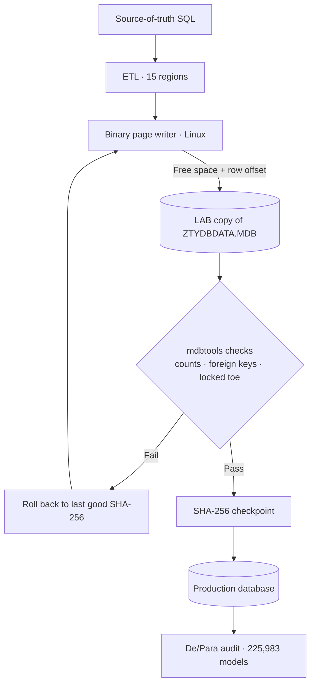

import JetPageLayout from '@/components/case/JetPageLayout.astro';
import BeforeAfter from '@/components/case/BeforeAfter.astro';
import StatGrid from '@/components/case/StatGrid.astro';
import Callout from '@/components/case/Callout.astro';

<Callout kind="scope" lang="en">
This project was performed under explicit authorization from a licensed customer, to enable legitimate vehicle-data updates on equipment they own. The licensing and dongle mechanism was never touched, bypassed, distributed or used offensively. All work was confined to the customer's own specification database and remains within the scope of their license.
</Callout>

## Context

A second legacy wheel-alignment system — a different vendor from my earlier [Blowfish project](/portfolio/projects/legacy-crypto-re/) — stored its vehicle specification data in a JET4 / Access 2000 database (`ZTYDBDATA.MDB`). Unlike the first system, the data itself was not encrypted. The blocker was structural: the workshop had a valid license and a working machine, but the only way to get current vehicle specs — including 2025/2026 models — into it was to write to a proprietary database that standard tooling refuses to modify.

The vehicle data is functional, factual specification data: caster, camber and toe geometry per model. What ages out of these expensive machines is not the hardware; it is the database. This is a right-to-repair problem.

- **A write-locked index.** Inserting a row into `TVehicleModel` requires updating an index built on a Chinese-collation sort order (`SortOrder[2052]`). No library outside Windows — UCanAccess, Jackcess, mdb-sql — can write through that index. They all fail on INSERT.
- **No clean ETL path.** A "clean rebuild" of the database silently created manufacturer-ID ranges the software did not expect, producing "ManuID Err" and duplicated regions in the UI. The regional layout is encoded in numeric `Manufact1` ranges that must be preserved exactly.
- **200K+ records with hard correctness constraints.** Front and rear toe fields are locked and must never change, sentinel "N/A" values must be preserved, and 15 regions share overlapping models with conflicting specs that have to be reconciled, not blindly merged.
- **No acceptable fallback.** The alternatives were a Windows-only, license-bound toolchain or manual data entry.

## What I did

I solved it 100% on Linux, at the byte level, in a phased and auditable workflow.

### Phase 1 — Map the format and the software's real behavior

JET4 pages are 4,096 bytes; rows are packed from the end of the page toward the start, with a row-offset table at the head. The critical observation: by examining the executable, I confirmed the software lists vehicles by **sequential scan, not by the locked index**. A correctly written row would be found even if the index was never updated. That single observation made binary INSERT viable.

<JetPageLayout />

### Phase 2 — Prove it on one record before touching anything at scale

I validated three write strategies on a **LAB copy**: binary UPDATE of existing specs (`TStandParameter`), reuse and replacement of obsolete slots, and finally a true binary INSERT of one brand-new vehicle into `TVehicleModel` + `TStandParameter`. After each one I verified with mdbtools that counts, foreign keys (`Specs1 = Model1`, `Model4 → Manufact1`) and locked toe fields were intact.

### Choosing the insertion method

I used coding assistants for ETL scaffolding, an independent integrity review and documentation. Their initial recommendation was to reuse and replace obsolete records. That was the lower-risk option, but it could only use the available slots — about 549 vehicles — and could not fit the requested update.

I compared that limit with the database page layout and tested direct insertion against a copy. I proceeded only after the write method and the integrity checks worked on controlled samples.

### Phase 3 — Scale, audit, reconcile

Once one insert was proven safe, the approach scaled to the full source dataset: **33,396 new vehicles** inserted through direct JET4 page writes. An independent audit (De/Para) against the source-of-truth SQL confirmed:

- **225,983 models** correct against the source of truth.
- **41 cross-region spec conflicts** resolved manually with documented decision rules (native market of the manufacturer, conservative caster and toe values).
- Every limitation logged consciously rather than hidden.

### Phase 4 — Lock and verify

Every version was checkpointed with a SHA-256 hash so any step was reversible. That mattered: when the "clean rebuild" approach broke the regional layout, I rolled straight back to the last good hash instead of debugging a corrupted file. The final database exported all 20 tables cleanly, with `TVersion` and the client config left byte-identical to the original.

## How it works

New rows go into free page space with an offset added to the row table, so the software finds them by sequential scan without touching the locked index. Every write is checked on a copy and checkpointed by hash before it reaches production, and the final database is audited against the source.

## Results

<BeforeAfter lang="en" title="Vehicles the update could add" items={[
  { label: 'New vehicles: slot reuse vs binary insertion', before: 549, after: 33396, beforeText: '~549', afterText: '33,396', better: 'higher' },
]} caption="Reusing obsolete slots capped the update at about 549 vehicles; binary insertion, validated on copies, added 33,396." />

<StatGrid title="Delivered database" stats={[
  { value: '442,505', label: 'Records reconciled', detail: '0 orphans, 0 duplicates' },
  { value: '225,983', label: 'Models verified', detail: 'Against the source-of-truth SQL' },
  { value: '33,396', label: 'New vehicles inserted', detail: 'Direct JET4 page writes' },
  { value: '41', label: 'Cross-region conflicts', detail: 'Resolved with documented rules' },
]} />

- **33,396 new vehicles** inserted into a write-locked JET4 database — on Linux, with no Windows, no OLEDB driver and no ACE.
- **442,505 records** in the delivered production database across 20 tables, reconciled with 0 orphans and 0 duplicates (independently audited).
- **225,983 models** verified against the source of truth; 41 cross-region conflicts resolved with documented decision rules.
- **Locked fields preserved** — front and rear toe untouched; `TVersion` and client config byte-identical to the original.
- **Full SHA-256 version trail** with working rollback — no data lost, no UI regression.
- **2 days** of focused engineering.

## Business value

<Callout kind="value" lang="en">
A licensed workshop kept using equipment it already owned instead of replacing it or waiting on a Windows-bound toolchain: its machine now carries current vehicle specs, including 2025/2026 models. The update was delivered in two days with a hash-verified rollback path at every step, and the audit trail shows exactly what changed and why — 41 conflicts resolved by written rules, not guesswork.
</Callout>

## Lessons

- **Read how the software reads.** Confirming that vehicles are listed by sequential scan, not by the locked index, is what made binary INSERT possible at all.
- **Prove it on one record first.** A single brand-new vehicle inserted and checked on a LAB copy came before any of the 33,396.
- **Question the safe default when it cannot meet the goal.** Slot reuse was lower risk but capped at about 549 vehicles; testing direct insertion on copies removed that ceiling.
- **Hash every version.** When the "clean rebuild" broke the regional layout, a SHA-256 checkpoint turned a corrupted file into a one-step rollback.
