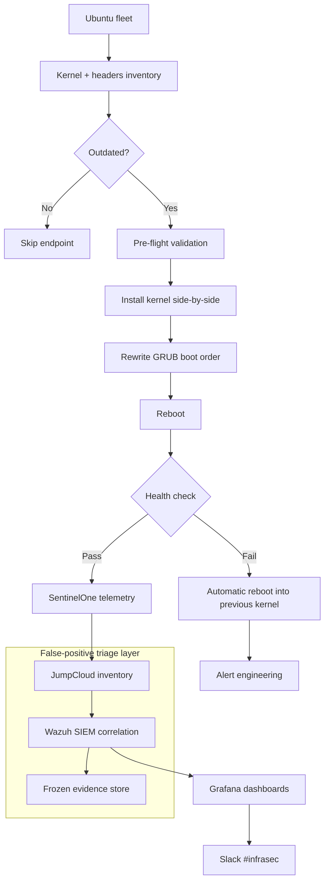

import BeforeAfter from '@/components/case/BeforeAfter.astro';
import StatGrid from '@/components/case/StatGrid.astro';
import Callout from '@/components/case/Callout.astro';

## Context

The Ubuntu fleet was carrying **569,000 vulnerabilities**, overwhelmingly tied to outdated kernels, unpatched GRUB chains and inconsistent remediation across hundreds of endpoints. Engineering had a corporate target of 469,000, and nobody trusted automation enough to pursue it without breaking production.

- **Manual patching** was slow, ran with an unbounded blast radius and never reached the long tail.
- **Fleet management tools** surfaced findings but stopped at the report.
- **The EDR count was not reliable** — remediated kernels kept showing up as open findings for days.
- **Broken APT state** on misconfigured hosts could silently stall any batch upgrade.

## What I did

### Ubuntu Kernel Guardian

I built **Ubuntu Kernel Guardian**, a Bash + Python framework that turned kernel remediation into a deterministic, observable pipeline:

- **Discovery first.** Inventory every installed kernel, header package and tooling dependency on each host before touching anything.
- **Side-by-side upgrades, never destructive.** Install the new kernel, headers and tools alongside the existing ones. The previous kernel stays present and bootable until the new one proves stable in production.
- **GRUB-aware boot ordering.** The framework rewrites the boot order *before* reboot so the new kernel is the default and the previous one remains as a fallback entry. If the post-reboot health check fails, the host automatically reboots into the previous kernel and returns to a known good state — no fleet-wide outage.
- **Pre-flight and post-reboot validation.** Health checks gate every transition: package integrity, dependency resolution, GRUB config syntax and post-reboot telemetry confirmation through the SentinelOne API.
- **Engineering review gates** on critical-severity changes. Routine upgrades are fully automated; a human stays in the loop for anything touching kernel signing or LTS transitions.

The framework runs on a controlled cadence: weekly inventory scans and weekly batched upgrades, with automatic rollback on health-check failure.

### When the EDR is not the source of truth

Halfway through the rollout we hit a real problem. SentinelOne was double-counting kernels and reporting vulnerabilities that had already been remediated upstream — a kernel would ship with a CVE patched, but the EDR inventory still surfaced the finding for days. Trusting the EDR count blindly would have made our metrics lie. I added a parallel visibility layer:

- **JumpCloud** as the system inventory ground truth — what is actually installed, with the version pinned per host.
- **Wazuh SIEM** correlating the JumpCloud inventory against SentinelOne findings to mark known false positives without dropping the data.
- **Frozen evidence retention.** Even ignored findings are archived in cold storage. If a "false positive" later turns out to be real, or compliance asks for an audit trail, the raw history is intact.

This does not bypass the EDR — it gives the program a second source so the metric we report is the metric that is true.

### Keeping APT healthy

A second script handles fleet hygiene around the upgrade pipeline. Hosts accumulate broken GPG keys, expired repository signatures and corrupted APT caches — any one of which can silently block a kernel upgrade and stall the entire batch. The script runs weekly:

- Detects and repairs broken or expired GPG keys when `apt update` fails.
- Re-syncs corrupted package indexes.
- Surfaces hosts that fall outside the recoverable set for engineering review.

Without it, the kernel pipeline would have ground to a halt on the long tail of misconfigured hosts.

## How it works

Every host goes through inventory, validation and a side-by-side install before it reboots; a failed health check sends it back to the previous kernel and alerts engineering. Passing hosts feed telemetry into the triage layer, which separates real findings from EDR noise before the numbers reach Grafana.

## Results

<BeforeAfter lang="en" title="Ubuntu fleet vulnerabilities" items={[
  { label: 'Fleet vulnerabilities, start vs end', before: 569000, after: 318000, beforeText: '569K', afterText: '318K' },
  { label: 'Corporate target vs result', before: 469000, after: 318000, beforeText: '469K target', afterText: '318K' },
]} caption="Monthly SentinelOne vulnerability counts for the Ubuntu fleet, start and end of the program; the second row compares the result with the 469K corporate target." />

<StatGrid title="Monthly snapshot · Grafana" stats={[
  { value: '285,671', label: 'Linux findings', detail: '172,952 critical · 84,993 high' },
  { value: '30,202', label: 'Windows findings', detail: '27,125 critical' },
  { value: '2,361', label: 'macOS findings', detail: '1,145 critical' },
]} caption="One monthly snapshot from the Grafana dashboard shown in the evidence below — a separate reading, not the start or end point of the program." />

- **569K → 318K vulnerabilities** — a 44% reduction across the Ubuntu fleet.
- **151K below the 469K corporate target** — the result landed 32% under the goal.
- **285,671 monthly Linux findings** tracked by severity (Critical, High, Medium, Low) in the monthly snapshot, so prioritization follows data.
- **Multi-OS visibility** — the same telemetry pipeline extended to Windows (30,202 monthly findings) and macOS (2,361 monthly findings).
- **Zero production incidents** caused by automated patching during the rollout — pre-flight validation, GRUB ordering and automatic rollback paid off.

## Business value

<Callout kind="value" lang="en">
The company's largest pool of vulnerabilities shrank by 251,000 findings and finished well past the corporate target, without a patching outage. Kernel updates stopped being a risky manual event and became a weekly routine with a built-in way back, and the reported number became one that infra, security and compliance could trust because noise was separated from real exposure with the evidence kept.
</Callout>

## Lessons

- **Discovery before mutation.** Inventorying every kernel and header package before touching a host is what made weekly batched upgrades safe to automate.
- **Never destructive.** Keeping the previous kernel bootable meant a failed health check cost one automatic reboot, not an outage.
- **Do not trust a single source for vulnerability data.** SentinelOne kept counting remediated kernels for days; cross-checking with JumpCloud and Wazuh kept the 318K honest.
- **Hygiene is part of the pipeline.** Broken GPG keys and stale APT caches would have stalled the long tail; repairing them weekly kept the batches moving.
