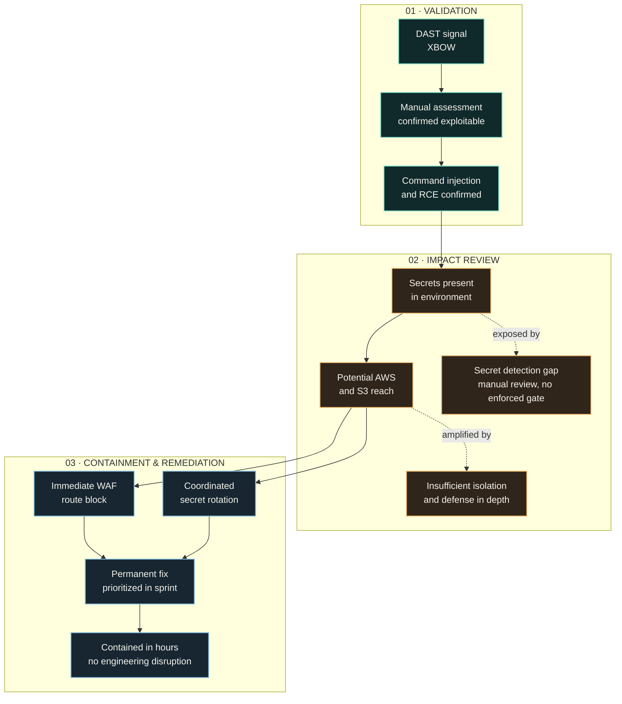

import Timeline from '@/components/case/Timeline.astro';
import Callout from '@/components/case/Callout.astro';

<Callout kind="scope" lang="en" title="Responsible disclosure">
Conceptual write-up about vulnerabilities in a former employer's product. The issues were reported and remediated. No payloads, endpoints, routes or exploitation steps are included.
</Callout>

## Context

It started as a DAST signal. An automated offensive tool, XBOW, suggested command injection in the reporting engine. A scanner result is a hypothesis, not proof, and it was not enough to justify calling this a critical incident or to support urgent mitigation.

The web application called the reporting engine directly. If the signal was real, the question was not only whether the application could be exploited, but how far an attacker could reach from there.

- **Unconfirmed severity** — a scanner signal, with no evidence yet of exploitability.
- **Unknown blast radius** — no one knew which trust boundary the issue crossed.
- **Delivery pressure** — any response had to reduce exposure without causing an outage or derailing the roadmap.

## What I did

### Validate: from scanner signal to confirmed impact

XBOW's signal gave me a place to investigate. I assessed the finding manually, confirmed command injection and remote code execution, and then traced the security impact at the level needed for response and prioritization.

The goal was to establish three things safely: whether the issue was exploitable, what trust boundary it crossed, and which immediate control could reduce exposure. This write-up intentionally omits request data, payloads, routes and reproduction steps.

### Size the blast radius

That impact review surfaced secrets exposed in the environment. Secret detection had been misconfigured and relied on human review instead of an enforced pipeline control — the same failure mode I had documented in the [SAST governance audit](/portfolio/projects/sast-governance-audit/). The gap was not theoretical; it had failed in a real exploit chain during testing.

Those credentials expanded the potential blast radius beyond the application. They created a path toward AWS access, including potential visibility into S3 storage. The finding therefore connected three control gaps: an unsafe execution path, secrets that were not stopped by an enforced gate, and cloud boundaries that did not sufficiently limit the possible reach.

### Contain without stopping delivery

The scanner result was enough to investigate, but not enough to assign severity. Manual validation established the RCE; the potential cloud reach then set the urgency. I chose three actions, in this order:

1. **Block the vulnerable route at the WAF.** I made the call and applied an immediate route block as soon as RCE was confirmed, cutting off the exposed path while the permanent fix was prepared.
2. **Rotate the exposed secrets.** I coordinated with the responsible team to invalidate the credentials and close the immediate cloud exposure.
3. **Drive the permanent fix through the sprint.** I worked the remediation into the team's normal delivery flow, prioritized for the incident without displacing the rest of the roadmap.

The trade-off was deliberate: the WAF block was a fast containment measure, not a fix. It bought time for the code correction to go through the normal delivery process instead of an emergency change.

## How it works

The diagram separates what I established (validation), what it could reach (impact) and what I did next (response). AWS/S3 is shown as potential impact, not as a claim of confirmed data access. Containment ran in parallel while the permanent correction moved through the sprint.

## Results

<Timeline title="Response" steps={[
  { when: 'Signal', title: 'XBOW flags possible command injection', detail: 'Treated as a hypothesis, not proof' },
  { when: 'Validation', title: 'RCE confirmed manually', detail: 'Impact traced to exposed secrets and potential AWS/S3 reach' },
  { when: 'On confirmation', title: 'Vulnerable route blocked at the WAF', detail: 'Exposed path cut off while the fix was prepared', key: true },
  { when: 'In parallel', title: 'Exposed secrets rotated', detail: 'Coordinated with the responsible team' },
  { when: 'Within hours', title: 'Exposure contained', detail: 'Engineering kept shipping' },
  { when: 'Sprint', title: 'Permanent code fix delivered', detail: 'Through the normal delivery flow' },
]} />

- **RCE confirmed manually**, which justified re-rating the finding on evidence rather than on scanner severity alone.
- **Exposure contained within hours** through a WAF route block and coordinated secret rotation.
- **0 sprint disruption** — the permanent fix went through the team's normal delivery flow and the rest of the roadmap kept moving.
- **Secret-detection gap proven in practice** — human review without an enforced control had missed exposed credentials.
- **Issue reported and remediated** through the responsible process.

## Business value

<Callout kind="value" lang="en">
A critical vulnerability with potential reach into cloud storage was taken off the table within hours, without an outage and without pulling engineering off the roadmap. The incident also turned two abstract gaps — secret detection that relied on human review, and thin cloud boundaries — into evidence-backed priorities for controls that work before an incident reaches production data.
</Callout>

## Lessons

- **A scanner signal sets the investigation, not the severity.** XBOW pointed to the issue; only manual validation justified treating it as critical.
- **Credentials reachable from the code path turn an application bug into infrastructure risk.** The exposed secrets are what extended the potential reach to AWS and S3.
- **Contain first, then fix properly.** The WAF block reduced exposure immediately; it did not replace fixing the vulnerable code path, which went through the sprint.
- **Missing layers matter more than attacker skill.** The exploit did not require an unusually sophisticated attack, which pointed to missing security layers in the code path rather than an exceptional attacker.
