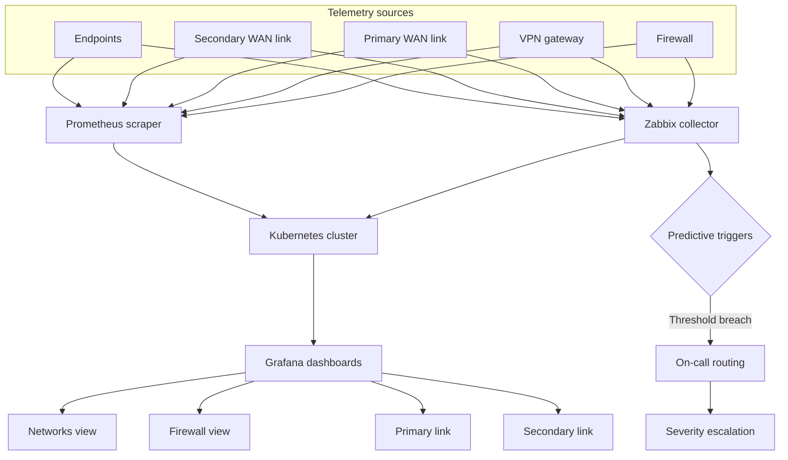

import BeforeAfter from '@/components/case/BeforeAfter.astro';
import StatGrid from '@/components/case/StatGrid.astro';
import Callout from '@/components/case/Callout.astro';

## Context

Volt Sport ran a multi-branch retail network where every store was a flat L2 segment behind a residential-grade gateway. There was no way to tell whether a branch was healthy, slow or under attack until customers complained at the register. Defense and visibility were both missing, and they had to be built together: you can't fix what you can't see, and you can't see what you can't reach.

- **No segmentation** — POS, back office, guest Wi-Fi and peripherals shared one network.
- **No IDS/IPS** — the gateway did NAT and DHCP and nothing else.
- **Exposed remote access** — RDP and ad hoc port forwarding instead of VPNs.
- **No telemetry** — firewall, WAN link and endpoint signals landed nowhere a person could read them.

## What I did

### Defense layer

I deployed a per-branch security stack with three pillars:

- **pfSense as the branch gateway** — VLAN segmentation per role (POS, back office, guest Wi-Fi, IoT/peripherals), with inter-VLAN traffic gated by explicit rules and default-deny between segments.
- **Suricata IDS/IPS on the pfSense edge** — perimeter and east-west detection, with the ruleset tuned to retail traffic (POS protocols, payment gateways, vendor APIs) instead of generic noise.
- **Site-to-site and remote-access VPNs** — branches connect back to HQ over IPsec, and admin and vendor access requires an authenticated VPN session instead of a public IP.

Suricata logs and pfSense state feed [Wazuh](/portfolio/projects/wazuh-soc/), where they are correlated with Active Directory authentication events. A brute-force on a branch firewall and an AD lockout at HQ show up as the same incident, not two unrelated alerts.

### Visibility layer

To investigate branch incidents I needed a reliable view of WAN health and firewall activity, so I built a separate monitoring platform, open-sourced as [`Network_Monitoring`](https://github.com/CHDevSec/Network_Monitoring):

- **Zabbix** as the active poller — SNMP and ICMP against firewalls, VPN gateways, primary and secondary WAN links and endpoint sensors, with polling intervals set by asset criticality.
- **Prometheus** scraping the same devices — exporters on the firewalls, custom probes on the WAN circuits, node exporters on the endpoints.
- **Kubernetes** hosting the whole stack — Zabbix, Prometheus, exporters and Grafana run as workloads with resource limits, persistent volumes for time-series data and isolated ingress. Nothing on the branch firewall touches the dashboard plane.
- **Grafana** as the operator surface — *Networks*, *Firewall*, *Primary link* and *Secondary link* views, all reading from the same time-series databases, so one anomaly is visible from any angle.
- **Predictive triggers** in Zabbix — rolling-window threshold breaches escalate through on-call routing by severity, so a degrading WAN link is caught before the branch reports an outage.

Two collectors on the same sources is a deliberate cross-check, not redundancy for its own sake. When one reports green and the other red, the problem is a probe bug, not a branch incident.

## How it works

Every source is read by two independent collectors running on Kubernetes. Grafana presents four views of the same data, and Zabbix's predictive triggers route degradation to on-call before it becomes an outage.

## Results

<BeforeAfter lang="en" title="Attack surface per branch" items={[
  { label: 'Attack vectors, relative to before', before: 100, after: 30, beforeText: '100%', afterText: '~30%' },
]} caption="Measured against the pre- and post-change pentest scope and the exposed-service inventory." />

<StatGrid title="What each branch runs" stats={[
  { value: '4', label: 'VLAN segments', detail: 'POS, back office, guest Wi-Fi, IoT' },
  { value: '5', label: 'Telemetry sources', detail: 'Firewall, VPN, 2 WAN links, endpoints' },
  { value: '2', label: 'Independent collectors', detail: 'Zabbix and Prometheus' },
  { value: '4', label: 'Grafana operator views', detail: 'Networks, firewall, primary and secondary link' },
]} />

- **~70% fewer attack vectors per branch**, measured with the pre- and post-change pentest scope and the exposed-service inventory.
- **Firewall, primary WAN, secondary WAN and endpoint sensors** visible in real time, so a failing branch link is detected before the cashiers notice.
- **Incidents start with data, not phone calls** — the Grafana dashboards are the on-call operator's first screen.
- **Alerts fire on degradation, not only on outage** — the team can act on a failing link before customers notice.
- **The platform stayed in production after I left**, and the code is open source.

## Business value

<Callout kind="value" lang="en">
Each store went from an open, flat network to a segmented one with about 70% fewer ways in, which directly reduces the chance that a compromised guest device or vendor connection reaches the point of sale. Operations stopped learning about branch problems from customers at the register: link degradation reached on-call while there was still time to act, which protects sales on the shop floor.
</Callout>

## Lessons

- **Defense and visibility are one project.** The ~70% cut came from the perimeter, but only the monitoring stack showed whether each branch was actually healthy.
- **Two collectors are a feature.** Zabbix and Prometheus on the same sources cost a little extra CPU and gave a free check on probe correctness.
- **Tune for the traffic.** Suricata defaults were noise on a retail network; the ruleset earned its place once it reflected POS, payment and vendor traffic.
- **Predict, don't just alert.** Rolling-window triggers flagged the slope before the outage, which is what let branches recover links before customers felt it.
