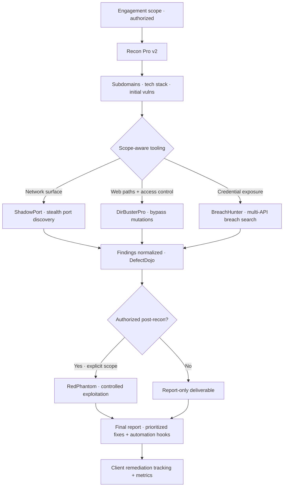

import StatGrid from '@/components/case/StatGrid.astro';
import Callout from '@/components/case/Callout.astro';

## Context

CHDevSec is my independent consulting practice — full-cycle offensive and defensive work for clients who need more than scanner output. This page is an overview of the practice, not a single project: what I offer, how an engagement runs, and the public tooling behind it.

- **Pentest** — web applications, APIs, cloud infrastructure (AWS, GCP, Azure) and internal networks.
- **Linux hardening** — CIS-aligned, with measurable score deltas before and after.
- **Wazuh SIEM** — deployment, rule tuning and operator playbooks tailored to the client environment.
- **DevSecOps integration** — SAST / SCA / IaC / secrets gates in client CI/CD, without slowing engineering down.
- **Vulnerability management** — DefectDojo-driven prioritization with end-to-end remediation tracking.

The problem I am hired to solve is the same across these lines: findings without a remediation plan change nothing.

## What I did

### How I work

Every engagement closes with:

- **Prioritized fixes** scored by exploitability and business impact, not raw CVSS.
- **Automation hooks** for what to detect next time — turning each engagement into the next baseline.
- **Metrics the client can track** — risk reduction in numbers, not adjectives.
- **Knowledge transfer** — the in-house security team can re-run the same playbook without me in the room.

### Why I build my own tools

Every off-the-shelf scanner solves the average case. Real engagements live in the long tail — the specific bypass the wordlist doesn't have, the multi-source correlation no single tool exposes, the report format a client's CISO actually reads. Buying or borrowing tools means inheriting someone else's assumptions; building them means owning the abstraction.

Writing offensive tooling also forces me to understand the tradecraft at the level of code, not CLI flags. The hardening I can teach a client is exactly as deep as the attack I can re-implement from scratch. Each public tool started as a friction point in a real scope.

### The public toolkit

- **[RedPhantom](https://github.com/CHDevSec/RedPhaton) — red team framework.** Mature red team operations need recon, exploitation, post-exploitation and C2 under one roof; stitching disparate tools together with shell scripts is how detection signatures find you. A unified Python framework integrating fuzzing, exploitation-chain generation, recent kernel CVE modules (Windows + Linux), payload obfuscation, multi-protocol C2 (HTTP/HTTPS/TCP/DNS) and an Active Directory attack suite. Authorization-only by design — the README leads with that condition.
- **[Recon Pro v2](https://github.com/CHDevSec/Recon_pro_v2) — web reconnaissance toolkit.** Every web engagement started with the same glue script merging subdomain sources. A modular Python framework consolidating Subfinder, Assetfinder, Amass, Findomain, Chaos and the SecurityTrails / Shodan / VirusTotal / Censys / crt.sh / Certspotter APIs, with a fuzzer for admin panels, sensitive files and API endpoints, and a vulnerability engine for SQLi, XSS, LFI, RFI, RCE, SSTI and XXE with confidence scoring. Reports as interactive HTML, JSON, CSV and an executive summary.
- **[ShadowPort](https://github.com/CHDevSec/ShadowPort) — stealth port discovery.** Default scan profiles are signature-matched by modern detection (NDR, Suricata, Snort). A TCP / UDP / SYN scanner with custom packet crafting via Scapy, service fingerprinting, banner grabbing, DNS enumeration and rate-limited SSH credential testing, with JSON / XML / TXT / CSV output for downstream tooling.
- **[BreachHunter](https://github.com/CHDevSec/BreachHunter) — credential exposure auditing.** Answering "are any of our employee emails exposed in a breach?" means querying several breach databases, each with its own API, rate limit and gaps. A Python tool integrating Breached.me, LeakCheck.io and HaveIBeenPwned that batch-processes email lists, respects per-API rate limits and emits CSV reports with breach-source attribution per finding.
- **[DirBusterPro](https://github.com/CHDevSec/DirBusterPro) — access-control bypass discovery.** Real access-control vulnerabilities live in path-encoding edge cases where the WAF and the application disagree. A multi-threaded (up to 50 concurrent) Python scanner that runs each candidate path through a battery of bypass mutations and compares responses by status code, size and content hash. Supports session management, HTTP / SOCKS proxy and Basic Auth.
- **[Recon Pro v1](https://github.com/CHDevSec/recon_pro.py) — `recon_pro.py`.** The single-file first attempt at a unified recon framework for bug bounty and pentest scopes, combining subdomain tools with Shodan / SecurityTrails / crt.sh, technology detection, context-aware fuzzing, Google Dorking and an HTML dashboard. It taught what *not* to do at scale.

### What stays private

A second tier of tooling — exploit chains, post-exploitation utilities and client-specific automation — stays off GitHub by design. Publishing offensive tooling primed for misuse without context trades a small portfolio win for a real cost to the broader ecosystem. Those tools are available to clients under contracted engagements, with the same care that applies to any deliverable that touches their environment.

## How it works

The diagram is the *typical* flow, not a fixed sequence. Real engagements skip phases (a code-review-only scope never touches RedPhantom) and revisit phases as new context surfaces. Exploitation only happens with explicit authorization; otherwise the deliverable is a report.

## Results

<StatGrid title="Public toolkit · github.com/CHDevSec" stats={[
  { value: 'RedPhantom', label: 'Red team framework', detail: 'CHDevSec/RedPhaton' },
  { value: 'Recon Pro v2', label: 'Web reconnaissance', detail: 'CHDevSec/Recon_pro_v2' },
  { value: 'ShadowPort', label: 'Stealth port discovery', detail: 'CHDevSec/ShadowPort' },
  { value: 'BreachHunter', label: 'Credential exposure audit', detail: 'CHDevSec/BreachHunter' },
  { value: 'DirBusterPro', label: 'Access-control bypass', detail: 'CHDevSec/DirBusterPro' },
  { value: 'Recon Pro v1', label: 'Single-file recon', detail: 'CHDevSec/recon_pro.py' },
]} />

- **6 open-source tools** public on GitHub, covering reconnaissance, port discovery, credential exposure, access-control bypass and red team operations.
- **Recon Pro v2** compresses the first 4 hours of a web engagement into one command, with the client report about 80% written when the scan completes.
- **BreachHunter** turns a 500-email exposure check — about a week by hand across several breach databases — into a run that finishes in a coffee break, with per-source attribution.
- **DirBusterPro** surfaces access-control bypasses that survive a single-form test, with concrete response evidence (status, size, content hash).
- **RedPhantom** runs from one CLI the work that would otherwise take half a dozen tools behind a homemade orchestrator.
- **Recon Pro v1** was production-tested for over a year before the v2 modular rewrite, and stays public for quick scopes.

## Business value

<Callout kind="value" lang="en">
A client gets more than a list of findings: fixes ranked by exploitability and business impact, detection hooks so the same issue is caught next time, metrics to track the risk reduction, and a playbook their own team can re-run. The public toolkit lets a client judge the depth of the work before hiring; the private tier is used only under contracted, authorized scope.
</Callout>

## Lessons

- **The toolkit is the proof.** Anyone can read the OWASP Top 10; the work is catching the cases the playbook doesn't list — which is why each tool started from a gap in a real scope.
- **Open-source what teaches, withhold what could be weaponized.** Recon and discovery belong in the open; exploit chains and live tradecraft stay behind authorized scope.
- **Findings are the start, not the deliverable.** A pentest that doesn't produce a measurable posture change is just an expensive observation, so every engagement closes with fixes, hooks and metrics.
- **Defense and offense are the same skill seen from two sides.** Wazuh deployments and DevSecOps gates are how offensive findings stop recurring.
