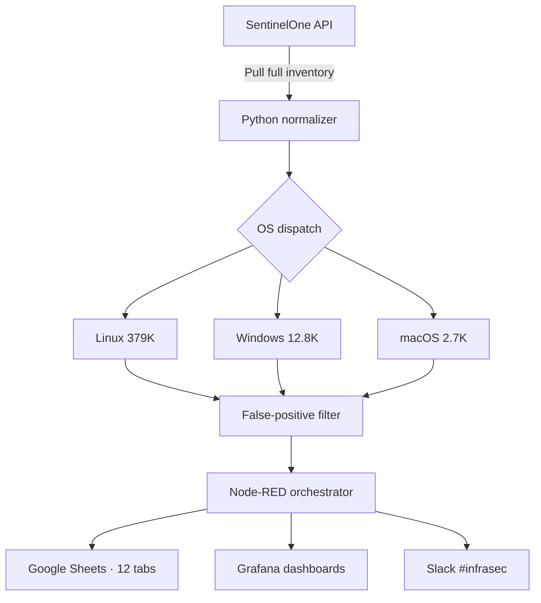

import BeforeAfter from '@/components/case/BeforeAfter.astro';
import StatGrid from '@/components/case/StatGrid.astro';
import Callout from '@/components/case/Callout.astro';

## Context

SentinelOne's UI shows vulnerabilities one endpoint at a time. The fleet generated hundreds of thousands of findings across Linux, Windows and macOS, and the security team was reporting on them by hand every week. Each meeting started from a fresh export, and false positives took up part of every discussion.

- **No central view** — each OS was read separately, endpoint by endpoint.
- **No history** — nobody could say whether this week was better or worse than last month.
- **No early warning** — spikes were found in the weekly meeting, not when they happened.
- **Noise** — kernel CVEs already fixed upstream kept showing up for days.

## What I did

### Collect and normalize

I wrote a Python service that pulls the full vulnerability inventory from the SentinelOne API, with timeouts and retries, and normalizes the records into one schema across Linux, Windows and macOS. Credentials come from the environment, and the run fails fast when one is missing.

### Filter the noise, keep the audit trail

The false-positive filter is the part that earned the team's trust. Declarative rules match on application, vendor and OS. They remove kernel CVEs already remediated upstream that SentinelOne kept flagging until its inventory reconciled, vendor-acknowledged false matches, and duplicates from multi-agent installs. Every filtered finding is written to cold storage, so a "false positive" that turns out to be real can be recovered.

### Deliver where people already look

Node-RED orchestrates a weekly run every Friday and a monthly consolidated report. The output goes to 12 Google Sheets tabs (Top 10, Historic, Weekly comparison and others), to Grafana dashboards for trends by OS, severity and application, and to Slack `#infrasec` when a threshold is crossed.

## How it works

One pull, one schema, one filter, then three outputs: Sheets for reporting, Grafana for trends, Slack for thresholds.

## Results

<BeforeAfter lang="en" title="Weekly reporting effort" items={[
  { label: 'Manual reporting time, relative to before', before: 100, after: 25, beforeText: '100%', afterText: '25%' },
]} />

<StatGrid title="Production snapshot · one sync" stats={[
  { value: '394,706', label: 'Vulnerabilities processed', detail: 'Full fleet, one run' },
  { value: '379,154', label: 'Linux', detail: '284,240 critical' },
  { value: '12,831', label: 'Windows', detail: '4,931 critical' },
  { value: '2,721', label: 'macOS', detail: '1,444 critical' },
]} />

- **394,706 vulnerabilities processed** in a single sync, with no manual SQL or console scrolling.
- **75% less time** spent on weekly manual reporting.
- **Spikes surfaced within minutes** through Grafana trends and Slack thresholds, instead of in the next meeting.
- **Security, infra and compliance** working from the same source of data.
- **Open-source code** published for reuse.

| OS      | Critical | High   | Medium | Low   | Total   |
| ------- | -------: | -----: | -----: | ----: | ------: |
| Linux   |  284,240 | 55,748 | 31,070 | 8,096 | 379,154 |
| Windows |    4,931 |  7,707 |    116 |    77 |  12,831 |
| macOS   |    1,444 |    864 |    147 |   266 |   2,721 |

## Business value

<Callout kind="value" lang="en">
Three quarters of the hours that went into assembling weekly reports went back to the team. Leadership got a weekly and monthly trend instead of a snapshot, compliance got a consistent record of what was open and what was filtered and why, and spikes reached the people who could act on them while they were still small.
</Callout>

## Lessons

- **Trust comes from the filter, not the volume.** Teams acted on the numbers once known false positives were gone and every exclusion was recoverable.
- **Deliver into existing habits.** Sheets for the meeting, Grafana for trends and Slack for alerts meant nobody had to learn a new tool.
- **Normalize first.** One schema across three operating systems is what made the cross-OS comparison possible at all.
