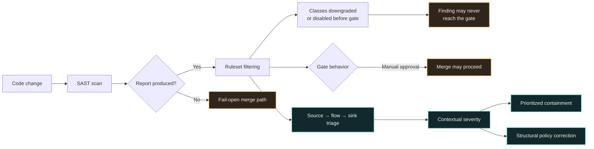

import StatGrid from '@/components/case/StatGrid.astro';
import Callout from '@/components/case/Callout.astro';

## Context

The organization believed its SAST pipeline was strict. Teams felt the friction of alerts and approvals every day, so the assumption was that the pipeline protected merges. My assignment was to verify the configured behavior, not the documented intent. The friction was real; the protection was not.

- **A control nobody had traced end to end** — from scanner output to the merge decision.
- **Friction mistaken for protection** — approvals and alerts looked like a block.
- **Eroded trust in findings** — false-positive overload made teams discount what the scanner reported.

## What I did

### Trace the policy, not the documentation

I followed the policy from scanner output to merge decision and found a structural fail-open design:

- **Approval, not a block** — the gate requested manual approval instead of failing the pipeline. It created a pause, not a technical block.
- **Classes removed before the gate** — ruleset configuration downgraded or disabled entire vulnerability classes before they could reach the gate.
- **No report, no check** — when the scanner failed to produce a report, the merge could still proceed.

Together, these behaviors let the control look strict while allowing the outcome it was meant to prevent. This was a governance and policy-as-code problem, not a matter of adding more scanner rules.

### Fix the signal before expanding coverage

Raising coverage without first improving triage would have added noise and made the gate easier to ignore. I developed a source → flow → sink method to assess each finding in context:

1. **Source:** can an attacker control the input?
2. **Flow:** is there real neutralization or validation along the path?
3. **Sink:** can execution reach the dangerous operation?

That data-flow review separated credible exploit paths from scanner noise and gave teams a defensible basis for severity and remediation.

### Separate containment from correction

For each finding, I split the short-term containment from the long-term structural correction, so teams could reduce exposure immediately without waiting for the policy redesign.

## How it works

This conceptual view summarizes the audited decision path and the triage method; it does not reproduce internal policy configuration.

The amber nodes are the three fail-open paths: no report, classes filtered out before the gate, and an approval that lets the merge proceed. The teal nodes are the triage method that turns a finding into contextual severity and a two-track fix.

## Results

<StatGrid title="Audit deliverables" stats={[
  { value: '8', label: 'Structural findings', detail: 'Contextual severity, not raw CVSS' },
  { value: '3', label: 'Fail-open paths', detail: 'Approval, ruleset, missing report' },
  { value: '6 pages', label: 'Executive report', detail: 'With a prioritized remediation plan' },
  { value: '1', label: 'End-to-end map', detail: 'Scanner output to merge decision' },
]} />

| Fail-open path | What it looked like | What it actually did |
| --- | --- | --- |
| Manual approval | A strict gate | Paused the merge, then let it proceed |
| Ruleset filtering | Full scanner coverage | Removed whole vulnerability classes before the gate |
| Missing report | A passing scan | Let the merge proceed with no result at all |

- **The first end-to-end technical map** of how SAST governance actually behaved, from scanner output to merge.
- **8 structural findings**, each rated with contextual severity rather than raw CVSS alone.
- **3 fail-open paths** identified and explained, each with short-term containment and long-term correction.
- **A 6-page executive report** and a prioritized remediation plan teams could apply within their own pipelines.
- **The gate became a hard fail** after the audit — the first containment applied, so a blocking finding now stops the merge instead of pausing it.

## Business value

<Callout kind="value" lang="en">
The audit replaced "we have a strict gate" with an evidence-based view of what the control did, where it failed open and what to change first. Leadership stopped counting on a control that was not protecting merges — the gate was switched to a hard fail — and teams got a prioritized plan that put containment first instead of an expansion of scanner coverage that would only have added noise.
</Callout>

## Lessons

- **Audit the configured behavior, not the intent.** Every team believed the gate blocked; only tracing the policy showed it asked for approval and let the merge through.
- **Friction is not protection.** Daily alerts and approvals made the control feel strict while three paths failed open.
- **Improve signal before coverage.** With trust in findings already eroded, the source → flow → sink method came before any new rules.
- **Split containment from correction.** Separating the quick fix from the structural one gives teams a way to reduce exposure without waiting for a policy redesign.
