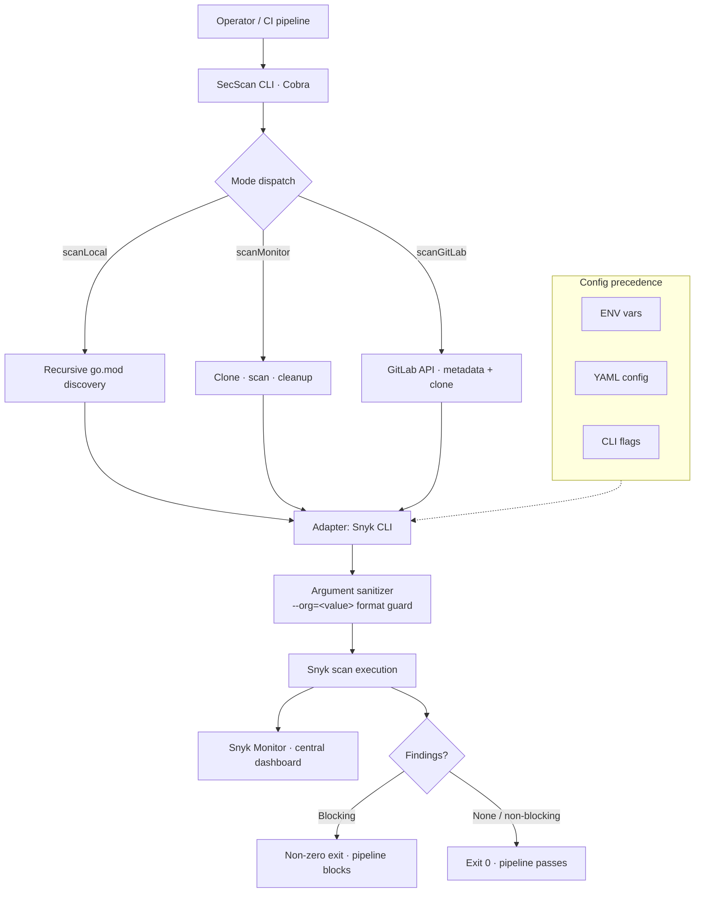

import StatGrid from '@/components/case/StatGrid.astro';
import Callout from '@/components/case/Callout.astro';

## Context

Running Snyk against a fleet of Go microservices meant running the CLI by hand for every repository, every branch and every pipeline. Engineers either skipped scans or copied shell scripts that drifted between teams, and every GitLab integration needed its own glue code.

- **No consistent way to scan** dozens of Go services at scale.
- **No batch mode** — each repository was a manual run.
- **No clean GitLab integration** — project IDs needed custom scripts every time.
- **No stable output for pipelines** — a scan that ran was not always a scan that registered in Snyk.

## What I did

### One binary, three modes

I built SecScan in Go: a CLI orchestrator that wraps the Snyk CLI with three opinionated modes.

- **scanLocal** — recursively discovers `go.mod` files in a workspace and scans each one as a separate project.
- **scanMonitor** — clones one or many repositories from a URL list, scans them and cleans up afterwards.
- **scanGitLab** — takes a GitLab project ID, pulls its metadata through the API and scans the repository with the right credentials.

All three modes feed Snyk Monitor for central dashboards, read configuration from `.env`, YAML and CLI flags in a fixed precedence, and return exit codes a pipeline can gate on.

### Engineering decisions

- **Hexagonal architecture** — the CLI layer (Cobra), the adapters (Snyk CLI, Git, GitLab) and the domain logic are separated behind ports, so each adapter can be mocked in tests.
- **Argument sanitization** — explicit `--org=<value>` formatting avoids a Snyk CLI parsing ambiguity (`--org=true`) that I hit in production.
- **Credential isolation** — secrets stay in environment variables, never in arguments or temp files.
- **Repository batching** — `--repo-file` accepts a URL list for parallel scanning through GNU parallel.
- **CI templates** — GitHub Actions, GitLab CI and Jenkins pipelines documented in the README.

The hard part of wrapping a CLI is the edge cases: transient Git credentials, the `--org` parsing bug, and the difference between "the scan ran" and "the scan ran and registered in the Snyk dashboard". That thin layer is where the engineering is.

## How it works

Three entry points converge on one Snyk adapter, so every scan gets the same sanitized arguments, the same Snyk Monitor registration and the same exit-code contract.

## Results

<StatGrid title="What shipped" stats={[
  { value: '60%+', label: 'Go stack adoption', detail: 'One binary replacing ad-hoc scripts' },
  { value: '3', label: 'Scan modes', detail: 'Local, remote list, GitLab project' },
  { value: '3', label: 'CI templates', detail: 'GitHub Actions, GitLab CI, Jenkins' },
  { value: '3', label: 'Config sources', detail: 'ENV, YAML, CLI flags' },
]} />

- **Adopted across more than 60% of the Go stack**, replacing ad-hoc Snyk shell scripts with a single binary.
- **3 scan modes in one tool** — the same binary runs locally for developer triage and in pipelines for gate enforcement.
- **Every scan registered in Snyk Monitor** — the evidence shows a project imported from CI/CLI with 195 dependencies tracked and fix versions for each issue.
- **3 CI templates** (GitHub Actions, GitLab CI, Jenkins) so a team could adopt it without writing pipeline code.
- **Open source under MIT**, with README, architecture diagrams, troubleshooting guide and the CI templates.

## Business value

<Callout kind="value" lang="en">
Dependency scanning stopped depending on who remembered to run it and which script they copied. One binary gave the Go stack the same scan, the same output and the same exit-code contract in every pipeline, and every result landed in the Snyk dashboard where security could see the whole fleet instead of one repository at a time.
</Callout>

## Lessons

- **Standardize the runner before the rules.** Copied shell scripts drifted between teams; one binary with fixed exit codes made results comparable across services.
- **"It ran" is not "it registered".** Checking that each scan reached Snyk Monitor mattered as much as running it, because the dashboard is where the fleet view lives.
- **Wrappers live or die on edge cases.** The `--org=true` parsing bug and transient Git credentials were where the real work was, not the happy path.
- **Make adoption free.** Shipping three CI templates meant teams could add the gate without writing pipeline code.
