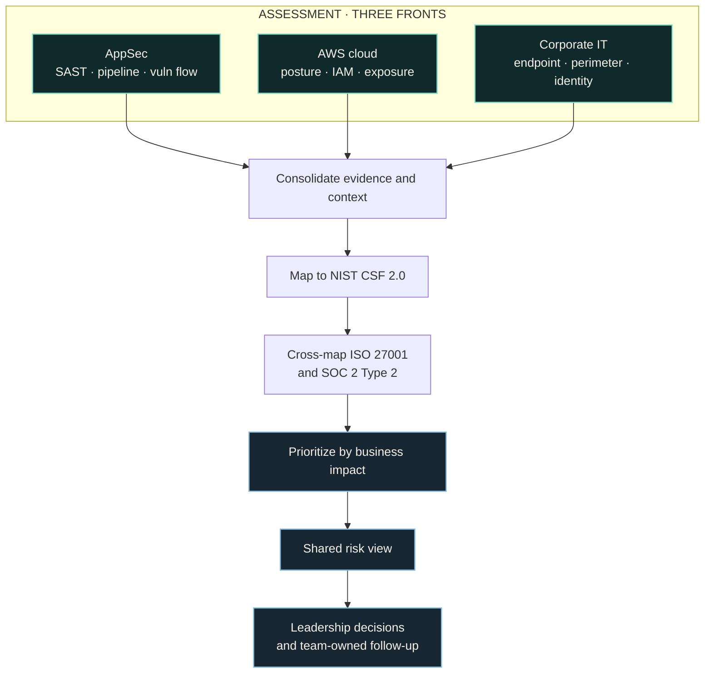

import StatGrid from '@/components/case/StatGrid.astro';
import Callout from '@/components/case/Callout.astro';

## Context

Security ownership was distributed across CloudOps, Architecture and Corporate IT, with Governance/GRC operating separately. Each function had its own view, but leadership lacked a single picture of how the risks connected or which ones deserved attention first. Reporting to the CTO, my mandate was to build that shared view.

- **Fragmented ownership** — four functions, each with its own view of risk.
- **No cross-functional picture** — leadership could not see how risks on different fronts connected.
- **No shared priority** — nothing said which risks deserved attention first.

## What I did

### Assess three fronts, beyond the tools

I reviewed the underlying processes, architecture, vulnerabilities and risk on each front — not just the findings surfaced by tools:

- **Application security:** SAST governance, pipeline behavior and the vulnerability lifecycle.
- **AWS cloud:** posture, identity and access, exposure and configuration risk.
- **Corporate IT:** endpoints, perimeter and identity lifecycle.

### Map to recognized frameworks

The assessment used NIST CSF 2.0 as its organizing framework and cross-mapped the observations to ISO 27001 and SOC 2 Type 2. That let the same work support engineering decisions, leadership prioritization and GRC conversations.

### Treat gaps as questions, not blame

I framed gaps as questions for the teams that owned them: understand the original decision and its constraints before judging the result. The assessment only works if the teams recognize their environment in the findings, so I documented the context for each gap before comparing the resulting risks. This kept the work focused on risk and correction rather than blame.

## How it works

Evidence from three fronts is consolidated with its context, mapped once to NIST CSF 2.0 and cross-mapped to ISO 27001 and SOC 2 Type 2, then prioritized by business impact into one view that leadership decides on and the owning teams follow up.

## Results

<StatGrid title="Assessment scope" stats={[
  { value: '3', label: 'Fronts assessed', detail: 'AppSec · AWS · Corporate IT' },
  { value: '4', label: 'Functions in one view', detail: 'CloudOps · Architecture · Corporate IT · GRC' },
  { value: '3', label: 'Frameworks mapped', detail: 'NIST CSF 2.0 · ISO 27001 · SOC 2 Type 2' },
  { value: '1', label: 'Shared risk view', detail: 'For the CTO, prioritized by business impact' },
]} />

- **1 consolidated risk view** across AppSec, AWS and corporate IT, prioritized by business impact rather than tool count.
- **3 fronts compared side by side**, so leadership could direct effort across functions with shared context.
- **3 frameworks mapped** — NIST CSF 2.0, ISO 27001 and SOC 2 Type 2 — so the assessment could support audit and compliance discussions.
- **A common foundation** for the deeper work documented in related case studies, such as the [SAST governance audit](/portfolio/projects/sast-governance-audit/).

## Business value

<Callout kind="value" lang="en">
Leadership got one picture of security risk instead of four partial ones, ranked by what mattered to the business. The same assessment served three audiences — engineering, the CTO and GRC — and its mapping to NIST CSF 2.0, ISO 27001 and SOC 2 Type 2 gave it direct use in audit and compliance conversations.
</Callout>

## Lessons

- **Assess the process, not just the tool output.** Reviewing processes, architecture and risk on each front is what made the findings comparable across functions.
- **One framework to organize, others to translate.** NIST CSF 2.0 structured the work; cross-mapping to ISO 27001 and SOC 2 Type 2 let the same work support GRC conversations.
- **Ask before judging.** Framing each gap as a question to its owner kept the teams engaged and the assessment focused on correction rather than blame.
