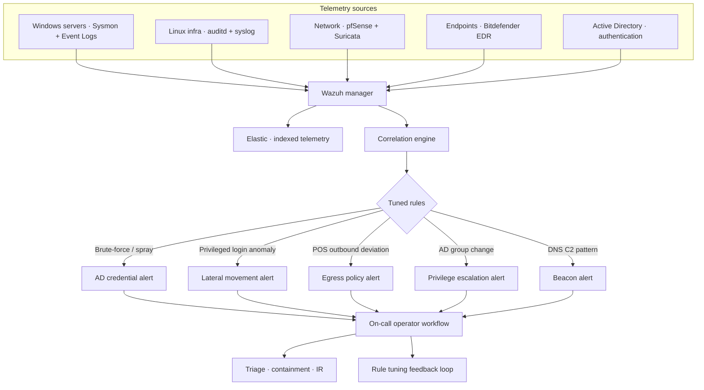

import StatGrid from '@/components/case/StatGrid.astro';
import Timeline from '@/components/case/Timeline.astro';
import Callout from '@/components/case/Callout.astro';

## Context

Volt Sport was a growing multi-branch retailer with **400+ assets** spread across HQ servers, branch endpoints, point-of-sale systems, network appliances and a small group of Linux infrastructure servers. There was no detection layer: incidents arrived as tickets ("the cashiers can't connect"), not as telemetry. The SOC had to be useful from week one, not become a dashboard engineering learned to ignore.

- **No centralized logs** — every system kept its own logs and rotated them before anyone could correlate.
- **No correlation** — Bitdefender, the domain controllers and pfSense each told a separate story, and nobody read them together.
- **No threat model** — without one, any SOC effort would either drown in noise or miss the real threats.
- **Reactive forensics** — investigations started after the fact, with whatever logs had not rotated yet.

## What I did

### Wazuh SOC

I centralized log ingestion and correlation across the asset surface:

- **Windows servers** (domain controllers, file servers, application hosts) — Sysmon for process, network and registry telemetry, Windows Event Logs for authentication and policy events.
- **Linux infrastructure** — auditd, syslog and application logs from the internal services.
- **Network appliances** — pfSense, Suricata IDS alerts (handed off from the [network defense work](/portfolio/projects/network-defense/)) and VPN gateway logs.
- **Endpoints** — Bitdefender EDR alerts feeding Wazuh, so endpoint, AD and network telemetry sit in one incident view.

I tuned the correlation rules to the threat model of a multi-branch retailer instead of keeping generic defaults:

- Brute-force and credential-spray patterns against AD accounts, especially service accounts.
- Privileged user logon from a non-administrator host.
- Lateral SMB / RDP movement from workstations outside the IT team.
- POS-host outbound connections outside the payment-gateway allowlist.
- Membership changes on critical AD groups (Domain Admins, Backup Operators, anything with delegation rights).
- DNS callback patterns matching common C2 beacon profiles.

The long tail — legacy POS terminals, branches with intermittent WAN, kiosk-class devices — was named as the next phase of the program instead of being hidden in the coverage number.

### Infrastructure pentest before go-live

Before declaring the SOC live, I ran an internal-perspective pentest covering network, AD, endpoints and exposed services. The SOC was supposed to detect attackers like me, and I wanted to know what it would miss.

- **16 critical findings**, scored by exploitability and business impact.
- **A severity-driven remediation roadmap** — a Jira board with owners and SLAs, not a 200-page PDF.
- I worked with the infra and dev teams to close the findings. Every fix included a SIEM rule update, so the same class of finding would be caught next time.
- The pentest showed which Wazuh rules fired on real activity and which stayed silent — half of the rule tuning that mattered came from this exercise.

### Attack-surface reduction

Detection without reducing exposure means monitoring the inevitable, so I reduced the surface in parallel:

- **Zero Trust architecture** across branches — authenticated, segmented access instead of implicit-trust LANs. Branch staff get only what their role needs; vendor and admin access goes through dedicated paths.
- **Cloudflare WAF** in front of public-facing services — rate limiting, OWASP rule packs tuned to the application stack, and bot management for the e-commerce surface.
- **Hardening** of Linux and Windows infrastructure — CIS-aligned baselines, GPO enforcement, unnecessary services disabled.
- **IAM governance and privileged access** — role-based groups, audited admin elevation, no shared credentials.

## How it works

Five telemetry sources land in one Wazuh manager, Elastic indexes everything, and the tuned rules turn raw events into a small set of alert types the on-call operator acts on. Every triage feeds back into the rules.

## Results

<StatGrid title="SOC after the first year" stats={[
  { value: '400+', label: 'Assets onboarded', detail: 'Centralized telemetry' },
  { value: '~80%', label: 'Critical asset visibility', detail: 'Long tail planned as phase two' },
  { value: '16', label: 'Critical findings closed', detail: 'Each with a SIEM rule update' },
  { value: '5', label: 'Telemetry sources correlated', detail: 'Windows, Linux, network, EDR, AD' },
]} />

### A real detection

An incident the tuned rules caught in production (anonymized). A finance contractor's laptop opened SMB connections to several branch servers, matching the "lateral SMB from non-IT workstation" rule. The alert arrived with the source host, the account, the destination set, the time window and the previous week's baseline showing this user had never made these connections.

<Timeline title="Lateral movement alert" steps={[
  { when: '90-second window', title: 'Laptop opens SMB connections to several branch servers', detail: 'Matches the lateral SMB rule' },
  { when: 'Alert', title: 'Wazuh fires with full context', detail: "Host, account, destinations, time window, last week's baseline" },
  { when: 'Under 10 min', title: 'Triage done, laptop isolated via EDR', key: true },
  { when: 'Follow-up', title: 'Credentials rotated, movement chain rebuilt from Sysmon' },
  { when: 'After', title: 'Rule tightened to catch the pattern earlier' },
]} />

- **400+ assets onboarded** to centralized telemetry within the first year of the program.
- **Lateral movement contained in under 10 minutes** — from the alert to the laptop isolated through the EDR, in a real incident.
- **~80% visibility on critical assets**, with the long tail planned as phase two instead of ignored.
- **16 critical findings closed**, each with a SIEM rule update derived from it.
- **Zero Trust, WAF and hardening** reduced what the SOC had to detect, instead of asking it to compensate for sprawl.
- **The SOC became the steady-state operation**, not a project — it kept running after I left.

## Business value

<Callout kind="value" lang="en">
A retailer with no detection layer ended up with a working SOC, a documented incident response process and a measurable security posture. Incidents started from telemetry with context instead of a cashier's complaint, the 16 critical gaps an attacker could have used were closed, and each one left a rule behind so the same class of attack would be caught next time. The operation outlived the project and ran without me.
</Callout>

## Lessons

- **Tune for the actual threat model.** The six rule families came from how this retail network could actually be attacked — POS egress, AD groups, lateral SMB — not from vendor defaults.
- **Test detection with an attack.** The pre-launch pentest showed which rules stayed silent, and half of the tuning that mattered came from it.
- **Close the finding and the blind spot together.** Every one of the 16 fixes shipped with a SIEM rule update.
- **Reduce the surface while you detect it.** Zero Trust, WAF and hardening kept the SOC's job bounded as the business grew.
- **Alerts must come with a story.** "This account, this host, these destinations, never before" is an incident; "anomaly detected" is not.
