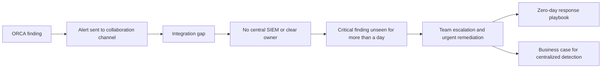

import Timeline from '@/components/case/Timeline.astro';
import Callout from '@/components/case/Callout.astro';

<Callout kind="scope" lang="en" title="Responsible disclosure">
Conceptual write-up. The issue affected the company's own product, was reported through the responsible process, and was remediated. No component, attack path, endpoint or exploit detail is included.
</Callout>

## Context

While reviewing cloud security posture findings in ORCA, I investigated an alert and identified a zero-day in the company's own product. It was a chain of critical issues, including remote code execution and domain-level impact. Given the product's exposure and the surrounding cloud architecture, the chain could potentially reach AWS and S3 storage.

I reported it immediately so the responsible team could assess and remediate it. The technical finding was serious. The operational finding changed what I focused on next: by the time I found it, the alert had been open in ORCA for **more than a day** without anyone acting on it. When I asked the teams responsible whether they had seen it, they said they had not.

An alert technically existed: it was sent to Teams. But the integration was not working reliably, ORCA was not properly connected to the response workflow, and there was no SIEM or central queue where an alert could land with a clear owner.

- **No dependable destination** — the Teams notification was not working reliably.
- **No owner** — no SIEM or central queue where an urgent finding would land with someone responsible for it.
- **Console-watching as a control** — catching an incident depended on someone happening to look at ORCA, which also conflicts with least privilege.
- **Thin cloud boundaries** — little to limit the impact before it reached cloud resources.

## What I did

I treated the incident as two connected problems: reduce the immediate exposure, then address the missing detection capability. The zero-day was not the root problem. It exposed a detection gap: the organization had no dependable way to notice and own an attack in progress.

### Coordinate urgent remediation

I brought in the responsible team and leadership, pressed for a fast fix, and identified network blocking as a temporary containment option if remediation could not happen immediately.

### Make the business case

I used the incident in a leadership discussion to show what a critical issue sitting unseen for a day meant in practice. Email and a misrouted Teams notification were not enough; the organization needed centralized alerting, a properly integrated SIEM, and an owned response path.

### Write the response playbook

I authored the zero-day triage and escalation process, with explicit ownership, privilege boundaries and business-impact criteria, so urgent findings would receive timely attention. Expecting engineers to watch a console around the clock is not a control, and people who do not need access to a security console should not have to monitor it just to catch an urgent incident.

### Diagnose the blast radius

The cloud architecture lacked defense-in-depth boundaries such as VPC segmentation, route and gateway controls, endpoint isolation and zero-trust access. Those controls would not make the vulnerability disappear, but they could limit its impact before it reached cloud resources.

## How it works

The diagram describes the operational gap and the response at a high level, and intentionally omits the vulnerability mechanics. The failure sits between B and D: the alert existed, but it had no reliable destination and no owner.

## Results

<Timeline title="Detection and response" steps={[
  { when: '>24h', title: 'Critical ORCA alert open, unseen', detail: 'The responsible teams later confirmed they had not seen it' },
  { when: 'Finding', title: 'I identified the zero-day from that alert', detail: 'Chain with RCE and domain-level impact; potential AWS/S3 reach' },
  { when: 'Immediately', title: 'Reported to the responsible team', detail: 'Through the responsible disclosure process' },
  { when: 'Escalation', title: 'Team and leadership engaged for an urgent fix', detail: 'Network blocking identified as a fallback containment', key: true },
  { when: 'Follow-up', title: 'Playbook written, case for SIEM made', detail: 'Ownership, privilege boundaries and business-impact criteria' },
]} />

- **1 critical zero-day** in the company's own product reported responsibly and remediated. There is no indication it was exploited in the wild.
- **More than 24 hours** of an unseen critical alert became a concrete case for centralized alerting, a properly integrated SIEM, and the foundation of a SOC.
- **1 zero-day response playbook** created, defining how urgent findings are triaged, owned and escalated.
- **The discussion shifted** from "someone should watch the console" to a detection workflow with a destination, an owner and a response process.

## Business value

<Callout kind="value" lang="en">
A critical issue in the company's own product, with potential reach into cloud storage, was remediated with no indication of exploitation in the wild. More lasting than the fix: leadership saw, with the company's own evidence, that an urgent alert could sit unseen for more than a day. That gave centralized alerting and a SIEM a concrete, evidence-backed justification, and the playbook gave the organization an owned response path for the next urgent finding.
</Callout>

## Lessons

- **Ask what the bug reveals.** Anyone can report a bug; here the more important finding was what the organization could not see.
- **An alert without a destination and an owner is not detection.** The ORCA alert existed and was sent to Teams, and still went unseen for more than a day.
- **Console-watching is not a control.** A control that depends on a person happening to look fails when that person is busy, lacks access, or does not know the alert exists.
- **Boundaries limit what detection misses.** Segmentation, gateway controls and zero-trust access would not remove the vulnerability, but they would limit its reach into cloud resources.
