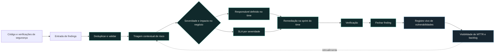

import StatGrid from '@/components/case/StatGrid.astro';
import Callout from '@/components/case/Callout.astro';

<Callout kind="scope" lang="pt" title="Status">
Este caso é um desenho. Ele definiu a arquitetura-alvo e o roadmap; colocar o fluxo completo em produção ficou definido como a fase seguinte. Nada abaixo descreve um sistema implantado.
</Callout>

## Contexto

A segurança de aplicações era reativa. Findings apareciam e talvez fossem corrigidos, mas não havia uma forma confiável de saber o que continuava aberto, quem era responsável, há quanto tempo estava aberto ou quando deveria ser corrigido. Sem responsáveis, o trabalho se perdia. Sem um MTTR confiável, o programa não conseguia medir se estava melhorando.

- **Sem responsável** — um finding não pertencia a um time nem a uma pessoa.
- **Sem prazo** — nada dizia quando a correção era esperada.
- **Sem MTTR confiável** — o tempo de correção não podia ser medido a partir de um registro consistente.
- **Prioridade pelo CVSS nominal** — a nota ignorava exposição e contexto de negócio.

O que faltava não era outro scanner. Era uma estrutura operacional que conectasse findings a pessoas, decisões, prazos e verificação.

## O que eu fiz

### Um ciclo em cinco etapas

Desenhei um ciclo completo com transições explícitas:

1. **Detectar** — coletar findings das verificações de segurança existentes.
2. **Triar** — validar o contexto e remover duplicidades ou ruído.
3. **Priorizar** — considerar exposição, sensibilidade dos dados, explorabilidade e possibilidade de encadeamento, em vez de depender apenas do CVSS nominal.
4. **Atribuir e corrigir** — definir um responsável no time pertinente e associar um SLA por severidade.
5. **Verificar e fechar** — confirmar a correção e manter o histórico de status no registro de vulnerabilidades.

### SLAs que os times conseguem cumprir

As metas de remediação precisavam ser realistas o bastante para serem operadas e firmes o bastante para terem efeito. Um SLA ambicioso que os times perdem repetidamente vira ruído; um responsável e um prazo tornam a prioridade executável dentro da sprint de cada time.

| Severidade | SLA de remediação |
| --- | --: |
| Critical | 15 dias |
| High | 30 dias |
| Medium | 60 dias |
| Low | 90 dias |

### Desenho antes de ferramenta

Deliberadamente, não acrescentei outro scanner. O desenho torna o trabalho existente operável primeiro — responsável, prazo, fechamento verificado — para que as medições venham do registro, e não de uma planilha pontual.

## Como funciona

Cada finding sai da triagem com um responsável e um prazo, e só é fechado depois da verificação. Todo fechamento entra no registro, de onde vêm o MTTR e a idade do backlog, e essa visibilidade retroalimenta a priorização dos próximos findings.

## Resultados

Este foi um trabalho de desenho, então os resultados são as entregas, não resultados de produção.

<StatGrid title="Entregas do desenho" stats={[
  { value: '5', label: 'Etapas do ciclo', detail: 'Da detecção ao fechamento verificado' },
  { value: '4', label: 'Fatores de prioridade', detail: 'Exposição, dados, explorabilidade, encadeamento' },
  { value: '5', label: 'Artefatos do desenho', detail: 'Arquitetura, modelo de prioridade, responsabilidades, abordagem de SLA, roadmap' },
  { value: '1', label: 'Responsável por finding', detail: 'Nomeado no time pertinente' },
]} />

- **Arquitetura-alvo** para um fluxo em cinco etapas, da entrada do finding ao fechamento verificado.
- **Modelo de priorização** com 4 fatores contextuais além do CVSS nominal.
- **Regras de responsabilidade** que nomeiam um responsável por finding no time pertinente.
- **SLAs de remediação de 15, 30, 60 e 90 dias** para Critical, High, Medium e Low, pensados para caber dentro da sprint de um time.
- **Roadmap** para o próximo ciclo de implementação, tornando a construção específica e mensurável.

## Valor para o negócio

<Callout kind="value" lang="pt">
O desenho define o que a liderança precisa para responder "a segurança de aplicações está melhorando?": todo finding com responsável, prazo e fechamento verificado, registrado em um único lugar. Depois de implementado, o MTTR e a idade do backlog podem ser calculados a partir desse registro, em vez de reconstruídos a partir de retratos isolados, e a remediação parada fica visível por time. Ele também dá à próxima fase um alvo concreto e delimitado, em vez de uma intenção genérica, e é a base da [auditoria de governança SAST](/portfolio/pt/projects/sast-governance-audit/) e do trabalho de [gestão de vulnerabilidades corporativa](/portfolio/pt/projects/enterprise-vuln-mgmt/).
</Callout>

## Aprendizados

- **Responsabilidade antes de ferramenta.** A lacuna não era detecção, e sim quem era dono de um finding e até quando; o desenho não acrescenta nenhum scanner.
- **Um SLA sempre perdido é ruído.** As metas precisavam caber dentro da sprint de um time para mudar algum comportamento.
- **Meça a partir do registro, não de uma planilha.** O MTTR só é confiável quando o histórico de status de cada finding fica em um único lugar.
- **Chame um desenho de desenho.** Deixar explícito que era uma arquitetura-alvo mantém o roadmap crível para a fase de implementação.
