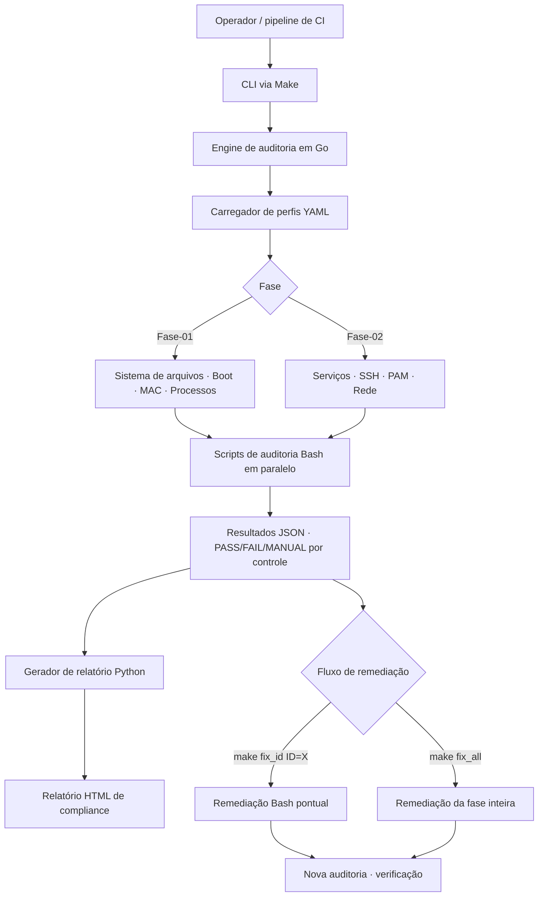

import StatGrid from '@/components/case/StatGrid.astro';
import Callout from '@/components/case/Callout.astro';

## Contexto

Hardening parece ótimo em uma auditoria pontual e se degrada assim que as pessoas começam a trabalhar. O cenário que herdamos era conhecido: revisões manuais do CIS Benchmark duas vezes por ano, feitas por um prestador externo com uma checklist.

- **Desvios se acumulavam em silêncio** entre auditorias — pacotes adicionados, configurações alteradas, sysctls trocados, opções de montagem modificadas.
- **Sem comparação entre auditorias** — via-se o estado atual, nunca como ele tinha se degradado.
- **Sem como distinguir** *"nunca configuramos isso"* de *"isso já esteve protegido e alguém quebrou"*.
- **Contagens de vulnerabilidades subindo** porque a postura do sistema operacional se degradava mais rápido do que os patches chegavam.

O hardening precisava deixar de ser um projeto e virar um sinal recorrente.

## O que eu fiz

### Uma engine híbrida, uma linguagem por camada

Construí o **CIS-Auditor** como um framework em Go + Bash + Python para Ubuntu 22.04 LTS, com cada linguagem na camada em que ela é mais forte e separação estrita entre auditoria e remediação.

- **Engine de orquestração em Go** (`internal/auditor`) — execução dos controles, rodadas em paralelo, agregação em JSON e carregamento dos perfis YAML. A tipagem estática mantém a engine previsível; a concorrência mantém rápidas as auditorias em muitos hosts.
- **Scripts de auditoria e remediação em Bash** — os controles CIS *são* verificações de shell (opções de montagem, valores de sysctl, permissões de arquivo, configuração do GRUB, perfis do AppArmor). Reimplementar `findmnt` e `sysctl` em Go só acrescentaria código.
- **Gerador de relatório em Python** (`scripts/generate_report.py`) — HTML com resumo executivo, visão por controle, severidade e disponibilidade de remediação.
- **Perfis de controle em YAML** (`configs/profiles/`) — Fase 01 (configuração inicial: sistema de arquivos, boot loader, MAC, proteção de processos) e Fase 02 (serviços: SSH, PAM, rede). Os perfis são dados versionados, então pacotes STIG ou de hardening interno poderiam ser adicionados sem tocar no código da engine.
- **Uso pelo Make** — `make audit`, `make audit_id ID=1.1.3`, `make fix_all`, `make report`. Quem opera não precisa saber Go nem Python.

### Por que não Go puro

Go puro teria sido mais limpo no papel. Três motivos para o projeto continuar híbrido:

- **Bash corresponde ao que os controles CIS de fato são.** Um controle como *"Ensure nodev option set on /tmp partition"* é `findmnt -k -n -o OPTIONS /tmp | grep -q nodev`. Reimplementar isso em Go custa mais código, mais bugs e nenhum ganho de clareza.
- **Go é para orquestração, não para inspecionar o sistema.** Uma goroutine por controle executa as verificações em paralelo em vez de em série, e um binário único chega do mesmo jeito a centenas de hosts.
- **Python para relatórios porque se encaixa.** Templates, gráficos e bibliotecas HTML maduras. O `html/template` do Go serve bem para servidores web; para um relatório de compliance com severidade e visão de aprovados e reprovados, Python foi mais rápido de construir e é mais fácil de evoluir.

O custo de três linguagens é real (complexidade de build, entrada de novos contribuidores), mas cada camada pode ser trocada de forma independente. Um controle novo é um script Bash em `scripts/Fase-XX/auditoria/`; um novo formato de relatório é um alvo em Python; um perfil novo é YAML, sem mudança na engine.

### Decisões que fizeram diferença

- **Auditoria e remediação estritamente separadas.** O caminho de auditoria não consegue alterar o estado do sistema. `make audit` é seguro para rodar em produção às 3h; `make fix_*` exige chamada explícita. O limite está na arquitetura, não em convenção — diretórios de scripts separados, alvos do Make separados, caminhos de código separados.
- **Idempotente por design.** Todo script de auditoria e de remediação pode rodar repetidas vezes: uma correção reaplicada não acumula efeitos colaterais, e uma auditoria repetida dá o mesmo resultado em um sistema sem mudanças.
- **Modo de auditoria não destrutivo é inegociável.** Quem opera roda `make audit` em produção toda semana. Se a auditoria pudesse causar um incidente, ninguém a rodaria.
- **Pacotes de regras plugáveis.** A mesma engine roda perfis CIS e pode rodar perfis STIG ou padrões internos de hardening. Perfil é dado; engine é código.
- **Formato intermediário em JSON.** Os resultados viram JSON estruturado antes da renderização em HTML, então os pipelines de CI leem o mesmo artefato que gera o relatório — sem um caminho "legível por máquina" separado que se afaste do que aparece na tela.

## Como funciona

A engine carrega um perfil, executa as verificações Bash em paralelo e grava um resultado JSON por controle. O relatório HTML e o CI leem esse JSON; a remediação é um ramo separado que só roda com um `make fix_*` explícito e sempre termina em uma nova auditoria.

## Resultados

<StatGrid title="O que a ferramenta cobre" stats={[
  { value: '70%', label: 'Controles CIS Ubuntu 22.04', detail: 'Detecção e remediação automatizadas' },
  { value: '5', label: 'Perfis YAML', detail: 'Fase 01 e quatro pacotes da Fase 02' },
  { value: '8 + 8', label: 'Scripts da Fase 01', detail: 'Uma auditoria e uma correção por controle' },
  { value: '0', label: 'Alterações feitas pela auditoria', detail: 'A remediação é outro comando' },
]} />

<StatGrid title="Uma execução de auditoria · VM de teste, 15/10/2025" stats={[
  { value: '8', label: 'Controles verificados', detail: 'Perfil ubuntu_22.04_fase01' },
  { value: '4', label: 'Aprovados' },
  { value: '4', label: 'Reprovados', detail: 'Cada um com seu script de correção' },
  { value: '0', label: 'Erros' },
]} caption="Da saída do make audit mostrada nas evidências abaixo." />

- **70% dos controles CIS do Ubuntu 22.04 automatizados** — detecção e remediação, com os controles que só podem ser verificados manualmente marcados explicitamente nos relatórios.
- **O desvio ficou visível** — um controle que estava conforme e regride aparece na próxima execução da auditoria, não na próxima revisão externa daqui a seis meses.
- **O hardening virou uma disciplina contínua** — um número que a engenharia e a liderança acompanham semana a semana, em vez de um fichário aberto só na época da auditoria.
- **Pronto para CI/CD** — o mesmo binário roda localmente para a triagem do engenheiro e nos pipelines como gate de postura.
- **Trilha pronta para auditoria** — cada execução salva em JSON com data e hora (`audit-results-ubuntu-20251015-111122.json`), cada remediação registrada.
- **Contribuiu para a redução no Linux** — junto com o SecScan, o CIS-Auditor contribuiu para a frota Ubuntu sair de 569 mil para 318 mil vulnerabilidades, resultado do programa de [redução de vulnerabilidades Linux](/portfolio/pt/projects/linux-vuln-reduction/).

## Valor para o negócio

<Callout kind="value" lang="pt">
O compliance deixou de depender de uma revisão manual duas vezes por ano. O desvio agora aparece entre uma execução e outra, então o time corrige uma regressão enquanto ela ainda é uma configuração em um host, e não a descobre na próxima auditoria externa. Como o modo de auditoria não altera nada, ele é seguro para rodar em produção, e cada execução deixa um registro JSON com data e hora que Compliance pode entregar a um auditor como está.
</Callout>

## Aprendizados

- **Separe auditoria de remediação na arquitetura, não pela disciplina.** Diretórios, alvos do Make e caminhos de código separados é o que torna o `make audit` seguro em produção.
- **Escolha a linguagem pela camada.** As verificações CIS são comandos de shell de uma linha, como `findmnt ... | grep -q nodev`; o Go orquestra e o Python gera o relatório.
- **Compliance é efeito colateral, não objetivo.** O relatório entrega o status de cada controle, o motivo da falha e o script exato de correção; o número de compliance vem de corrigir os controles.
- **JSON antes de HTML, sempre.** O CI e o relatório HTML leem o mesmo JSON, então a apresentação nunca se afasta dos dados.
- **Idempotência é a única interface honesta.** Todo script de auditoria e de correção pode rodar de novo com segurança, e é isso que permite colocá-lo em um pipeline.
