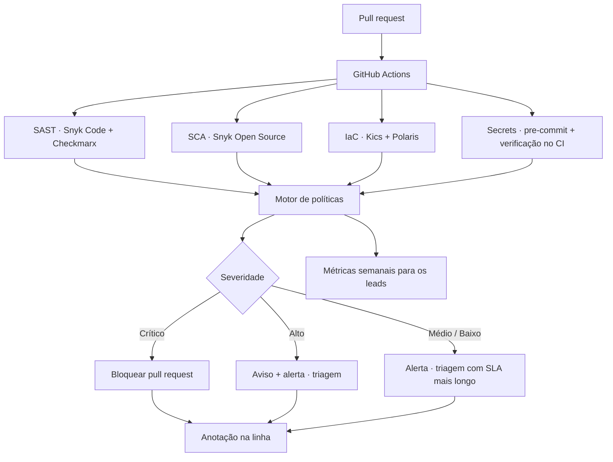

import StatGrid from '@/components/case/StatGrid.astro';
import Callout from '@/components/case/Callout.astro';

## Contexto

O pipeline já executava verificações de segurança, mas era difícil agir sobre os resultados. A engenharia via a segurança como um gargalo trimestral, e não como algo de sua responsabilidade, e as verificações davam poucos motivos para pensar diferente.

- **Mais ruído que sinal** — notas CVSS genéricas, sem contexto de alcançabilidade ou de explorabilidade, além de falsos positivos.
- **Findings que ninguém abria** — os resultados ficavam em um dashboard separado, longe da mudança de código.
- **Regras de bloqueio sem noção de risco** — uma CVE transitiva de baixa severidade era tratada igual a uma RCE explorada ativamente.
- **Sem próximo passo claro** — um finding não dizia quem deveria corrigi-lo nem como.

## O que eu fiz

Concentrei os gates em findings com caminho de impacto validado e coloquei os resultados no pull request, onde o responsável pelo código podia agir.

### Cinco gates em cada pull request

Os cinco rodam no GitHub Actions e geram anotações por linha no próprio pull request.

- **SAST** — Snyk Code para a cobertura principal do stack Go e Python; Checkmarx para uma análise mais profunda da lógica de aplicação nos serviços expostos à web.
- **SCA** — Snyk Open Source nas dependências diretas e transitivas, com filtro de alcançabilidade (reachability): a função vulnerável é de fato chamada pelo nosso código?
- **IaC** — Kics para Terraform, Helm e manifests do Kubernetes, mais Polaris para a postura do cluster Kubernetes.
- **Secrets** — hooks de pre-commit para um retorno rápido na máquina do desenvolvedor, mais uma verificação no CI que pega o que o hook deixou passar.
- **Policy as code** — regras versionadas para o que bloqueia, o que gera alerta e o que só comenta, revisadas por pull request como qualquer outro código.

### Escolha das ferramentas e trade-offs

- **Snyk para SAST e SCA juntos** — o Snyk Code cobria o código-fonte, e a análise de alcançabilidade do Snyk Open Source nas dependências Go foi o diferencial: ela separa um módulo vulnerável que nosso código chama de um que só é importado. O SonarQube é forte em qualidade de código, mas na época o modo de segurança dele ficava atrás na análise de dependências Go.
- **Checkmarx por cima, em um subconjunto** — no pequeno grupo de serviços expostos à web, a análise de fluxo de dados do Checkmarx, mais lenta e mais profunda, pegava categorias que o Snyk Code não pegava. O custo está em minutos de CI, não em horas de engenharia, então ele ficou.
- **Kics e Polaris juntos** — o Kics cobre Terraform, Helm e configurações incorretas de IaC em geral; o Polaris é especializado na postura do Kubernetes (limites de recursos, security contexts, network policies). Cada um revela categorias que o outro não vê, rodar os dois custa pouco tempo de CI e a sobreposição de falsos positivos é pequena.
- **Pre-commit e CI para secrets** — o hook dá retorno imediato antes do push; a verificação no CI comprova que o hook de fato rodou. Sem ela, um hook desativado expõe o repositório inteiro sem que ninguém perceba.

### Desenho pensado para a adoção

- **Bloqueio só para crítico** — um finding Critical impedia o merge. High gerava aviso e alerta para triagem, e Medium e Low iam para a triagem com um SLA mais longo. A alcançabilidade ordenava essa fila de triagem, então uma função vulnerável que o nosso código chama era tratada antes de uma que ele só importa. A engenharia aceitou a regra porque ela fazia sentido.
- **Anotações no pull request, não em um dashboard separado** — cada finding aparece na linha exata, com a correção recomendada ao lado.
- **Pull requests automáticos de atualização** — atualizações de dependência relevantes para a segurança, que têm correção, abrem como pull requests separados e testados, que a engenharia revisa e aprova como qualquer outra atualização.
- **Métricas semanais para os tech leads** — o que está vermelho, o que está verde e o que está piorando, por serviço, para que cada lead faça a triagem da própria postura antes da próxima sprint.

## Como funciona

Todos os scanners alimentam um único motor de políticas. Só um finding crítico bloqueia o merge. High gera aviso e alerta, Medium e Low vão para a triagem com um SLA mais longo, e todo finding aparece na linha exata — rígido onde importa, sem travar a engenharia no restante.

## Resultados

<StatGrid title="Cobertura dos gates" stats={[
  { value: '5', label: 'Tipos de gate', detail: 'SAST, SCA, IaC, secrets, política' },
  { value: '3', label: 'Decisões de política', detail: 'Bloquear, alertar, triar' },
  { value: '2', label: 'Nuvens', detail: 'AWS e GCP, um modelo de severidade' },
]} />

- **5 tipos de gate em cada pull request** em mais de 100 repositórios, integrados de ponta a ponta ao GitHub Actions.
- **Infraestrutura como código de AWS e GCP** sob o mesmo motor de políticas e o mesmo modelo de severidade, então um bucket S3 ou um workload GKE mal configurado era detectado antes do deploy que o exporia.
- **A segurança deixou de ser um gargalo trimestral** — o backlog de atualização de dependências andou continuamente, em vez de se acumular antes dos ciclos de auditoria.
- **A engenharia passou a confiar nos gates** — os pull requests deixaram de ser enviados com `--no-verify`, os leads passaram a citar os números semanais no planejamento e os serviços novos adotaram o mesmo template por padrão.
- **Os gates continuaram ligados** — a engenharia não conseguiu derrubá-los ao longo do projeto.

## Valor para o negócio

<Callout kind="value" lang="pt">
As verificações de segurança saíram da correria trimestral de auditoria e entraram no fluxo diário de revisão de código. Um merge bloqueado passou a significar um risco crítico, então a engenharia corrigia os findings em vez de contornar o gate. Os leads passaram a ver e a planejar a postura do próprio serviço toda semana, e configurações incorretas de nuvem eram detectadas antes de chegar à produção, tanto na AWS quanto no GCP.
</Callout>

## Aprendizados

- **Bloqueie por sinal, não por superfície.** Um gate que dispara em toda CVE transitiva ensina a engenharia a ignorar gates; bloquear só findings críticos, e mandar o resto para a triagem com SLA, foi o que manteve estes gates ligados.
- **Coloque o finding onde a correção acontece.** O dashboard serve para tendências; a anotação na linha do pull request serve para corrigir.
- **Scanners sobrepostos podem ser uma vantagem.** Kics e Polaris olham para o Kubernetes, e cada um revela categorias que o outro não vê.
- **Policy as code é inegociável.** Regras de bloqueio versionadas com o pipeline são revisadas como código; regras escondidas em uma interface se perdem assim que o responsável muda de função.
