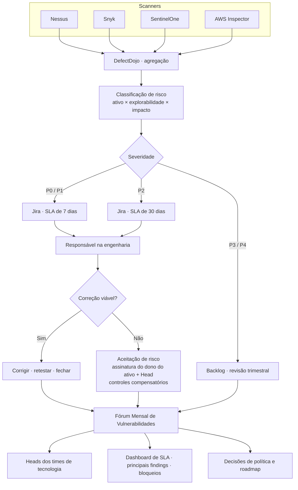

import StatGrid from '@/components/case/StatGrid.astro';
import Timeline from '@/components/case/Timeline.astro';
import Callout from '@/components/case/Callout.astro';

## Contexto

As vulnerabilidades chegavam de quatro scanners — Nessus, Snyk, SentinelOne e AWS Inspector — em caixas de entrada separadas, sem priorização comum, sem SLA e sem responsabilidade compartilhada. Segurança abria os findings, a engenharia não sabia quais importavam, e a correção ficava parada por meses. A gestão de vulnerabilidades acontecia em tickets do Jira e em conversas avulsas no Slack, invisível para os líderes que precisavam escolher entre corrigir, aceitar o risco ou despriorizar.

- **Quatro caixas de entrada** — cada scanner reportava por conta própria, e ninguém tinha uma fonte única de verdade.
- **Sem priorização** — problemas críticos se misturavam ao ruído, ordenados no máximo pela severidade bruta do scanner.
- **Sem SLA nem responsável** — os findings não tinham prazo nem time definido.
- **Sem fórum** — os Heads de tecnologia nunca revisavam os findings juntos, então as decisões de risco eram tomadas informalmente ou não eram tomadas.

## O que eu fiz

### Entrada centralizada

Os quatro scanners alimentam o DefectDojo, que agrega e normaliza os findings. Cada finding recebe uma classificação de risco e então é encaminhado para um único fluxo no Jira: Backlog → Refinamento → Em andamento → Reteste → Concluído. Os findings de pentests em ativos críticos entram no mesmo fluxo.

### Priorização por risco

Severidade não é uma cópia do CVSS. Antes de qualquer coisa chegar à engenharia, a classificação combina três sinais:

- **Criticidade do ativo** — exposto à internet? guarda dados de clientes? faz parte do fluxo de pagamento? Um único atributo do ativo pode mover um finding dois níveis para cima ou para baixo.
- **Explorabilidade** — existe PoC público? módulo em framework de exploração? campanhas ativas conhecidas? As fontes são o CISA KEV, os avisos dos fabricantes e feeds de inteligência de ameaças.
- **Impacto no negócio** — o que quebra se isso for explorado: receita, classe de dados, exposição regulatória, custo de recuperação.

Dois findings ilustrativos:

- **API exposta à internet · SQL injection com PoC público** — criticidade *máxima* × explorabilidade *máxima* × impacto *máximo* = **P0, SLA de 7 dias**. O responsável é identificado automaticamente pela tag de serviço no Jira, e uma regra de automação do Jira escala o SLA estourado.
- **Ferramenta administrativa interna · CVE em dependência transitiva sem caminho de execução** — criticidade *baixa* × explorabilidade *baixa* (não alcançável) × impacto *baixo* = **P3, backlog**. Revisado a cada trimestre, sem bloquear nada.

O mesmo modelo de classificação colocou os dois a dois níveis de distância: um SLA de 7 dias e o backlog trimestral. Foi o contexto, e não a nota bruta, que definiu a ordem do trabalho.

### O Fórum Mensal de Vulnerabilidades

Esta é a metade do programa que não cabe em um board do Jira, e eu fui responsável por ela de ponta a ponta: escrevi o playbook, defini a pauta e apresentei o dashboard ao CTO, aos Heads e coordenadores dos times de tecnologia e aos responsáveis pelas áreas donas das vulnerabilidades. O fórum é onde a priorização, o acompanhamento de SLA e as decisões de aceitação de risco acontecem com as pessoas que podem autorizá-las.

<Timeline title="Um ciclo do fórum" steps={[
  { when: '48h antes', title: 'Material prévio enviado', detail: 'Principais findings, cumprimento de SLA, fila de aceitação de risco, bloqueios' },
  { when: '5 min', title: 'Dashboard de SLA', detail: 'O que está vermelho, o que está verde, o que atrasou' },
  { when: '20 min', title: 'Análise dos 5 principais findings', detail: 'Contexto, responsável, bloqueio, decisão necessária', key: true },
  { when: '15 min', title: 'Revisões de aceitação de risco', detail: 'Assinatura formal e controles compensatórios' },
  { when: '10 min', title: 'Bloqueios e escaladas entre times' },
  { when: '10 min', title: 'Política e roadmap', detail: 'Tendências, nova cobertura de scanners, ajustes na classificação' },
  { when: 'Depois', title: 'Cada decisão vira uma ação no Jira', detail: 'Responsável e prazo alinhados ao nível de SLA' },
]} />

- **Cadência** — mensal, um horário fixo na agenda dos Heads de todos os times de tecnologia.
- **Material prévio 48 horas antes**, para que a reunião servisse para decidir, e não para atualizar status.
- **Trilha de aceitação de risco** — quando a correção não era viável (sistema legado em fim de vida, fabricante sem suporte, custo de refatoração maior que o risco), o finding ia para uma trilha estruturada de aceitação. O dono do ativo e o Head do time responsável assinavam juntos, os controles compensatórios eram documentados (regra de WAF, segmentação de rede, monitoramento adicional) e a aceitação tinha uma data de revisão (90, 180 ou 365 dias), quando voltava ao fórum.

## Como funciona

Os quatro scanners convergem no DefectDojo, cada finding é classificado pelo contexto e chega ao Jira com um nível de SLA, e tudo — corrigido, aceito ou no backlog — volta ao fórum mensal, onde os Heads decidem.

## Resultados

<StatGrid title="Retrato do board no Jira" stats={[
  { value: '212', label: 'Tickets em gestão', detail: 'Vulnerabilidades e requisitos de segurança' },
  { value: '192', label: 'Backlog', detail: 'Classificados e na fila por nível' },
  { value: '9', label: 'Refinamento', detail: 'Responsável e correção em definição' },
  { value: '5', label: 'Em andamento', detail: 'Em correção' },
  { value: '6', label: 'Reteste', detail: 'Correção aguardando validação' },
]} caption="Contagens por status do resumo do espaço no Jira, no momento da captura. Os tickets fechados são arquivados, por isso Concluído aparece com 0." />

| Tipo de trabalho | Parcela dos tickets |
| --- | ---: |
| Vulnerabilidade de aplicação | 43% |
| Vulnerabilidade de infraestrutura | 30% |
| Requisito de segurança | 27% |

| Nível | SLA | Destino |
| --- | --- | --- |
| P0 / P1 | 7 dias | Jira, com responsável na engenharia |
| P2 | 30 dias | Jira, com responsável na engenharia |
| P3 / P4 | Revisão trimestral | Backlog |

- **212 tickets em gestão ativa**, cada um com status, nível de SLA e uma trilha formal de aceitação para o que não pode ser corrigido.
- **4 scanners em um único fluxo** — sem conversas por e-mail, planilhas ou acompanhamento duplicado.
- **Os Fóruns Mensais de Vulnerabilidades** institucionalizaram a revisão com o CTO, os Heads e os coordenadores de todos os times de tecnologia, todos olhando para o mesmo dashboard.
- **Pentests direcionados** em ativos críticos validaram correções e revelaram falhas que os scanners não apontavam, e os findings entraram no mesmo fluxo do Jira.
- **Aceitação de risco com data de revisão** de 90, 180 ou 365 dias, assinada pelo dono do ativo e pelo Head do time.

## Valor para o negócio

<Callout kind="value" lang="pt">
A empresa ganhou um único lugar para ver sua exposição a vulnerabilidades e uma reunião em que as pessoas responsáveis por ela tomavam decisões. A engenharia passou a trabalhar primeiro no que tinha mais chance de prejudicar o negócio, em vez de tentar corrigir tudo de uma vez. E quando alguém perguntava "por que isso não foi corrigido?", a resposta deixou de ser "não sabíamos" e passou a ser "sabemos, aqui está a assinatura, aqui estão os controles, aqui está a data de revisão" — uma posição defensável diante de auditorias, clientes e da liderança.
</Callout>

## Aprendizados

- **Um programa de vulnerabilidades é um ritmo, não um software.** As ferramentas normalizam os dados; o fórum toma as decisões; o playbook torna o fórum útil. Sem o ritmo, as ferramentas viram cemitério.
- **CVSS não é severidade.** A criticidade do ativo e a explorabilidade movem um finding por níveis, como mostram a API em P0 e a ferramenta administrativa em P3.
- **Aceitar risco é um recurso, não uma falha.** Uma trilha governada, com assinatura, controles e data de revisão, substituiu a versão informal e invisível.
- **Monte o fórum para quem decide.** Engenheiros corrigem; Heads decidem o que é corrigido e quando, então a pauta e o material prévio foram escritos para eles.
- **Pentests pertencem ao mesmo fluxo.** Encaminhar findings de pentest e de scanner pelo mesmo fluxo no Jira é como a empresa para de redescobrir as mesmas falhas.
