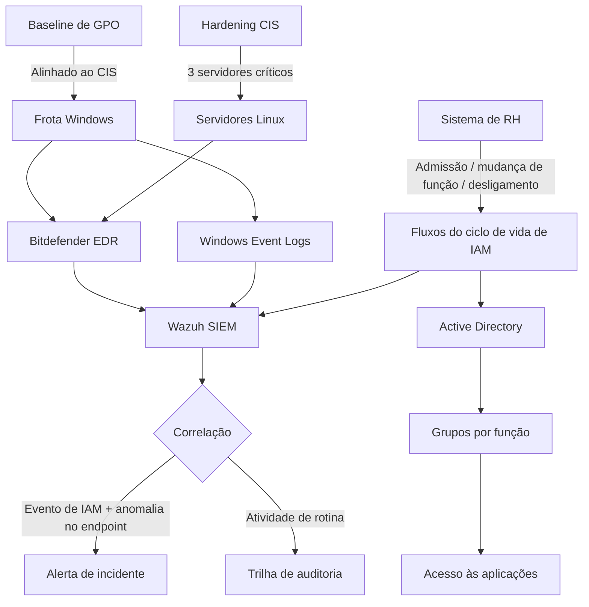

import StatGrid from '@/components/case/StatGrid.astro';
import Callout from '@/components/case/Callout.astro';

## Contexto

A Global Estratégias Financeiras é uma fintech brasileira regulada que lida com dados financeiros sensíveis. Nesse tipo de ambiente, **o acúmulo indevido de permissões não é questão de higiene, é risco de compliance**. O processo anterior dependia de revisões de acesso manuais e trimestrais e de chamados avulsos de desligamento (offboarding), e toda auditoria virava uma varredura manual, porque nada podia ser respondido a partir dos dados existentes.

- **Desligamento lento** — a janela entre "a pessoa saiu" e "o acesso foi revogado" era medida em dias, às vezes semanas. Para uma fintech, essa janela é o próprio apontamento de auditoria.
- **Acesso acumulado entre mudanças de função** — as pessoas trocavam de time e mantinham as permissões antigas, porque ninguém era dono da tarefa de removê-las.
- **Sem histórico** — as revisões trimestrais mostravam o estado atual, nunca como ele tinha mudado desde a revisão anterior.
- **Telemetria de endpoint isolada do IAM** — um usuário privilegiado entrando a partir de um host incomum não aparecia ao lado do histórico de mudanças de acesso desse usuário.

## O que eu fiz

Fui responsável pelo ciclo de vida de IAM e o reconstruí em torno de três princípios: estado sempre conhecido, transições sempre registradas, desvios sempre detectáveis.

### Automação do ciclo de vida

- **Admissão → mudança de função → desligamento → auditoria.** Eventos do RH atualizavam os grupos do Active Directory por meio de fluxos em PowerShell, usando a Microsoft Graph API para o Microsoft 365, e não por chamados. A cada mudança de função, os grupos eram recalculados a partir de uma matriz canônica de função e permissões, em vez de se acumularem manualmente.
- **Desligamento automatizado.** Quando o RH registrava uma saída, o fluxo desativava a conta do AD, removia os grupos, arquivava a caixa de e-mail e registrava cada etapa na trilha de auditoria, tudo em 10 a 15 minutos. A revogação deixou de esperar alguém abrir um chamado.

### Hardening

- **3 servidores Linux críticos** — a camada de dados financeiros — em um baseline alinhado ao CIS. O hardening era idempotente e agendado, e não uma ação única, e o desvio entre as varreduras era a métrica.
- **Baseline de GPO** aplicado em toda a frota Windows.

### Correlação entre endpoint e identidade

O Bitdefender EDR e os Windows Event Logs alimentavam o Wazuh junto com os eventos de IAM. Um login privilegiado a partir de um endpoint incomum, uma mudança no grupo de administradores locais de um servidor crítico e uma conta de serviço se movendo lateralmente eram correlacionados em uma única linha do tempo de incidente, em vez de três alertas não relacionados em três dashboards.

### Pensado para auditoria

Uma fintech regulada precisa responder "quem acessou o quê, de onde e quando?", tanto para as obrigações da LGPD quanto para as auditorias de controle de acesso da ISO 27001. As decisões de design respondem a essa pergunta:

- **A trilha de auditoria é o sistema** — cada transição de IAM, login privilegiado e mudança de grupo é registrado com data e hora, autor e contexto. A auditoria é uma consulta sobre a mesma telemetria que o SIEM usa, e não um relatório à parte.
- **Menor privilégio por padrão** — grupos definidos por função e recalculados a cada mudança de função. Um usuário só ganha acesso quando a função canônica dele o concede.
- **Um baseline com hardening, e não servidores feitos à mão** — quando alguém pergunta "o que tem hardening?", a resposta é um número e um relatório de desvios.

## Como funciona

Os eventos do RH atualizam o Active Directory por meio dos fluxos do ciclo de vida. Esses mesmos eventos, o EDR e os logs do Windows chegam ao Wazuh, que abre um incidente quando uma mudança de identidade coincide com uma anomalia no endpoint e registra todo o resto como trilha de auditoria.

## Resultados

<StatGrid title="Programa de identidade em operação contínua" stats={[
  { value: '500+', label: 'Usuários com ciclo de vida gerenciado', detail: 'Toda transição registrada' },
  { value: '10–15 min', label: 'Desligamento após aviso do RH', detail: 'Antes: dias, às vezes semanas' },
  { value: '3', label: 'Servidores Linux críticos com hardening', detail: 'Alinhados ao CIS, desvios monitorados' },
  { value: '3', label: 'Fontes de sinal no Wazuh', detail: 'Eventos de IAM, EDR, logs do Windows' },
]} />

| | Antes | Depois |
| --- | --- | --- |
| Desligamento | Por chamado, de dias a semanas | Automatizado a partir do aviso do RH, em 10 a 15 minutos |
| Mudança de função | Acesso acumulado | Grupos recalculados pela matriz de funções |
| Pergunta de auditoria | Varredura manual | Consulta na telemetria existente |
| Anomalia privilegiada | Alertas separados por ferramenta | Uma linha do tempo de incidente correlacionada no Wazuh |

- **Mais de 500 usuários** com ciclo de vida gerenciado continuamente, com cada transição registrada.
- **O desligamento caiu de dias para 10 a 15 minutos** após o aviso do RH, com arquivamento da caixa de e-mail, sem chamado manual no caminho.
- **Perguntas de auditoria respondidas com a telemetria existente**, sem varredura manual.
- **3 servidores Linux críticos** em um baseline alinhado ao CIS, com detecção contínua de desvios.
- **Anomalias privilegiadas correlacionadas** em um único incidente no Wazuh, em vez de alertas isolados no dashboard do Bitdefender.

## Valor para o negócio

<Callout kind="value" lang="pt">
A fintech fechou a janela de acesso que os auditores procuram primeiro: quem saía perdia o acesso 10 a 15 minutos depois do registro no RH, e não dias depois. A postura de compliance virou um registro contínuo em vez de um retrato trimestral, então as perguntas de auditoria passaram a ser respondidas com dados que a empresa já tinha, e os sistemas com dados financeiros rodavam sobre um baseline com hardening e monitorado.
</Callout>

## Aprendizados

- **Em ambiente regulado, a auditoria é o sistema.** A resposta de auditoria e a consulta no SIEM passaram a ser a mesma consulta, e foi isso que acabou com as varreduras manuais.
- **O desligamento é a métrica que revela todo o resto.** Tirar a revogação do chamado e ligá-la ao aviso do RH foi a mudança que tornou o menor privilégio crível.
- **O acúmulo de permissões é um incidente em câmera lenta.** Recalcular os grupos a cada mudança de função impediu que o acesso se acumulasse em silêncio.
- **Telemetria de endpoint sem contexto de IAM é metade da história.** Um login privilegiado a partir de um host incomum só fazia sentido ao lado da mudança de acesso que veio antes.
