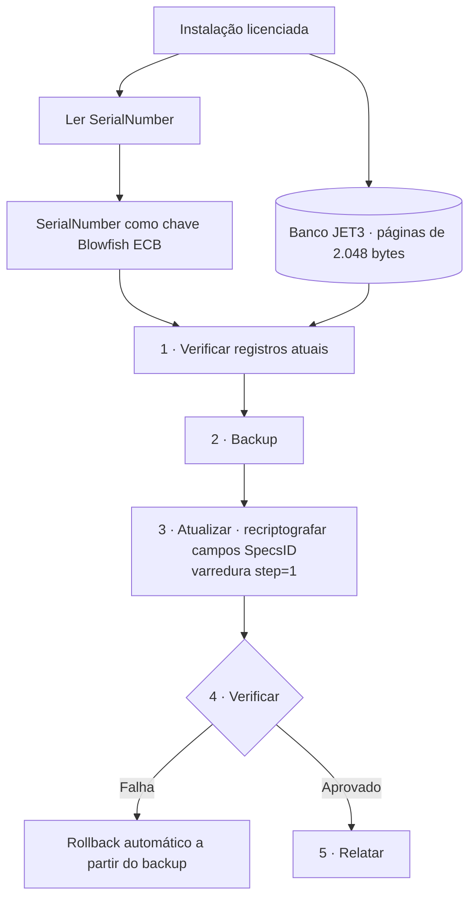

import BeforeAfter from '@/components/case/BeforeAfter.astro';
import StatGrid from '@/components/case/StatGrid.astro';
import Timeline from '@/components/case/Timeline.astro';
import Callout from '@/components/case/Callout.astro';

<Callout kind="scope" lang="pt">
Todo o trabalho foi realizado com autorização explícita de clientes licenciados, para permitir atualizações legítimas de banco de dados em instalações já licenciadas. Nenhum mecanismo de proteção foi distribuído, replicado para uso não autorizado ou usado ofensivamente. Todos os entregáveis permanecem dentro do escopo da licença original do software.
</Callout>

## Contexto

Um sistema legado de alinhamento automotivo (Windows 32 bits, por volta de 2001) guardava seus bancos de especificações de veículos em formato proprietário JET3 / Access 97, com criptografia proprietária. O esquema de licenciamento vinculava cada banco ao hardware do cliente, o que tornava impossível uma atualização legítima sem reinstalação completa. Clientes com licença válida precisavam de dados de veículos atualizados, e o caminho de atualização original do fabricante não funcionava mais.

- **O SerialNumber tinha duas funções ao mesmo tempo** — autenticação e chave criptográfica dos campos SpecsID.
- **O JET3 / Access 97 tem suporte limitado de escrita fora do Windows** — bibliotecas comuns (Jackcess) não conseguiam atualizar campos indexados criptografados.
- **Sem documentação, sem código-fonte, sem pistas** — o esquema precisava ser recuperado por análise binária de caixa-preta.

## O que eu fiz

Usei o Ghidra para análise estática e um assistente de IA para comparar hipóteses de algoritmo com os padrões encontrados no binário. Conferi cada hipótese contra o comportamento observado; o trabalho levou dois dias.

### Dia 1 — Reconhecimento e identificação do algoritmo

- Carreguei no Ghidra o binário PE32 principal da aplicação completa, de ~635MB, e extraí as strings para mapear a superfície da DLL de segurança.
- Encontrei a chamada a `GetVolumeInformationA`, que confirmou um ID de máquina vinculado ao hardware.
- Desmontei a rotina de criptografia na seção `.text`; a assistência de IA acelerou a comparação de padrões de opcodes.
- Reconheci a **assinatura do Blowfish ECB**: um P-array de 18 entradas e quatro S-boxes de 256 entradas, em uma estrutura Feistel clássica.
- Validei a hipótese com um par conhecido de texto claro e texto cifrado, que decifrou para o `SpecsID = 1978` esperado.

### Dia 2 — Implementação e implantação em produção

- Construí a ferramenta de recriptografia em **C** (manipulação binária das páginas JET3) e **Python** (orquestração).
- Mapeei à mão a estrutura das páginas JET3: páginas de 2.048 bytes, com os offsets das linhas gravados do fim para o início.
- Encontrei e corrigi um bug crítico: a varredura de bytes com `step=4` encontrava só 30% dos registros, porque os campos JET3 não são alinhados a 4 bytes. Com `step=1`, a varredura recuperou 100%.
- Empacotei um instalador compatível com Windows 7 32 bits usando PyInstaller (Python 3.8 e um Blowfish em Python puro, sem dependência de ctypes).
- Implementei um fluxo de segurança em 5 fases — **Verificar → Backup → Atualizar → Verificar → Relatar** — com rollback automático.

### Como usei a assistência de IA

O assistente ajudou em três tarefas delimitadas:

1. **Reconhecimento de padrões de opcodes em escala**, em vez de comparar manualmente com mais de 20 assinaturas de algoritmos.
2. **Ordenação de hipóteses** a partir de evidência parcial — quais algoritmos correspondem ao layout observado de P-array e S-boxes?
3. **Validação entre linguagens** — convenções de chamada de Pascal/Delphi identificadas a partir de padrões no binário.

As decisões de análise e implementação continuaram sendo minhas. Confirmei o algoritmo identificado com um par conhecido de texto claro e texto cifrado antes de construir a ferramenta de atualização.

## Como funciona

O SerialNumber da instalação é ao mesmo tempo a verificação de licença e a chave, então a ferramenta o lê, recriptografa cada campo SpecsID no lugar com essa chave e verifica o resultado antes de gerar o relatório. Qualquer verificação com falha restaura o backup automaticamente.

## Resultados

<Timeline title="Dois dias, do binário à entrega" steps={[
  { when: 'Dia 1', title: 'Vínculo com o hardware encontrado', detail: 'Chamada a GetVolumeInformationA no binário' },
  { when: 'Dia 1', title: 'Blowfish ECB identificado', detail: 'Layout de P-array e S-boxes reconhecido' },
  { when: 'Dia 1', title: 'Hipótese confirmada', detail: 'Par conhecido decifrado para SpecsID = 1978', key: true },
  { when: 'Dia 2', title: 'Bug da varredura corrigido', detail: 'step=4 → step=1, de 30% para 100% dos registros' },
  { when: 'Dia 2', title: 'Implantação', detail: '166.144 registros em 15 regiões, fluxo de segurança em 5 fases' },
]} />

<BeforeAfter lang="pt" title="Registros encontrados pela varredura de bytes" items={[
  { label: 'Fração dos registros encontrados, step=4 vs step=1', before: 30, after: 100, beforeText: '30%', afterText: '100%', better: 'higher' },
]} caption="Os campos JET3 não são alinhados a 4 bytes; varrer byte a byte recuperou todos os registros." />

<StatGrid title="Implantação em produção" stats={[
  { value: '166.144', label: 'Registros recriptografados', detail: 'Zero falhas em produção' },
  { value: '15', label: 'Regiões geográficas' },
  { value: '5', label: 'Fases de segurança', detail: 'Com rollback automático' },
]} />

- **166.144 registros** recriptografados em **15 regiões geográficas**, com zero falhas em produção.
- **2 dias de ponta a ponta**, do primeiro contato com o binário à ferramenta entregue.
- **`.exe` independente** entregue para Windows 7/10 (32 e 64 bits).
- **Fluxo de segurança em 5 fases** com rollback automático — nenhum cliente perdeu dados.
- **Metodologia reutilizável** documentada para análises semelhantes de criptografia legada.

## Valor para o negócio

<Callout kind="value" lang="pt">
Clientes que já tinham pagado pela licença receberam dados de veículos atualizados no equipamento que já era seu, sem reinstalação completa e sem depender de um caminho de atualização do fabricante que não funcionava mais. A atualização saiu em dois dias, como um único instalador com rollback automático, para que cada oficina pudesse aplicá-la com segurança, e o método documentado torna mais rápido lidar com o próximo formato legado.
</Callout>

## Aprendizados

- **Confirme a hipótese antes de construir em cima dela.** Um único par conhecido decifrando para `SpecsID = 1978` definiu o algoritmo antes de qualquer linha da ferramenta.
- **Verifique suas suposições de alinhamento.** Uma varredura com `step=4` encontrava em silêncio só 30% dos registros; varrer byte a byte encontrou todos.
- **Mantenha a IA em tarefas delimitadas.** A comparação de padrões e a ordenação de hipóteses ficaram mais rápidas com o assistente; a decisão e a verificação continuaram manuais.
- **Entregue o rollback junto com a atualização.** Verificar → Backup → Atualizar → Verificar → Relatar permitiu alterar 166.144 registros com um caminho de volta em cada etapa.
