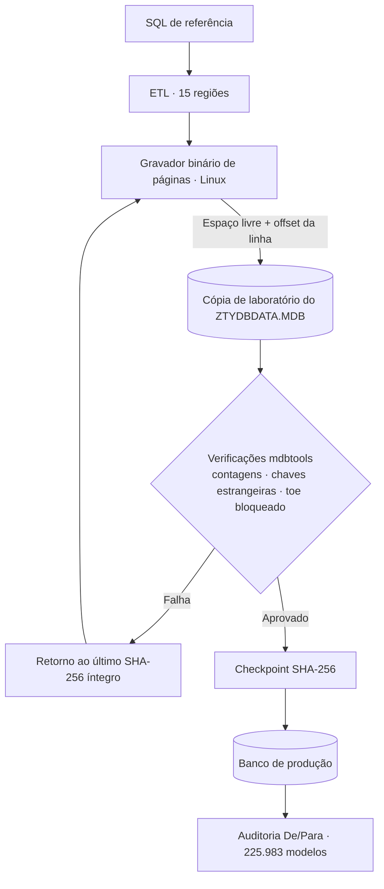

import JetPageLayout from '@/components/case/JetPageLayout.astro';
import BeforeAfter from '@/components/case/BeforeAfter.astro';
import StatGrid from '@/components/case/StatGrid.astro';
import Callout from '@/components/case/Callout.astro';

<Callout kind="scope" lang="pt">
O projeto foi realizado com autorização explícita de um cliente licenciado, para permitir atualizações legítimas de dados de veículos em equipamento de sua propriedade. O mecanismo de licença e o dongle nunca foram alterados, contornados, distribuídos nem usados ofensivamente. Todo o trabalho ficou restrito à base de especificações do próprio cliente e permanece dentro do escopo da sua licença.
</Callout>

## Contexto

Um segundo sistema legado de alinhamento automotivo — de um fabricante diferente do meu [projeto com Blowfish](/portfolio/pt/projects/legacy-crypto-re/) — guardava os dados de especificação dos veículos em um banco JET4 / Access 2000 (`ZTYDBDATA.MDB`). Ao contrário do primeiro sistema, os dados não eram criptografados. O bloqueio era estrutural: a oficina tinha licença válida e uma máquina funcionando, mas a única forma de colocar especificações atuais — incluindo modelos 2025/2026 — era escrever em um banco proprietário que as ferramentas comuns se recusam a modificar.

Os dados dos veículos são especificações funcionais e factuais: geometria de caster, cambagem e convergência (toe) por modelo. O que envelhece nessas máquinas caras não é o hardware, é o banco de dados. É um problema de direito ao reparo.

- **Um índice bloqueado para escrita.** Inserir uma linha em `TVehicleModel` exige atualizar um índice construído sobre uma ordenação com collation chinesa (`SortOrder[2052]`). Nenhuma biblioteca fora do Windows — UCanAccess, Jackcess, mdb-sql — consegue escrever através desse índice. Todas falham no INSERT.
- **Sem um caminho de ETL limpo.** Uma "reconstrução limpa" do banco criou, sem aviso, faixas de ID de fabricante que o software não esperava, gerando "ManuID Err" e regiões duplicadas na interface. A organização regional está codificada em faixas numéricas de `Manufact1` que precisam ser preservadas exatamente.
- **Mais de 200 mil registros com restrições rígidas de correção.** Os campos de toe dianteiro e traseiro são bloqueados e nunca podem mudar, os valores sentinela "N/A" precisam ser preservados e 15 regiões compartilham modelos com especificações conflitantes que precisam ser reconciliadas, não simplesmente mescladas.
- **Nenhuma alternativa aceitável.** As opções eram um conjunto de ferramentas exclusivo do Windows e preso à licença, ou digitação manual dos dados.

## O que eu fiz

Resolvi 100% no Linux, em nível de byte, em um fluxo por fases e auditável.

### Fase 1 — Mapear o formato e o comportamento real do software

As páginas JET4 têm 4.096 bytes; as linhas são gravadas do fim da página para o início, com uma tabela de offsets de linha no cabeçalho. A observação decisiva: examinando o executável, confirmei que o software lista os veículos por **leitura sequencial, e não pelo índice bloqueado**. Uma linha gravada corretamente seria encontrada mesmo que o índice nunca fosse atualizado. Essa observação tornou o INSERT binário viável.

<JetPageLayout lang="pt" />

### Fase 2 — Provar com um registro antes de qualquer coisa em escala

Validei três estratégias de escrita em uma **cópia de laboratório**: UPDATE binário de especificações existentes (`TStandParameter`), reutilização e substituição de espaços obsoletos e, por fim, um INSERT binário de verdade de um veículo novo em `TVehicleModel` + `TStandParameter`. Depois de cada uma, conferi com o mdbtools que contagens, chaves estrangeiras (`Specs1 = Model1`, `Model4 → Manufact1`) e campos de toe bloqueados continuavam intactos.

### Escolhendo o método de inserção

Usei assistentes de código para a estrutura inicial do ETL, para uma revisão independente de integridade e para a documentação. A recomendação inicial deles foi reutilizar e substituir registros obsoletos. Era a opção de menor risco, mas só aproveitava os espaços disponíveis — cerca de 549 veículos — e não comportava a atualização pedida.

Comparei esse limite com o layout das páginas do banco e testei a inserção direta em uma cópia. Só segui adiante depois que o método de escrita e as verificações de integridade funcionaram em amostras controladas.

### Fase 3 — Escalar, auditar, reconciliar

Com uma inserção comprovadamente segura, a abordagem escalou para o conjunto completo de dados de origem: **33.396 veículos novos** inseridos por escrita direta em páginas JET4. Uma auditoria independente (De/Para) contra o SQL de referência confirmou:

- **225.983 modelos** corretos em relação à fonte de referência.
- **41 conflitos de especificação entre regiões** resolvidos manualmente com regras de decisão documentadas (mercado de origem do fabricante, valores conservadores de caster e toe).
- Toda limitação registrada de forma consciente, em vez de escondida.

### Fase 4 — Travar e verificar

Cada versão recebeu um checkpoint com hash SHA-256, para que qualquer etapa fosse reversível. Isso fez diferença: quando a "reconstrução limpa" quebrou a organização regional, voltei direto para o último hash íntegro em vez de depurar um arquivo corrompido. O banco final exportou as 20 tabelas sem erro, com `TVersion` e a configuração do cliente idênticos byte a byte ao original.

## Como funciona

As linhas novas entram no espaço livre da página, com um offset adicionado à tabela de linhas, e o software as encontra por leitura sequencial sem tocar no índice bloqueado. Cada escrita é verificada em uma cópia e registrada por hash antes de chegar à produção, e o banco final é auditado contra a fonte.

## Resultados

<BeforeAfter lang="pt" title="Veículos que a atualização podia incluir" items={[
  { label: 'Veículos novos: reutilização de espaços vs inserção binária', before: 549, after: 33396, beforeText: '~549', afterText: '33.396', better: 'higher' },
]} caption="Reutilizar espaços obsoletos limitava a atualização a cerca de 549 veículos; a inserção binária, validada em cópias, incluiu 33.396." />

<StatGrid title="Banco entregue" stats={[
  { value: '442.505', label: 'Registros reconciliados', detail: '0 órfãos, 0 duplicidades' },
  { value: '225.983', label: 'Modelos conferidos', detail: 'Contra o SQL de referência' },
  { value: '33.396', label: 'Veículos novos inseridos', detail: 'Escrita direta em páginas JET4' },
  { value: '41', label: 'Conflitos entre regiões', detail: 'Resolvidos com regras documentadas' },
]} />

- **33.396 veículos novos** inseridos em um banco JET4 bloqueado para escrita — no Linux, sem Windows, sem driver OLEDB e sem ACE.
- **442.505 registros** no banco de produção entregue, distribuídos em 20 tabelas, reconciliados sem órfãos e sem duplicidades (auditoria independente).
- **225.983 modelos** conferidos contra a fonte de referência; 41 conflitos entre regiões resolvidos com regras de decisão documentadas.
- **Campos bloqueados preservados** — toe dianteiro e traseiro intactos; `TVersion` e configuração do cliente idênticos byte a byte ao original.
- **Histórico completo de versões em SHA-256** com rollback funcionando — nenhum dado perdido, nenhuma regressão na interface.
- **2 dias** de engenharia dedicada.

## Valor para o negócio

<Callout kind="value" lang="pt">
Uma oficina licenciada continuou usando um equipamento que já era seu, em vez de substituí-lo ou depender de ferramentas presas ao Windows: a máquina agora tem especificações atuais, incluindo modelos 2025/2026. A atualização foi entregue em dois dias, com caminho de rollback verificado por hash em cada etapa, e a trilha de auditoria mostra exatamente o que mudou e por quê — 41 conflitos resolvidos por regras escritas, não por palpite.
</Callout>

## Aprendizados

- **Entenda como o software lê.** Confirmar que os veículos são listados por leitura sequencial, e não pelo índice bloqueado, foi o que tornou o INSERT binário possível.
- **Prove com um registro primeiro.** Um único veículo novo, inserido e conferido em uma cópia de laboratório, veio antes de qualquer um dos 33.396.
- **Questione o padrão seguro quando ele não atinge o objetivo.** A reutilização de espaços tinha menos risco, mas parava em cerca de 549 veículos; testar a inserção direta em cópias removeu esse teto.
- **Registre o hash de cada versão.** Quando a "reconstrução limpa" quebrou a organização regional, um checkpoint SHA-256 transformou um arquivo corrompido em um rollback de um passo.
