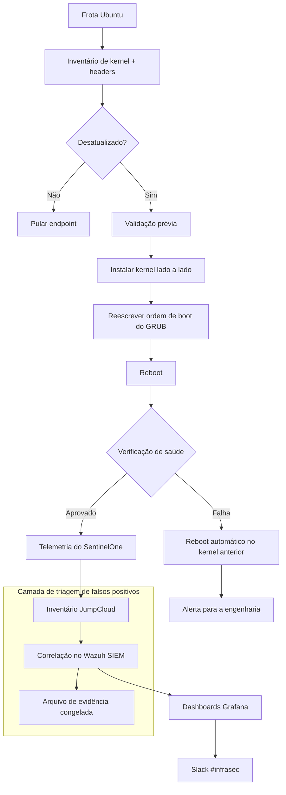

import BeforeAfter from '@/components/case/BeforeAfter.astro';
import StatGrid from '@/components/case/StatGrid.astro';
import Callout from '@/components/case/Callout.astro';

## Contexto

A frota Ubuntu carregava **569.000 vulnerabilidades**, em sua maioria ligadas a kernels desatualizados, cadeias de GRUB sem correção e remediação inconsistente em centenas de endpoints. A engenharia tinha uma meta corporativa de 469.000, e ninguém confiava na automação o bastante para persegui-la sem quebrar a produção.

- **O patching manual** era lento, tinha um raio de impacto sem limite e nunca alcançava a cauda longa.
- **As ferramentas de gestão da frota** mostravam os findings, mas paravam no relatório.
- **A contagem do EDR não era confiável** — kernels já corrigidos continuavam aparecendo como findings abertos por dias.
- **O APT quebrado** em hosts mal configurados podia travar silenciosamente qualquer lote de atualização.

## O que eu fiz

### Ubuntu Kernel Guardian

Construí o **Ubuntu Kernel Guardian**, um framework em Bash + Python que transformou a remediação de kernel em um pipeline determinístico e observável:

- **Descoberta primeiro.** Inventário de cada kernel instalado, pacote de headers e dependência de ferramentas em cada host antes de mexer em qualquer coisa.
- **Atualizações lado a lado, nunca destrutivas.** O novo kernel, os headers e as ferramentas são instalados ao lado dos existentes. O kernel anterior continua presente e inicializável até o novo provar estabilidade em produção.
- **Ordem de boot controlada no GRUB.** O framework reescreve a ordem de boot *antes* do reboot, deixando o novo kernel como padrão e o anterior como opção de reserva. Se a verificação de saúde após o reboot falha, o host reinicia automaticamente no kernel anterior e volta a um estado confiável — sem queda na frota inteira.
- **Validação antes e depois do reboot.** Verificações de saúde controlam cada transição: integridade dos pacotes, resolução de dependências, sintaxe da configuração do GRUB e confirmação da telemetria após o reboot pela API do SentinelOne.
- **Gates de revisão da engenharia** em mudanças de severidade crítica. Atualizações de rotina são totalmente automatizadas; uma pessoa revisa tudo que envolve assinatura de kernel ou transição de LTS.

O framework roda em uma cadência controlada: inventário semanal e lotes semanais de atualização, com rollback automático quando a verificação de saúde falha.

### Quando o EDR não é a fonte da verdade

No meio da implantação, encontramos um problema real. O SentinelOne contava kernels em duplicidade e apontava vulnerabilidades que já tinham sido corrigidas upstream — um kernel saía com a CVE corrigida, mas o inventário do EDR continuava mostrando o finding por dias. Confiar cegamente na contagem do EDR faria nossas métricas mentirem. Criei uma camada paralela de visibilidade:

- **JumpCloud** como referência do inventário de sistema — o que está de fato instalado, com a versão fixada por host.
- **Wazuh SIEM** cruzando o inventário do JumpCloud com os findings do SentinelOne para marcar falsos positivos conhecidos sem descartar o dado.
- **Retenção de evidência congelada.** Mesmo os findings ignorados ficam arquivados em armazenamento frio. Se um "falso positivo" depois se revelar real, ou se Compliance pedir uma trilha de auditoria, o histórico bruto está intacto.

Isso não contorna o EDR — dá ao programa uma segunda fonte, para que a métrica reportada seja a métrica verdadeira.

### Mantendo o APT saudável

Um segundo script cuida da higiene da frota em torno do pipeline de atualização. Os hosts acumulam chaves GPG quebradas, assinaturas de repositório expiradas e caches do APT corrompidos — qualquer um deles pode bloquear silenciosamente uma atualização de kernel e travar o lote inteiro. O script roda toda semana:

- Detecta e repara chaves GPG quebradas ou expiradas quando o `apt update` falha.
- Ressincroniza índices de pacotes corrompidos.
- Separa os hosts que ficam fora do conjunto recuperável para revisão da engenharia.

Sem ele, o pipeline de kernel teria parado na cauda longa de hosts mal configurados.

## Como funciona

Cada host passa por inventário, validação e instalação lado a lado antes do reboot; uma verificação de saúde com falha o devolve ao kernel anterior e alerta a engenharia. Os hosts aprovados alimentam a camada de triagem, que separa os findings reais do ruído do EDR antes de os números chegarem ao Grafana.

## Resultados

<BeforeAfter lang="pt" title="Vulnerabilidades da frota Ubuntu" items={[
  { label: 'Vulnerabilidades da frota, início vs fim', before: 569000, after: 318000, beforeText: '569 mil', afterText: '318 mil' },
  { label: 'Meta corporativa vs resultado', before: 469000, after: 318000, beforeText: 'meta 469 mil', afterText: '318 mil' },
]} caption="Contagem mensal de vulnerabilidades do SentinelOne na frota Ubuntu, início e fim do programa; a segunda linha compara o resultado com a meta corporativa de 469 mil." />

<StatGrid title="Retrato mensal · Grafana" stats={[
  { value: '285.671', label: 'Findings em Linux', detail: '172.952 críticos · 84.993 altos' },
  { value: '30.202', label: 'Findings em Windows', detail: '27.125 críticos' },
  { value: '2.361', label: 'Findings em macOS', detail: '1.145 críticos' },
]} caption="Um retrato mensal do dashboard do Grafana mostrado nas evidências abaixo — uma leitura à parte, não o início nem o fim do programa." />

- **De 569 mil para 318 mil vulnerabilidades** — redução de 44% na frota Ubuntu.
- **151 mil abaixo da meta corporativa de 469 mil** — o resultado ficou 32% abaixo do objetivo.
- **285.671 findings mensais em Linux** acompanhados por severidade (Critical, High, Medium, Low) no retrato mensal, para que a priorização siga os dados.
- **Visibilidade em vários sistemas** — o mesmo pipeline de telemetria estendido para Windows (30.202 findings mensais) e macOS (2.361 findings mensais).
- **Zero incidentes de produção** causados pelo patching automatizado durante a implantação — a validação prévia, a ordem de boot no GRUB e o rollback automático valeram a pena.

## Valor para o negócio

<Callout kind="value" lang="pt">
O maior volume de vulnerabilidades da empresa caiu 251 mil findings e terminou bem abaixo da meta corporativa, sem nenhuma queda causada por patching. A atualização de kernel deixou de ser um evento manual arriscado e virou uma rotina semanal com caminho de volta embutido, e o número reportado passou a ser confiável para Infraestrutura, Segurança e Compliance, porque o ruído foi separado da exposição real com a evidência preservada.
</Callout>

## Aprendizados

- **Descoberta antes de mudança.** Inventariar cada kernel e pacote de headers antes de mexer no host foi o que tornou seguro automatizar os lotes semanais.
- **Nunca destrutivo.** Manter o kernel anterior inicializável fez com que uma verificação de saúde com falha custasse um reboot automático, não uma queda.
- **Não confie em uma única fonte para dados de vulnerabilidade.** O SentinelOne continuou contando kernels corrigidos por dias; o cruzamento com JumpCloud e Wazuh manteve os 318 mil confiáveis.
- **Higiene faz parte do pipeline.** Chaves GPG quebradas e caches velhos do APT teriam travado a cauda longa; repará-los toda semana manteve os lotes andando.
