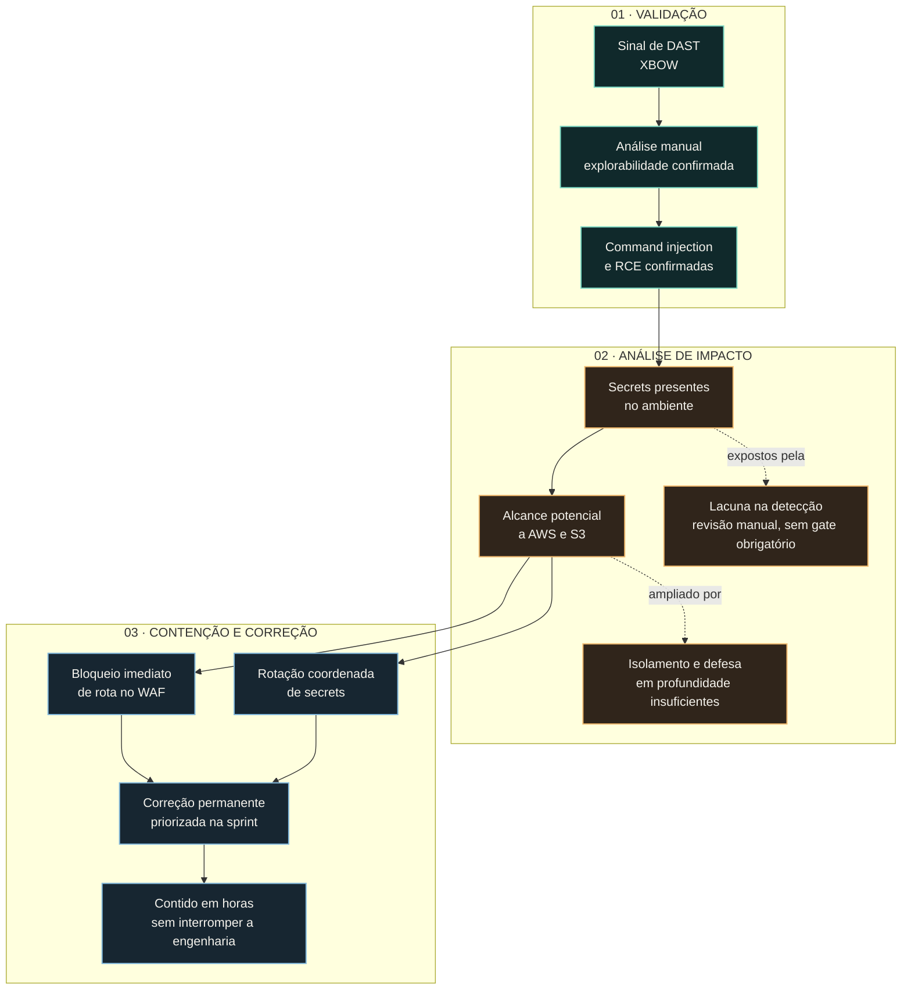

import Timeline from '@/components/case/Timeline.astro';
import Callout from '@/components/case/Callout.astro';

<Callout kind="scope" lang="pt" title="Divulgação responsável">
Relato conceitual sobre vulnerabilidades no produto de um antigo empregador. As falhas foram reportadas e corrigidas. Não incluo payloads, endpoints, rotas ou passos de exploração.
</Callout>

## Contexto

Tudo começou com um sinal de DAST. Uma ferramenta ofensiva automatizada, XBOW, indicou command injection no mecanismo de relatórios. Resultado de scanner é hipótese, não prova, e não bastava para classificar o caso como incidente crítico nem para justificar uma mitigação urgente.

A aplicação web chamava o mecanismo de relatórios diretamente. Se o sinal fosse real, a pergunta não era só se a aplicação podia ser explorada, mas até onde um atacante conseguiria chegar a partir dali.

- **Severidade não confirmada** — um sinal de scanner, ainda sem evidência de explorabilidade.
- **Raio de impacto desconhecido** — ninguém sabia qual limite de confiança a falha atravessava.
- **Pressão de entrega** — a resposta precisava reduzir a exposição sem causar indisponibilidade nem desviar o roadmap.

## O que eu fiz

### Validar: do sinal do scanner ao impacto confirmado

O sinal do XBOW indicou por onde investigar. Avaliei o finding manualmente, confirmei command injection e execução remota de código e então rastreei o impacto no nível necessário para resposta e priorização.

O objetivo era estabelecer três pontos com segurança: se a falha era explorável, qual limite de confiança ela atravessava e qual controle imediato poderia reduzir a exposição. Este relato omite intencionalmente dados de requisição, payloads, rotas e passos de reprodução.

### Dimensionar o raio de impacto

Essa análise revelou secrets expostos no ambiente. A detecção de secrets estava mal configurada e dependia de revisão humana em vez de um controle técnico obrigatório no pipeline — o mesmo modo de falha que eu havia documentado na [auditoria de governança de SAST](/portfolio/pt/projects/sast-governance-audit/). A lacuna não era teórica; ela falhou em uma cadeia de exploração real durante os testes.

Essas credenciais ampliavam o raio de impacto para além da aplicação. Elas criavam um caminho para acesso à AWS, incluindo visibilidade potencial sobre armazenamento no S3. O finding conectou três lacunas de controle: um caminho de execução inseguro, secrets que não foram bloqueados por um gate obrigatório e limites na nuvem que não restringiam suficientemente o alcance potencial.

### Conter sem parar as entregas

O resultado do scanner justificava investigar, mas não bastava para definir a severidade. A validação manual confirmou a RCE; o alcance potencial na nuvem definiu a urgência. Escolhi três ações, nesta ordem:

1. **Bloquear a rota vulnerável no WAF.** Tomei a decisão e apliquei o bloqueio imediato assim que confirmei a RCE, interrompendo o caminho exposto enquanto a correção permanente era preparada.
2. **Rotacionar os secrets expostos.** Coordenei com o time responsável a invalidação das credenciais para fechar a exposição imediata na nuvem.
3. **Conduzir a correção permanente pela sprint.** Encaixei a remediação no fluxo normal de entrega do time, priorizada pelo incidente sem deslocar o restante do roadmap.

O trade-off foi deliberado: o bloqueio no WAF era uma contenção rápida, não uma correção. Ele deu tempo para que a correção do código seguisse o processo normal de entrega, em vez de uma mudança emergencial.

## Como funciona

O diagrama separa o que confirmei (validação), o que a falha poderia alcançar (impacto) e o que fiz em seguida (resposta). AWS/S3 aparece como impacto potencial, não como alegação de acesso confirmado a dados. A contenção ocorreu em paralelo enquanto a correção permanente avançava pela sprint.

## Resultados

<Timeline title="Resposta" steps={[
  { when: 'Sinal', title: 'XBOW aponta possível command injection', detail: 'Tratado como hipótese, não como prova' },
  { when: 'Validação', title: 'RCE confirmada manualmente', detail: 'Impacto rastreado até secrets expostos e alcance potencial a AWS/S3' },
  { when: 'Na confirmação', title: 'Rota vulnerável bloqueada no WAF', detail: 'Caminho exposto interrompido enquanto a correção era preparada', key: true },
  { when: 'Em paralelo', title: 'Secrets expostos rotacionados', detail: 'Coordenado com o time responsável' },
  { when: 'Em horas', title: 'Exposição contida', detail: 'A engenharia continuou entregando' },
  { when: 'Sprint', title: 'Correção permanente do código entregue', detail: 'Pelo fluxo normal de entrega' },
]} />

- **RCE confirmada manualmente**, o que justificou reclassificar o finding com base em evidência, não apenas na severidade indicada pelo scanner.
- **Exposição contida em horas** com bloqueio de rota no WAF e rotação coordenada de secrets.
- **Zero interrupção da sprint** — a correção permanente seguiu o fluxo normal de entrega do time e o restante do roadmap continuou andando.
- **Lacuna na detecção de secrets comprovada na prática** — revisão humana sem controle obrigatório deixou passar credenciais expostas.
- **Falha reportada e corrigida** pelo processo responsável.

## Valor para o negócio

<Callout kind="value" lang="pt">
Uma vulnerabilidade crítica com alcance potencial ao armazenamento na nuvem foi neutralizada em horas, sem indisponibilidade e sem tirar a engenharia do roadmap. O incidente também transformou duas lacunas abstratas — detecção de secrets dependente de revisão humana e limites frágeis na nuvem — em prioridades sustentadas por evidência, a favor de controles que funcionem antes que um incidente alcance dados de produção.
</Callout>

## Aprendizados

- **Sinal de scanner define a investigação, não a severidade.** O XBOW apontou a falha; só a validação manual justificou tratá-la como crítica.
- **Credenciais alcançáveis a partir do código transformam um bug de aplicação em risco de infraestrutura.** Foram os secrets expostos que estenderam o alcance potencial até a AWS e o S3.
- **Primeiro conter, depois corrigir direito.** O bloqueio no WAF reduziu a exposição na hora; ele não substituiu a correção do caminho vulnerável no código, que seguiu pela sprint.
- **Camadas ausentes pesam mais que a habilidade do atacante.** A exploração não exigiu um ataque excepcionalmente sofisticado, o que apontou para camadas de segurança ausentes no fluxo de código, não para um atacante extraordinário.
