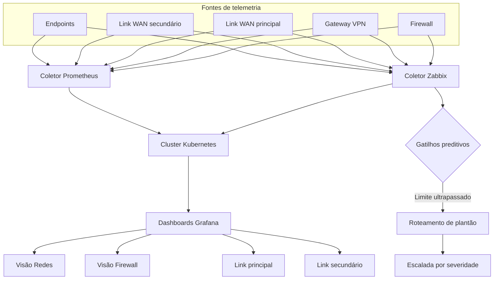

import BeforeAfter from '@/components/case/BeforeAfter.astro';
import StatGrid from '@/components/case/StatGrid.astro';
import Callout from '@/components/case/Callout.astro';

## Contexto

A Volt Sport operava uma rede de varejo multi-filial em que cada loja era um segmento L2 plano atrás de um gateway de padrão residencial. Não havia como saber se uma filial estava saudável, lenta ou sob ataque até o cliente reclamar no caixa. Faltavam defesa e visibilidade, e as duas precisavam ser construídas juntas: não dá para corrigir o que não se vê, e não dá para ver o que não se alcança.

- **Sem segmentação** — POS, retaguarda, Wi-Fi de visitantes e periféricos dividiam a mesma rede.
- **Sem IDS/IPS** — o gateway fazia NAT e DHCP e mais nada.
- **Acesso remoto exposto** — RDP e redirecionamento de portas improvisado no lugar de VPNs.
- **Sem telemetria** — os sinais de firewall, links WAN e endpoints não chegavam a nenhum lugar onde alguém pudesse lê-los.

## O que eu fiz

### Camada de defesa

Implantei uma stack de segurança por filial com três pilares:

- **pfSense como gateway da filial** — segmentação em VLANs por função (POS, retaguarda, Wi-Fi de visitantes, IoT/periféricos), com o tráfego entre VLANs controlado por regras explícitas e bloqueio padrão entre segmentos.
- **Suricata IDS/IPS na borda do pfSense** — detecção no perímetro e no tráfego interno (leste-oeste), com o conjunto de regras ajustado ao tráfego de varejo (protocolos de POS, gateways de pagamento, APIs de fornecedores) em vez de ruído genérico.
- **VPNs site a site e de acesso remoto** — as filiais se conectam à matriz por IPsec, e o acesso de administradores e fornecedores exige uma sessão VPN autenticada, e não um IP público.

Os logs do Suricata e o estado do pfSense alimentam o [Wazuh](/portfolio/pt/projects/wazuh-soc/), onde são correlacionados com os eventos de autenticação do Active Directory. Uma força bruta no firewall de uma filial e um bloqueio de conta no AD da matriz aparecem como o mesmo incidente, e não como dois alertas sem relação.

### Camada de visibilidade

Para investigar incidentes nas filiais, eu precisava de uma visão confiável da saúde da WAN e da atividade dos firewalls, então construí uma plataforma de monitoramento separada, publicada como código aberto em [`Network_Monitoring`](https://github.com/CHDevSec/Network_Monitoring):

- **Zabbix** como coletor ativo — SNMP e ICMP contra firewalls, gateways VPN, links WAN principal e secundário e sensores de endpoint, com intervalos de coleta definidos pela criticidade de cada ativo.
- **Prometheus** coletando dos mesmos equipamentos — exporters nos firewalls, sondas próprias nos circuitos WAN e node exporters nos endpoints.
- **Kubernetes** hospedando a stack inteira — Zabbix, Prometheus, exporters e Grafana rodam como workloads com limites de recursos, volumes persistentes para as séries temporais e ingress isolado. Nada no firewall da filial toca a camada de dashboards.
- **Grafana** como interface do operador — visões *Redes*, *Firewall*, *Link principal* e *Link secundário*, todas lendo dos mesmos bancos de séries temporais, para que uma anomalia apareça de qualquer ângulo.
- **Gatilhos preditivos** no Zabbix — limites ultrapassados em janela móvel escalam pelo roteamento de plantão conforme a severidade, então um link WAN em degradação é detectado antes de a filial relatar a queda.

Dois coletores nas mesmas fontes são uma conferência deliberada, e não redundância por si só. Quando um mostra verde e o outro vermelho, o problema é uma sonda com defeito, e não um incidente na filial.

## Como funciona

Cada fonte é lida por dois coletores independentes rodando em Kubernetes. O Grafana apresenta quatro visões dos mesmos dados, e os gatilhos preditivos do Zabbix levam a degradação ao plantão antes que ela vire uma queda.

## Resultados

<BeforeAfter lang="pt" title="Superfície de ataque por filial" items={[
  { label: 'Vetores de ataque, relativo ao anterior', before: 100, after: 30, beforeText: '100%', afterText: '~30%' },
]} caption="Medido pelo escopo do pentest antes e depois da mudança e pelo inventário de serviços expostos." />

<StatGrid title="O que cada filial roda" stats={[
  { value: '4', label: 'Segmentos VLAN', detail: 'POS, retaguarda, Wi-Fi de visitantes, IoT' },
  { value: '5', label: 'Fontes de telemetria', detail: 'Firewall, VPN, 2 links WAN, endpoints' },
  { value: '2', label: 'Coletores independentes', detail: 'Zabbix e Prometheus' },
  { value: '4', label: 'Visões no Grafana', detail: 'Redes, firewall, link principal e secundário' },
]} />

- **~70% menos vetores de ataque por filial**, medidos pelo escopo do pentest antes e depois da mudança e pelo inventário de serviços expostos.
- **Firewall, WAN principal, WAN secundária e sensores de endpoint** visíveis em tempo real, então um link de filial com falha é detectado antes de os caixas perceberem.
- **Os incidentes começam com dados, e não com telefonemas** — os dashboards do Grafana são a primeira tela do operador de plantão.
- **Os alertas disparam na degradação, e não só na queda** — o time consegue agir sobre um link com falha antes de os clientes perceberem.
- **A plataforma continuou em produção depois que saí**, e o código é aberto.

## Valor para o negócio

<Callout kind="value" lang="pt">
Cada loja passou de uma rede plana e aberta para uma rede segmentada com cerca de 70% menos portas de entrada, o que reduz diretamente a chance de um dispositivo de visitante ou uma conexão de fornecedor comprometidos chegarem ao ponto de venda. A operação deixou de descobrir problemas nas filiais pelos clientes no caixa: a degradação dos links chegava ao plantão enquanto ainda havia tempo de agir, o que protege as vendas na loja.
</Callout>

## Aprendizados

- **Defesa e visibilidade são um projeto só.** O corte de ~70% veio do perímetro, mas só a stack de monitoramento mostrava se cada filial estava de fato saudável.
- **Dois coletores são uma vantagem.** Zabbix e Prometheus consultando as mesmas fontes custaram um pouco mais de CPU e deram de graça uma conferência da precisão das sondas.
- **Ajuste ao tráfego.** Os padrões do Suricata eram ruído em uma rede de varejo; o conjunto de regras ganhou seu lugar quando passou a refletir o tráfego de POS, pagamentos e fornecedores.
- **Preveja, não só alerte.** Os gatilhos em janela móvel sinalizavam a tendência antes da queda, e foi isso que permitiu às filiais recuperar links antes de os clientes sentirem.
