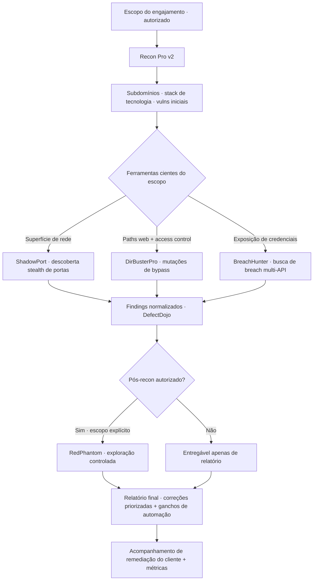

import StatGrid from '@/components/case/StatGrid.astro';
import Callout from '@/components/case/Callout.astro';

## Contexto

A CHDevSec é minha prática independente de consultoria — trabalho ofensivo e defensivo de ponta a ponta para clientes que precisam de mais do que a saída de um scanner. Esta página é uma visão geral da prática, não um projeto único: o que ofereço, como um engajamento acontece e as ferramentas públicas por trás dele.

- **Pentest** — aplicações web, APIs, infraestrutura na nuvem (AWS, GCP, Azure) e redes internas.
- **Hardening de Linux** — alinhado ao CIS, com variação mensurável de score antes e depois.
- **Wazuh SIEM** — implantação, ajuste de regras e playbooks operacionais sob medida para o ambiente do cliente.
- **Integração DevSecOps** — gates de SAST / SCA / IaC / secrets no CI/CD do cliente, sem desacelerar a engenharia.
- **Gestão de vulnerabilidades** — priorização com DefectDojo e acompanhamento da remediação de ponta a ponta.

O problema que me contratam para resolver é o mesmo em todas essas linhas: findings sem plano de remediação não mudam nada.

## O que eu fiz

### Como trabalho

Todo engajamento termina com:

- **Correções priorizadas** por explorabilidade e impacto no negócio, não pelo CVSS bruto.
- **Ganchos de automação** para detectar o problema da próxima vez — cada engajamento vira a linha de base do próximo.
- **Métricas que o cliente consegue acompanhar** — redução de risco em números, não em adjetivos.
- **Transferência de conhecimento** — o time interno de segurança consegue executar o mesmo playbook sem mim na sala.

### Por que construo minhas próprias ferramentas

Todo scanner de prateleira resolve o caso médio. Engajamentos reais vivem na cauda longa — o bypass específico que a wordlist não tem, a correlação entre várias fontes que nenhuma ferramenta isolada mostra, o formato de relatório que o CISO do cliente realmente lê. Comprar ou pegar ferramentas emprestadas é herdar as premissas dos outros; construí-las é dominar a abstração.

Escrever ferramentas ofensivas também me obriga a entender as técnicas no nível do código, não das flags de CLI. O hardening que consigo ensinar a um cliente é exatamente tão profundo quanto o ataque que consigo reimplementar do zero. Cada ferramenta pública começou como um ponto de atrito em um escopo real.

### As ferramentas públicas

- **[RedPhantom](https://github.com/CHDevSec/RedPhaton) — framework de red team.** Operações maduras de red team precisam de reconhecimento, exploração, pós-exploração e C2 sob o mesmo teto; costurar ferramentas díspares com shell scripts é como as assinaturas de detecção te encontram. Um framework Python unificado que integra fuzzing, geração de cadeias de exploração, módulos de CVEs recentes de kernel (Windows + Linux), ofuscação de payload, C2 multiprotocolo (HTTP/HTTPS/TCP/DNS) e uma suíte de ataque a Active Directory. É de uso exclusivo sob autorização — o README abre com essa condição.
- **[Recon Pro v2](https://github.com/CHDevSec/Recon_pro_v2) — toolkit de reconhecimento web.** Todo engajamento web começava com o mesmo glue script juntando fontes de subdomínios. Um framework Python modular que consolida Subfinder, Assetfinder, Amass, Findomain, Chaos e as APIs SecurityTrails / Shodan / VirusTotal / Censys / crt.sh / Certspotter, com um fuzzer para painéis admin, arquivos sensíveis e endpoints de API, e um engine de vulnerabilidades para SQLi, XSS, LFI, RFI, RCE, SSTI e XXE com confidence scoring. Relatórios em HTML interativo, JSON, CSV e resumo executivo.
- **[ShadowPort](https://github.com/CHDevSec/ShadowPort) — descoberta stealth de portas.** Perfis de scan padrão são reconhecidos por assinatura pela detecção moderna (NDR, Suricata, Snort). Um scanner TCP / UDP / SYN com packet crafting customizado via Scapy, fingerprinting de serviço, banner grabbing, enumeração DNS e teste de credencial SSH com rate-limit, e saída em JSON / XML / TXT / CSV para ferramentas downstream.
- **[BreachHunter](https://github.com/CHDevSec/BreachHunter) — auditoria de exposição de credenciais.** Responder "algum e-mail dos nossos funcionários está exposto em um breach?" exige consultar várias bases de breach, cada uma com sua API, rate limit e lacunas. Uma ferramenta Python que integra Breached.me, LeakCheck.io e HaveIBeenPwned, processa listas de e-mail em lote, respeita os rate limits por API e emite relatórios CSV com a atribuição da fonte do breach por finding.
- **[DirBusterPro](https://github.com/CHDevSec/DirBusterPro) — descoberta de bypass de access control.** Vulnerabilidades reais de access control vivem em casos de path encoding em que o WAF e a aplicação discordam. Um scanner Python multithread (até 50 simultâneos) que roda cada path candidato por uma bateria de mutações de bypass e compara respostas por status, tamanho e content hash. Suporta session management, proxy HTTP / SOCKS e Basic Auth.
- **[Recon Pro v1](https://github.com/CHDevSec/recon_pro.py) — `recon_pro.py`.** A primeira tentativa, em arquivo único, de um framework de recon unificado para escopos de bug bounty e pentest, combinando ferramentas de subdomínio com Shodan / SecurityTrails / crt.sh, detecção de tecnologia, fuzzing ciente de contexto, Google Dorking e um dashboard HTML. Ensinou o que *não* fazer em escala.

### O que fica privado

Uma segunda camada de ferramentas — cadeias de exploração, utilitários de pós-exploração e automação específica do cliente — fica fora do GitHub por decisão. Publicar ferramentas ofensivas prontas para mau uso sem contexto troca um pequeno ganho de portfólio por um custo real ao ecossistema mais amplo. Essas ferramentas ficam disponíveis a clientes sob engajamentos contratados, com o mesmo cuidado que se aplica a qualquer entregável que toca o ambiente deles.

## Como funciona

O diagrama é o fluxo *típico*, não uma sequência fixa. Engajamentos reais pulam fases (um escopo apenas de revisão de código nunca toca o RedPhantom) e revisitam fases conforme surge contexto novo. A exploração só acontece com autorização explícita; caso contrário, o entregável é um relatório.

## Resultados

<StatGrid title="Ferramentas públicas · github.com/CHDevSec" stats={[
  { value: 'RedPhantom', label: 'Framework de red team', detail: 'CHDevSec/RedPhaton' },
  { value: 'Recon Pro v2', label: 'Reconhecimento web', detail: 'CHDevSec/Recon_pro_v2' },
  { value: 'ShadowPort', label: 'Descoberta stealth de portas', detail: 'CHDevSec/ShadowPort' },
  { value: 'BreachHunter', label: 'Auditoria de exposição de credenciais', detail: 'CHDevSec/BreachHunter' },
  { value: 'DirBusterPro', label: 'Bypass de access control', detail: 'CHDevSec/DirBusterPro' },
  { value: 'Recon Pro v1', label: 'Recon em arquivo único', detail: 'CHDevSec/recon_pro.py' },
]} />

- **6 ferramentas open-source** públicas no GitHub, cobrindo reconhecimento, descoberta de portas, exposição de credenciais, bypass de access control e operações de red team.
- **Recon Pro v2** comprime as primeiras 4 horas de um engajamento web em um comando, com o relatório do cliente cerca de 80% escrito quando o scan termina.
- **BreachHunter** transforma um check de exposição de 500 e-mails — cerca de uma semana na mão, em várias bases de breach — em uma execução que termina numa pausa para o café, com atribuição por fonte.
- **DirBusterPro** revela bypasses de access control que sobrevivem a um teste de forma única, com evidência concreta na resposta (status, tamanho, content hash).
- **RedPhantom** roda de uma única CLI o trabalho que, de outra forma, exigiria meia dúzia de ferramentas atrás de um orquestrador caseiro.
- **Recon Pro v1** foi testado em produção por mais de um ano antes do rewrite modular da v2, e segue público para escopos rápidos.

## Valor para o negócio

<Callout kind="value" lang="pt">
O cliente recebe mais do que uma lista de findings: correções ordenadas por explorabilidade e impacto no negócio, ganchos de detecção para que o mesmo problema seja pego na próxima vez, métricas para acompanhar a redução de risco e um playbook que o próprio time consegue executar. As ferramentas públicas permitem ao cliente avaliar a profundidade do trabalho antes de contratar; a camada privada é usada apenas sob escopo contratado e autorizado.
</Callout>

## Aprendizados

- **O toolkit é a prova.** Qualquer um lê o OWASP Top 10; o trabalho é pegar os casos que o playbook não lista — por isso cada ferramenta nasceu de uma lacuna em um escopo real.
- **Abrir o que ensina, reter o que poderia ser usado como arma.** Reconhecimento e descoberta pertencem ao aberto; cadeias de exploração e técnicas ao vivo ficam atrás de escopo autorizado.
- **Findings são o começo, não o entregável.** Um pentest que não produz uma mudança mensurável de postura é só uma observação cara, então todo engajamento termina com correções, ganchos e métricas.
- **Defesa e ataque são a mesma habilidade vista de dois lados.** Implantações de Wazuh e gates de DevSecOps são como findings ofensivos param de ser recorrentes.