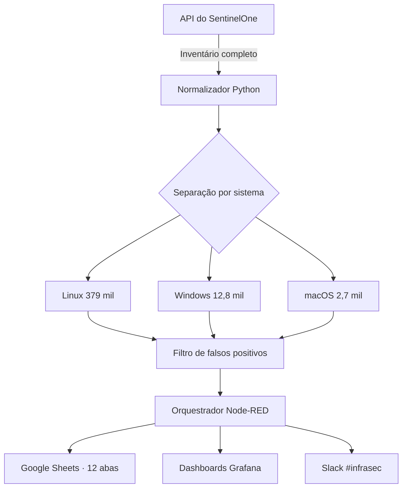

import BeforeAfter from '@/components/case/BeforeAfter.astro';
import StatGrid from '@/components/case/StatGrid.astro';
import Callout from '@/components/case/Callout.astro';

## Contexto

A interface do SentinelOne mostra vulnerabilidades um endpoint por vez. A frota gerava centenas de milhares de findings entre Linux, Windows e macOS, e o time de segurança montava o reporte à mão toda semana. Cada reunião começava de uma exportação nova, e os falsos positivos ocupavam parte de toda discussão.

- **Sem visão central** — cada sistema operacional era lido separadamente, endpoint por endpoint.
- **Sem histórico** — ninguém sabia dizer se a semana estava melhor ou pior que o mês anterior.
- **Sem alerta antecipado** — picos eram descobertos na reunião semanal, não quando aconteciam.
- **Ruído** — CVEs de kernel já corrigidas upstream continuavam aparecendo por dias.

## O que eu fiz

### Coletar e normalizar

Escrevi um serviço em Python que puxa o inventário completo de vulnerabilidades pela API do SentinelOne, com timeout e novas tentativas, e normaliza os registros em um único esquema para Linux, Windows e macOS. As credenciais vêm do ambiente, e a execução falha logo quando alguma está ausente.

### Filtrar o ruído, manter a trilha de auditoria

O filtro de falsos positivos é a parte que conquistou a confiança do time. Regras declarativas comparam aplicação, fabricante e sistema operacional. Elas removem CVEs de kernel já corrigidas upstream que o SentinelOne continuava apontando até reconciliar o inventário, correspondências que o próprio fabricante reconhece como falsas e duplicatas de instalações com mais de um agente. Todo finding filtrado é gravado em armazenamento frio, para que um "falso positivo" que se revele real possa ser recuperado.

### Entregar onde as pessoas já olham

O Node-RED orquestra uma execução semanal toda sexta-feira e um relatório mensal consolidado. A saída vai para 12 abas do Google Sheets (Top 10, Histórico, Comparação semanal e outras), para dashboards do Grafana com tendências por sistema, severidade e aplicação, e para o canal `#infrasec` no Slack quando um limite é ultrapassado.

## Como funciona

Uma coleta, um esquema, um filtro e três saídas: Sheets para o reporte, Grafana para as tendências e Slack para os limites.

## Resultados

<BeforeAfter lang="pt" title="Esforço de reporte semanal" items={[
  { label: 'Tempo de reporte manual, relativo ao anterior', before: 100, after: 25, beforeText: '100%', afterText: '25%' },
]} />

<StatGrid title="Retrato de produção · uma sincronização" stats={[
  { value: '394.706', label: 'Vulnerabilidades processadas', detail: 'Frota inteira, uma execução' },
  { value: '379.154', label: 'Linux', detail: '284.240 críticas' },
  { value: '12.831', label: 'Windows', detail: '4.931 críticas' },
  { value: '2.721', label: 'macOS', detail: '1.444 críticas' },
]} />

- **394.706 vulnerabilidades processadas** em uma única sincronização, sem SQL manual nem rolagem de console.
- **75% menos tempo** gasto no reporte manual semanal.
- **Picos identificados em minutos** pelas tendências do Grafana e pelos limites no Slack, e não na reunião seguinte.
- **Segurança, Infraestrutura e Compliance** trabalhando a partir da mesma fonte de dados.
- **Código aberto** publicado para reuso.

| Sistema | Crítica | Alta   | Média  | Baixa | Total   |
| ------- | ------: | -----: | -----: | ----: | ------: |
| Linux   | 284.240 | 55.748 | 31.070 | 8.096 | 379.154 |
| Windows |   4.931 |  7.707 |    116 |    77 |  12.831 |
| macOS   |   1.444 |    864 |    147 |   266 |   2.721 |

## Valor para o negócio

<Callout kind="value" lang="pt">
Três quartos das horas que iam para montar o reporte semanal voltaram para o time. A liderança passou a ver uma tendência semanal e mensal em vez de um retrato isolado, Compliance ganhou um registro consistente do que estava aberto, do que foi filtrado e por quê, e os picos chegaram a quem podia agir enquanto ainda eram pequenos.
</Callout>

## Aprendizados

- **A confiança vem do filtro, não do volume.** Os times passaram a agir sobre os números quando os falsos positivos conhecidos saíram e toda exclusão ficou recuperável.
- **Entregue dentro dos hábitos que já existem.** Sheets para a reunião, Grafana para tendências e Slack para alertas: ninguém precisou aprender uma ferramenta nova.
- **Normalize primeiro.** Um esquema único para três sistemas operacionais foi o que tornou possível comparar um com o outro.
