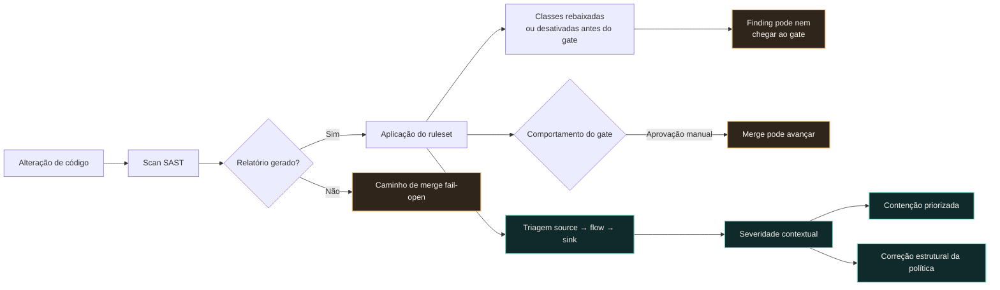

import StatGrid from '@/components/case/StatGrid.astro';
import Callout from '@/components/case/Callout.astro';

## Contexto

A organização acreditava que o pipeline SAST era rígido. Os times sentiam todos os dias o atrito de alertas e aprovações, então presumiam que o pipeline protegia os merges. Minha missão foi verificar o comportamento configurado, não a intenção descrita. O atrito existia; a proteção, não.

- **Um controle que ninguém tinha seguido de ponta a ponta** — da saída do scanner até a decisão de merge.
- **Atrito confundido com proteção** — aprovações e alertas pareciam um bloqueio.
- **Confiança desgastada nos findings** — o excesso de falsos positivos fazia os times desconsiderarem o que o scanner reportava.

## O que eu fiz

### Seguir a política, não a documentação

Segui a política desde a saída do scanner até a decisão de merge e encontrei um desenho estrutural fail-open:

- **Aprovação, não bloqueio** — o gate solicitava aprovação manual em vez de falhar o pipeline. Criava uma pausa, não um bloqueio técnico.
- **Classes removidas antes do gate** — a configuração do ruleset rebaixava ou desativava classes inteiras de vulnerabilidades antes que chegassem ao gate.
- **Sem relatório, sem verificação** — quando o scanner não produzia um relatório, o merge ainda podia prosseguir.

Em conjunto, esses comportamentos faziam o controle parecer rígido enquanto permitiam justamente o resultado que ele deveria impedir. Era um problema de governança e de policy as code, não de falta de regras no scanner.

### Melhorar o sinal antes de ampliar a cobertura

Aumentar a cobertura antes de melhorar a triagem só elevaria o ruído e facilitaria ignorar o gate. Desenvolvi um método source → flow → sink para avaliar cada finding em contexto:

1. **Source:** a entrada pode ser controlada por um atacante?
2. **Flow:** existe neutralização ou validação real ao longo do caminho?
3. **Sink:** a execução alcança a operação perigosa?

Essa análise de fluxo de dados separava caminhos de exploração plausíveis do ruído do scanner e deu aos times uma base defensável para severidade e correção.

### Separar contenção de correção

Para cada achado, separei a contenção de curto prazo da correção estrutural de longo prazo, para que os times pudessem reduzir a exposição de imediato sem esperar o redesenho da política.

## Como funciona

Esta visão conceitual resume o caminho de decisão auditado e o método de triagem; não reproduz a configuração interna das políticas.

Os nós em âmbar são os três caminhos fail-open: sem relatório, classes filtradas antes do gate e uma aprovação que deixa o merge seguir. Os nós em verde-azulado são o método de triagem, que transforma um finding em severidade contextual e em uma correção em duas frentes.

## Resultados

<StatGrid title="Entregas da auditoria" stats={[
  { value: '8', label: 'Achados estruturais', detail: 'Severidade contextual, não CVSS bruto' },
  { value: '3', label: 'Caminhos fail-open', detail: 'Aprovação, ruleset, relatório ausente' },
  { value: '6 páginas', label: 'Relatório executivo', detail: 'Com plano de remediação priorizado' },
  { value: '1', label: 'Mapa de ponta a ponta', detail: 'Da saída do scanner ao merge' },
]} />

| Caminho fail-open | Como parecia | O que de fato fazia |
| --- | --- | --- |
| Aprovação manual | Um gate rígido | Pausava o merge e depois o deixava seguir |
| Filtro do ruleset | Cobertura completa do scanner | Removia classes inteiras de vulnerabilidades antes do gate |
| Relatório ausente | Um scan aprovado | Deixava o merge seguir sem nenhum resultado |

- **O primeiro mapa técnico de ponta a ponta** do comportamento real da governança SAST, da saída do scanner ao merge.
- **8 achados estruturais**, cada um classificado por severidade contextual em vez de apenas CVSS bruto.
- **3 caminhos fail-open** identificados e explicados, cada um com contenção de curto prazo e correção de longo prazo.
- **Um relatório executivo de 6 páginas** e um plano de remediação priorizado que os times podiam aplicar nos próprios pipelines.
- **O gate passou a ser hard fail** depois da auditoria — a primeira contenção aplicada, então um finding bloqueante agora impede o merge em vez de só pausá-lo.

## Valor para o negócio

<Callout kind="value" lang="pt">
A auditoria substituiu "temos um gate rígido" por uma visão baseada em evidências: o que o controle fazia, onde falhava aberto e o que mudar primeiro. A liderança deixou de contar com um controle que não protegia os merges — o gate passou a ser hard fail — e os times receberam um plano priorizado que colocava a contenção primeiro, em vez de uma ampliação da cobertura do scanner que só traria mais ruído.
</Callout>

## Aprendizados

- **Audite o comportamento configurado, não a intenção.** Todos os times acreditavam que o gate bloqueava; só seguir a política mostrou que ele pedia aprovação e deixava o merge passar.
- **Atrito não é proteção.** Alertas e aprovações diárias faziam o controle parecer rígido enquanto três caminhos falhavam aberto.
- **Melhore o sinal antes da cobertura.** Com a confiança nos findings já desgastada, o método source → flow → sink veio antes de qualquer regra nova.
- **Separe contenção de correção.** Dividir a correção rápida da estrutural dá aos times uma forma de reduzir a exposição sem esperar o redesenho da política.
