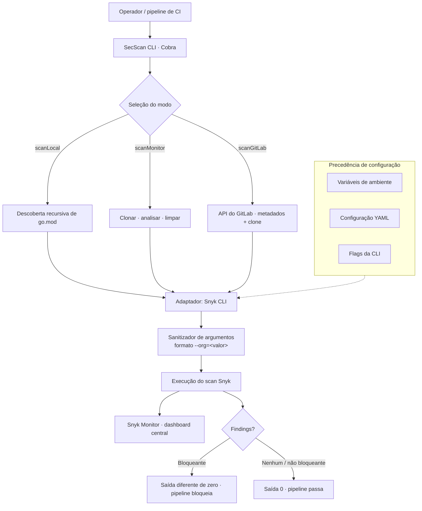

import StatGrid from '@/components/case/StatGrid.astro';
import Callout from '@/components/case/Callout.astro';

## Contexto

Executar o Snyk em uma frota de microsserviços Go significava rodar a CLI à mão para cada repositório, cada branch e cada pipeline. Os engenheiros pulavam os scans ou copiavam shell scripts que divergiam entre times, e cada integração com o GitLab exigia código de cola próprio.

- **Nenhuma forma consistente de analisar** dezenas de serviços Go em escala.
- **Sem modo em lote** — cada repositório era uma execução manual.
- **Sem integração limpa com o GitLab** — IDs de projeto exigiam scripts customizados toda vez.
- **Sem saída estável para pipelines** — um scan que rodou nem sempre era um scan registrado no Snyk.

## O que eu fiz

### Um binário, três modos

Construí o SecScan em Go: um orquestrador de linha de comando que envolve a Snyk CLI com três modos bem definidos.

- **scanLocal** — descobre recursivamente os arquivos `go.mod` de um workspace e analisa cada um como projeto separado.
- **scanMonitor** — clona um ou vários repositórios de uma lista de URLs, analisa e limpa tudo depois.
- **scanGitLab** — recebe o ID de um projeto do GitLab, busca os metadados pela API e analisa o repositório com as credenciais corretas.

Os três modos alimentam o Snyk Monitor para dashboards centralizados, leem a configuração de `.env`, YAML e flags da CLI em uma precedência fixa e retornam códigos de saída que o pipeline usa como gate.

### Decisões de engenharia

- **Arquitetura hexagonal** — a camada de CLI (Cobra), os adaptadores (Snyk CLI, Git, GitLab) e a lógica de domínio ficam separados por ports, então cada adaptador pode ser substituído por mock nos testes.
- **Sanitização de argumentos** — a formatação explícita `--org=<value>` evita uma ambiguidade de parsing da Snyk CLI (`--org=true`) que encontrei em produção.
- **Isolamento de credenciais** — os segredos ficam em variáveis de ambiente, nunca em argumentos nem em arquivos temporários.
- **Lotes de repositórios** — `--repo-file` aceita uma lista de URLs para análise paralela com GNU parallel.
- **Templates de CI** — pipelines de GitHub Actions, GitLab CI e Jenkins documentados no README.

A parte difícil de envolver uma CLI são os casos de borda: credenciais Git transitórias, o bug de parsing do `--org` e a diferença entre "o scan rodou" e "o scan rodou e foi registrado no dashboard do Snyk". É nessa camada fina que está a engenharia.

## Como funciona

Três pontos de entrada convergem para um único adaptador do Snyk, então todo scan recebe os mesmos argumentos sanitizados, o mesmo registro no Snyk Monitor e o mesmo contrato de código de saída.

## Resultados

<StatGrid title="O que foi entregue" stats={[
  { value: '60%+', label: 'Adoção no stack Go', detail: 'Um binário no lugar de scripts improvisados' },
  { value: '3', label: 'Modos de scan', detail: 'Local, lista remota, projeto GitLab' },
  { value: '3', label: 'Templates de CI', detail: 'GitHub Actions, GitLab CI, Jenkins' },
  { value: '3', label: 'Fontes de configuração', detail: 'Ambiente, YAML, flags da CLI' },
]} />

- **Adotado em mais de 60% do stack Go**, substituindo shell scripts improvisados de Snyk por um único binário.
- **3 modos de scan em uma ferramenta** — o mesmo binário roda localmente para a triagem do desenvolvedor e no pipeline para aplicar o gate.
- **Todo scan registrado no Snyk Monitor** — a evidência mostra um projeto importado via CI/CLI com 195 dependências acompanhadas e a versão de correção de cada issue.
- **3 templates de CI** (GitHub Actions, GitLab CI, Jenkins) para que um time pudesse adotar a ferramenta sem escrever código de pipeline.
- **Código aberto sob MIT**, com README, diagramas de arquitetura, guia de troubleshooting e os templates de CI.

## Valor para o negócio

<Callout kind="value" lang="pt">
A análise de dependências deixou de depender de quem lembrava de rodá-la e de qual script tinha copiado. Um único binário deu ao stack Go o mesmo scan, a mesma saída e o mesmo contrato de código de saída em todos os pipelines, e todo resultado chegou ao dashboard do Snyk, onde Segurança podia ver a frota inteira em vez de um repositório por vez.
</Callout>

## Aprendizados

- **Padronize o executor antes das regras.** Scripts copiados divergiam entre times; um binário com códigos de saída fixos tornou os resultados comparáveis entre serviços.
- **"Rodou" não é "registrou".** Confirmar que cada scan chegou ao Snyk Monitor importou tanto quanto rodá-lo, porque é no dashboard que está a visão da frota.
- **Um wrapper vive ou morre nos casos de borda.** O bug de parsing do `--org=true` e as credenciais Git transitórias concentraram o trabalho de verdade, não o caminho feliz.
- **Torne a adoção gratuita.** Entregar três templates de CI permitiu que os times adicionassem o gate sem escrever código de pipeline.
