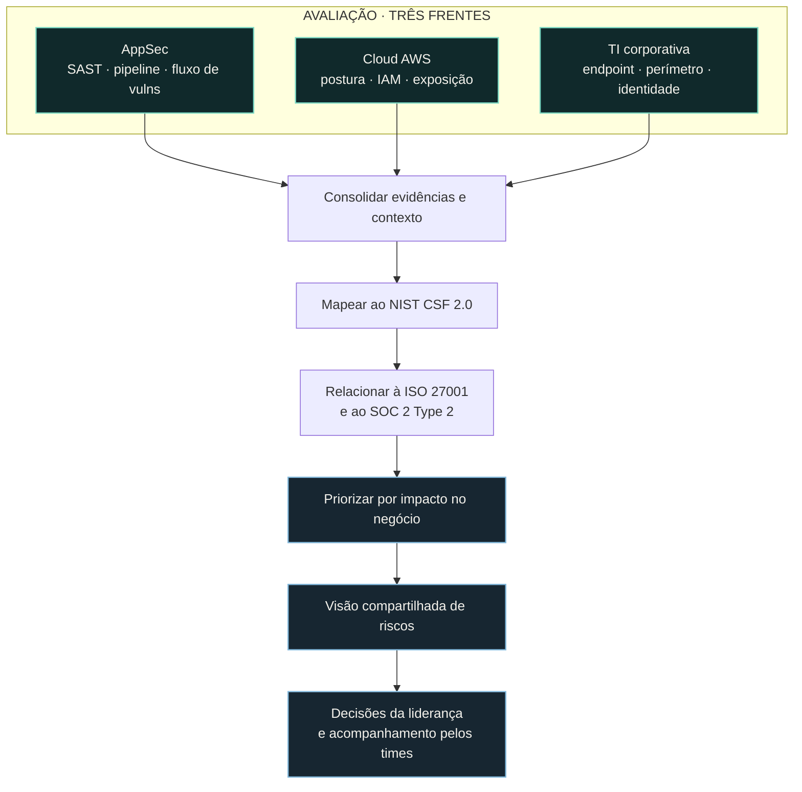

import StatGrid from '@/components/case/StatGrid.astro';
import Callout from '@/components/case/Callout.astro';

## Contexto

A responsabilidade por segurança estava distribuída entre CloudOps, Arquitetura e TI corporativa, enquanto Governança/GRC atuava separadamente. Cada área tinha sua própria visão, mas a liderança não possuía um panorama único de como os riscos se conectavam nem de quais deveriam receber atenção primeiro. Com reporte ao CTO, meu mandato era construir essa visão compartilhada.

- **Responsabilidade fragmentada** — quatro áreas, cada uma com sua própria visão de risco.
- **Sem panorama transversal** — a liderança não enxergava como riscos de frentes diferentes se conectavam.
- **Sem prioridade comum** — nada indicava quais riscos deveriam receber atenção primeiro.

## O que eu fiz

### Avaliar três frentes, além das ferramentas

Revisei processos, arquitetura, vulnerabilidades e riscos em cada frente — não apenas os achados apresentados pelas ferramentas:

- **Segurança de aplicações:** governança SAST, comportamento do pipeline e ciclo de vida das vulnerabilidades.
- **Cloud AWS:** postura, identidade e acesso, exposição e riscos de configuração.
- **TI corporativa:** endpoints, perímetro e ciclo de vida de identidades.

### Relacionar a frameworks reconhecidos

A avaliação usou o NIST CSF 2.0 como estrutura de organização e relacionou as observações à ISO 27001 e ao SOC 2 Type 2. Assim, o mesmo trabalho podia apoiar decisões de engenharia, priorização da liderança e conversas com GRC.

### Tratar lacunas como perguntas, não como culpa

Apresentei lacunas como perguntas para os times responsáveis: entender a decisão original e suas restrições antes de julgar o resultado. Uma avaliação só funciona se os times reconhecerem seu ambiente nos achados, então registrei o contexto de cada lacuna antes de comparar os riscos. Isso manteve o trabalho focado em risco e correção, sem culpabilização.

## Como funciona

As evidências das três frentes são consolidadas com seu contexto, mapeadas uma vez ao NIST CSF 2.0 e relacionadas à ISO 27001 e ao SOC 2 Type 2; depois, são priorizadas pelo impacto no negócio em uma visão única, sobre a qual a liderança decide e os times responsáveis dão continuidade.

## Resultados

<StatGrid title="Escopo da avaliação" stats={[
  { value: '3', label: 'Frentes avaliadas', detail: 'AppSec · AWS · TI corporativa' },
  { value: '4', label: 'Áreas em uma visão', detail: 'CloudOps · Arquitetura · TI corporativa · GRC' },
  { value: '3', label: 'Frameworks relacionados', detail: 'NIST CSF 2.0 · ISO 27001 · SOC 2 Type 2' },
  { value: '1', label: 'Visão de risco compartilhada', detail: 'Para o CTO, priorizada pelo impacto no negócio' },
]} />

- **1 visão consolidada de risco** entre AppSec, AWS e TI corporativa, priorizada pelo impacto no negócio, não pela quantidade de ferramentas.
- **3 frentes comparadas lado a lado**, para que a liderança pudesse direcionar esforços entre áreas com contexto compartilhado.
- **3 frameworks relacionados** — NIST CSF 2.0, ISO 27001 e SOC 2 Type 2 — para que a avaliação pudesse apoiar conversas de auditoria e compliance.
- **Uma base comum** para os trabalhos mais aprofundados registrados em estudos de caso relacionados, como a [auditoria de governança de SAST](/portfolio/pt/projects/sast-governance-audit/).

## Valor para o negócio

<Callout kind="value" lang="pt">
A liderança passou a ter um panorama único do risco de segurança, em vez de quatro visões parciais, ordenado pelo que importava para o negócio. A mesma avaliação atendeu três públicos — engenharia, CTO e GRC — e sua relação com NIST CSF 2.0, ISO 27001 e SOC 2 Type 2 permitiu usá-la diretamente em conversas de auditoria e compliance.
</Callout>

## Aprendizados

- **Avalie o processo, não só a saída da ferramenta.** Revisar processos, arquitetura e riscos em cada frente foi o que tornou os achados comparáveis entre áreas.
- **Um framework para organizar, outros para traduzir.** O NIST CSF 2.0 estruturou o trabalho; a relação com ISO 27001 e SOC 2 Type 2 permitiu que o mesmo trabalho apoiasse as conversas com GRC.
- **Pergunte antes de julgar.** Apresentar cada lacuna como pergunta ao responsável manteve os times engajados e a avaliação focada em correção, não em culpa.
