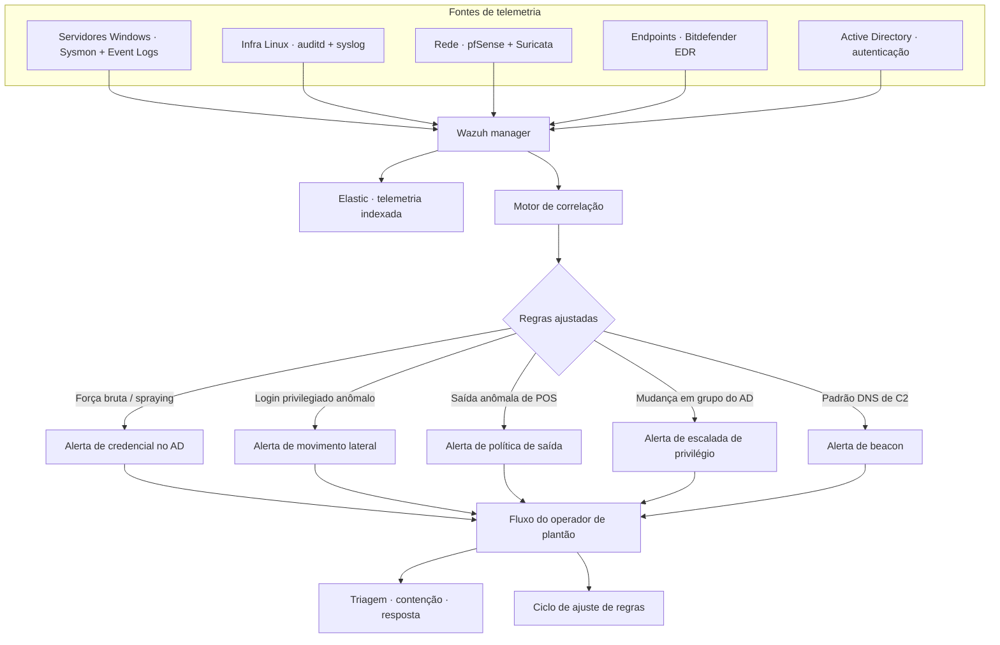

import StatGrid from '@/components/case/StatGrid.astro';
import Timeline from '@/components/case/Timeline.astro';
import Callout from '@/components/case/Callout.astro';

## Contexto

A Volt Sport era um varejo multi-filial em crescimento, com **mais de 400 ativos** entre servidores da matriz, endpoints das filiais, sistemas de ponto de venda (POS), appliances de rede e um pequeno grupo de servidores Linux de infraestrutura. Não havia camada de detecção: os incidentes chegavam como chamado ("os caixas não conectam"), não como telemetria. O SOC precisava ser útil desde a primeira semana, e não virar um dashboard que a engenharia aprenderia a ignorar.

- **Sem logs centralizados** — cada sistema guardava os próprios logs e os rotacionava antes que alguém pudesse correlacioná-los.
- **Sem correlação** — Bitdefender, controladores de domínio e pfSense contavam histórias separadas, e ninguém as lia juntas.
- **Sem modelo de ameaças** — sem ele, qualquer esforço de SOC afundaria em ruído ou deixaria passar as ameaças reais.
- **Forense reativa** — as investigações começavam depois do fato, com os logs que ainda não tinham sido rotacionados.

## O que eu fiz

### SOC com Wazuh

Centralizei a ingestão e a correlação de logs em toda a superfície de ativos:

- **Servidores Windows** (controladores de domínio, servidores de arquivos, hosts de aplicação) — Sysmon para telemetria de processos, rede e registro, e Windows Event Logs para eventos de autenticação e de política.
- **Infraestrutura Linux** — auditd, syslog e logs de aplicação dos serviços internos.
- **Appliances de rede** — pfSense, alertas do Suricata IDS (vindos do [trabalho de defesa de rede](/portfolio/pt/projects/network-defense/)) e logs do gateway VPN.
- **Endpoints** — alertas do Bitdefender EDR alimentando o Wazuh, para que telemetria de endpoint, AD e rede ficassem em uma única visão de incidente.

Ajustei as regras de correlação ao modelo de ameaças de um varejo multi-filial, em vez de manter os padrões genéricos:

- Padrões de força bruta e credential spraying contra contas do AD, principalmente contas de serviço.
- Logon de usuário privilegiado a partir de um host que não é de administração.
- Movimento lateral SMB / RDP a partir de estações fora do time de TI.
- Conexões de saída de hosts POS fora da lista permitida do gateway de pagamento.
- Mudanças de membros em grupos críticos do AD (Domain Admins, Backup Operators, qualquer grupo com direitos de delegação).
- Padrões de callback DNS compatíveis com perfis comuns de beacon de C2.

A cauda longa — terminais POS legados, filiais com WAN intermitente, dispositivos do tipo quiosque — foi declarada como a próxima fase do programa, em vez de ficar escondida no número de cobertura.

### Pentest de infraestrutura antes da entrada em operação

Antes de declarar o SOC em operação, fiz um pentest com perspectiva interna cobrindo rede, AD, endpoints e serviços expostos. O SOC deveria detectar atacantes como eu, e eu queria saber o que ele deixaria passar.

- **16 findings críticos**, classificados por explorabilidade e impacto no negócio.
- **Um roadmap de correção guiado por severidade** — um board no Jira com responsáveis e SLAs, e não um PDF de 200 páginas.
- Trabalhei com os times de infraestrutura e desenvolvimento para fechar os findings. Cada correção incluiu uma atualização de regra no SIEM, para que a mesma classe de finding fosse detectada da próxima vez.
- O pentest mostrou quais regras do Wazuh disparavam com atividade real e quais ficavam em silêncio — metade do ajuste de regras que importou veio desse exercício.

### Redução da superfície de ataque

Detectar sem reduzir a exposição é monitorar o inevitável, então reduzi a superfície em paralelo:

- **Arquitetura Zero Trust** nas filiais — acesso autenticado e segmentado no lugar de LANs de confiança implícita. A equipe das filiais recebe só o que a função exige; o acesso de fornecedores e administradores passa por caminhos dedicados.
- **Cloudflare WAF** na frente dos serviços públicos — limite de requisições, pacotes de regras OWASP ajustados ao stack da aplicação e gestão de bots para a superfície de e-commerce.
- **Hardening** da infraestrutura Linux e Windows — baselines alinhados ao CIS, aplicação por GPO e serviços desnecessários desativados.
- **Governança de IAM e acesso privilegiado** — grupos por função, elevação administrativa auditada e nenhuma credencial compartilhada.

## Como funciona

Cinco fontes de telemetria chegam a um único Wazuh manager, o Elastic indexa tudo e as regras ajustadas transformam eventos brutos em poucos tipos de alerta sobre os quais o operador de plantão age. Cada triagem volta para as regras.

## Resultados

<StatGrid title="O SOC depois do primeiro ano" stats={[
  { value: '400+', label: 'Ativos monitorados', detail: 'Telemetria centralizada' },
  { value: '~80%', label: 'Visibilidade de ativos críticos', detail: 'Cauda longa planejada como fase dois' },
  { value: '16', label: 'Findings críticos fechados', detail: 'Cada um com uma atualização de regra no SIEM' },
  { value: '5', label: 'Fontes de telemetria correlacionadas', detail: 'Windows, Linux, rede, EDR, AD' },
]} />

### Uma detecção real

Um incidente que as regras ajustadas pegaram em produção (anonimizado). O notebook de um prestador de serviço do financeiro abriu conexões SMB com vários servidores de filiais, o que correspondia à regra de "SMB lateral a partir de estação fora da TI". O alerta chegou com o host de origem, a conta, o conjunto de destinos, a janela de tempo e a linha de base da semana anterior, mostrando que esse usuário nunca tinha feito essas conexões.

<Timeline title="Alerta de movimento lateral" steps={[
  { when: 'Janela de 90 segundos', title: 'O notebook abre conexões SMB com vários servidores de filiais', detail: 'Corresponde à regra de SMB lateral' },
  { when: 'Alerta', title: 'O Wazuh dispara com o contexto completo', detail: 'Host, conta, destinos, janela de tempo, linha de base da semana anterior' },
  { when: 'Menos de 10 min', title: 'Triagem concluída, notebook isolado pelo EDR', key: true },
  { when: 'Em seguida', title: 'Credenciais trocadas, cadeia de movimento reconstruída a partir do Sysmon' },
  { when: 'Depois', title: 'Regra apertada para detectar o padrão mais cedo' },
]} />

- **Mais de 400 ativos monitorados** em telemetria centralizada no primeiro ano do programa.
- **Movimento lateral contido em menos de 10 minutos** — do alerta ao notebook isolado pelo EDR, em um incidente real.
- **~80% de visibilidade dos ativos críticos**, com a cauda longa planejada como fase dois em vez de ignorada.
- **16 findings críticos fechados**, cada um com uma atualização de regra no SIEM derivada dele.
- **Zero Trust, WAF e hardening** reduziram o que o SOC precisava detectar, em vez de pedir que ele compensasse a dispersão.
- **O SOC virou a operação contínua**, e não um projeto — ele continuou rodando depois que saí.

## Valor para o negócio

<Callout kind="value" lang="pt">
Um varejo sem camada de detecção passou a ter um SOC funcionando, um processo documentado de resposta a incidentes e uma postura de segurança mensurável. Os incidentes passaram a começar pela telemetria com contexto, e não pela reclamação de um caixa; as 16 brechas críticas que um atacante poderia usar foram fechadas, e cada uma deixou uma regra para trás, para que a mesma classe de ataque fosse detectada da próxima vez. A operação sobreviveu ao projeto e rodou sem mim.
</Callout>

## Aprendizados

- **Ajuste para o modelo de ameaças real.** As seis famílias de regras vieram de como esta rede de varejo poderia ser atacada — saída de POS, grupos do AD, SMB lateral — e não dos padrões do fabricante.
- **Teste a detecção com um ataque.** O pentest antes da entrada em operação mostrou quais regras ficavam em silêncio, e metade do ajuste que importou veio dele.
- **Feche o finding e o ponto cego juntos.** Cada uma das 16 correções saiu com uma atualização de regra no SIEM.
- **Reduza a superfície enquanto a monitora.** Zero Trust, WAF e hardening mantiveram o trabalho do SOC limitado conforme o negócio crescia.
- **Alertas precisam vir com uma história.** "Esta conta, este host, estes destinos, nunca antes" é um incidente; "anomalia detectada" não é.
