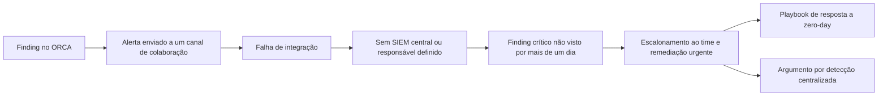

import Timeline from '@/components/case/Timeline.astro';
import Callout from '@/components/case/Callout.astro';

<Callout kind="scope" lang="pt" title="Divulgação responsável">
Relato conceitual. A falha afetava o produto da própria empresa, foi reportada pelo processo responsável e foi corrigida. Não incluo componentes, caminho de ataque, endpoints ou detalhes de exploração.
</Callout>

## Contexto

Ao revisar findings de postura de segurança na nuvem no ORCA, investiguei um alerta e identifiquei um zero-day no produto da própria empresa. Era uma cadeia de falhas críticas, incluindo execução remota de código e impacto em nível de domínio. Pela exposição do produto e pela arquitetura na nuvem ao redor, a cadeia poderia potencialmente alcançar recursos da AWS e armazenamento no S3.

Reportei o caso imediatamente para que o time responsável pudesse avaliar e corrigir a falha. O achado técnico era grave. O achado operacional mudou o foco do meu trabalho dali em diante: quando o encontrei, o alerta já estava aberto no ORCA havia **mais de um dia** sem que ninguém agisse. Quando perguntei aos times responsáveis se tinham visto o alerta, disseram que não.

Tecnicamente havia um alerta: ele era enviado ao Teams. Mas a integração não funcionava de forma confiável, o ORCA não estava conectado corretamente ao fluxo de resposta e não havia SIEM nem fila central onde o alerta pudesse chegar com um responsável definido.

- **Sem destino confiável** — a notificação no Teams não funcionava de forma confiável.
- **Sem responsável** — não havia SIEM nem fila central onde um finding urgente chegasse com alguém responsável por ele.
- **Olhar o console como controle** — perceber um incidente dependia de alguém abrir o ORCA por acaso, o que também contraria o menor privilégio.
- **Limites frágeis na nuvem** — pouco para conter o impacto antes que ele alcançasse recursos na nuvem.

## O que eu fiz

Tratei o incidente como dois problemas conectados: reduzir a exposição imediata e, depois, corrigir a falta de capacidade de detecção. O zero-day não era a causa raiz. Ele expôs uma falha de detecção: a organização não tinha um jeito confiável de perceber e assumir a resposta a um ataque em andamento.

### Coordenar a remediação urgente

Envolvi o time responsável e a liderança, pressionei por uma correção rápida e apontei o bloqueio de rede como contenção temporária caso a correção não pudesse acontecer imediatamente.

### Construir o argumento de negócio

Levei o incidente a uma conversa com a liderança para mostrar o que significava, na prática, um alerta crítico passar um dia sem ser visto. E-mail e uma notificação do Teams mal integrada não bastavam; a organização precisava de alertas centralizados, um SIEM integrado corretamente e um fluxo de resposta com responsáveis.

### Escrever o playbook de resposta

Criei o processo de triagem e escalonamento de zero-days, definindo responsáveis, limites de privilégio e critérios de impacto no negócio para que findings urgentes recebessem atenção em tempo hábil. Esperar que engenheiros monitorem um console 24 horas por dia não é um controle, e quem não precisa acessar um console de segurança não deveria ter que monitorá-lo para perceber um incidente urgente.

### Diagnosticar o raio de impacto

A arquitetura na nuvem não tinha camadas de defesa em profundidade como segmentação de VPC, controles de rota e gateway, isolamento de endpoints e acesso zero trust. Esses controles não eliminariam a vulnerabilidade, mas poderiam limitar o impacto antes que ela alcançasse recursos na nuvem.

## Como funciona

O diagrama mostra a falha operacional e a resposta em alto nível, e omite intencionalmente os detalhes técnicos da vulnerabilidade. A falha está entre B e D: o alerta existia, mas não tinha destino confiável nem responsável.

## Resultados

<Timeline title="Detecção e resposta" steps={[
  { when: '>24h', title: 'Alerta crítico aberto no ORCA, sem ser visto', detail: 'Depois, os times responsáveis confirmaram que não o tinham visto' },
  { when: 'Achado', title: 'Identifiquei o zero-day a partir desse alerta', detail: 'Cadeia com RCE e impacto em nível de domínio; alcance potencial a AWS/S3' },
  { when: 'Imediatamente', title: 'Reportado ao time responsável', detail: 'Pelo processo de divulgação responsável' },
  { when: 'Escalonamento', title: 'Time e liderança mobilizados para uma correção urgente', detail: 'Bloqueio de rede apontado como contenção alternativa', key: true },
  { when: 'Desdobramento', title: 'Playbook escrito e argumento por SIEM apresentado', detail: 'Responsáveis, limites de privilégio e critérios de impacto no negócio' },
]} />

- **1 zero-day crítico** no produto da própria empresa reportado de forma responsável e corrigido. Não há indicação de exploração no mundo real.
- **Mais de 24 horas** de um alerta crítico não visto viraram um caso concreto para alertas centralizados, um SIEM bem integrado e a base de um SOC.
- **1 playbook de resposta a zero-days** criado, definindo como findings urgentes são triados, assumidos e escalados.
- **A conversa mudou** de "alguém precisa ficar olhando o console" para um fluxo de detecção com destino, responsável e processo de resposta.

## Valor para o negócio

<Callout kind="value" lang="pt">
Uma falha crítica no produto da própria empresa, com alcance potencial ao armazenamento na nuvem, foi corrigida sem indicação de exploração no mundo real. Mais duradouro que a correção: a liderança viu, com evidência da própria empresa, que um alerta urgente podia ficar mais de um dia sem ser visto. Isso deu aos alertas centralizados e ao SIEM uma justificativa concreta e baseada em evidência, e o playbook deu à organização um fluxo de resposta com responsáveis para o próximo finding urgente.
</Callout>

## Aprendizados

- **Pergunte o que o bug revela.** Qualquer pessoa pode reportar um bug; aqui o achado mais importante foi o que a organização não conseguia enxergar.
- **Alerta sem destino e sem responsável não é detecção.** O alerta do ORCA existia e era enviado ao Teams, e mesmo assim passou mais de um dia sem ser visto.
- **Olhar o console não é controle.** Um controle que depende de alguém olhar por acaso falha quando a pessoa está ocupada, não tem acesso ou nem sabe que o alerta existe.
- **Limites contêm o que a detecção deixa passar.** Segmentação, controles de gateway e acesso zero trust não eliminariam a vulnerabilidade, mas limitariam seu alcance a recursos na nuvem.
